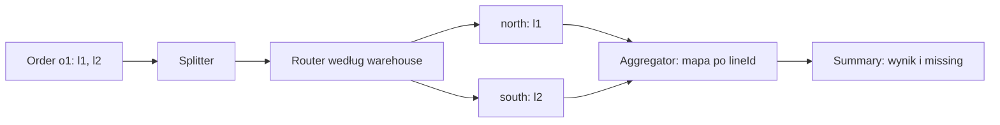

# Splitter, Router, Aggregator i naprawa niedostarczonej pracy

[Lista laboratoriów](README.md) · [Katalog messaging](../catalog/08-messaging/README.md)

**Modele w tym dokumencie:** [FulfillmentPipeline](02-messaging.md#model-fulfillmentpipeline). **Scenariusze
poprawności:** [dane, operacje i oczekiwane wyniki](02-messaging.md#scenariusze-poprawności).

## Jeden proces, trzy różne decyzje

Zamówienie o1 ma l1 w magazynie north i l2 w south. Chcemy zlecić rezerwacje oddzielnie i uznać całość za
sukces dopiero po pozytywnej odpowiedzi każdej pozycji. Duplikat nie może zastąpić brakującej odpowiedzi, a
czas oczekiwania ma koniec. „Otrzymaliśmy dwie wiadomości” nie jest równoważne „otrzymaliśmy wynik dwóch
różnych pozycji”.



`route()` najpierw waliduje całą wiadomość. Dopiero gdy każdy warehouse jest znany, buduje fragmenty
Reservation. To chroni lokalny model przed częściowym wynikiem już przy niepoprawnym wejściu. W transporcie
publikacja do kilku kanałów miałaby osobną granicę awarii i wymagałaby zapisania zamiaru dostawy.

## Kompletność, sukces i termin

Aggregator zapamiętuje oczekiwany zbiór lineId. W `accept()` sprawdza najpierw orderId i przynależność pozycji
do tej rozmowy. Następnie sprawdza, czy wynik został już zakończony i czy minął deadline. Dopiero wtedy
aktualizuje mapę. Stan zajmuje O(n) dla n pozycji, a nie O(liczba wszystkich dostarczeń).

| Wejście przed deadline | Stan po przyjęciu | Wynik |
| --- | --- | --- |
| l1=true | jedna pozycja | brak zakończenia |
| l1=true ponownie | nadal jedna pozycja | brak zakończenia |
| l2=true | dwie pozycje | complete i allReserved=true |
| l2=false zamiast true | dwie pozycje | complete i allReserved=false |
| l1=false po l1=true, przed zakończeniem | bez zmiany | konflikt duplikatu |

Przy `now == deadline` rozmowa jest już zakończona czasowo. Missing zawiera brakujące lineId. Późniejsza
poprawna odpowiedź nie zmienia opublikowanego Summary. To świadoma polityka finalizacji: późne reakcje, np.
zwolnienie rezerwacji, wymagałyby osobnego procesu i nie są automatycznym cofnięciem wyniku.

Fragment scenariusza asercji w konwencji JUnit; pełny model i kontekst są dalej w tym dokumencie:

```java
var aggregator = new Aggregator(order(), 100);
var first = new Result("o1", "l1", true);

assertTrue(aggregator.accept(first, 10).isEmpty());
assertTrue(aggregator.accept(first, 11).isEmpty());
Summary result = aggregator.accept(new Result("o1", "l2", true), 12).orElseThrow();

assertTrue(result.allReserved());
assertTrue(result.missing().isEmpty());
```

## Retry i ścieżka naprawy

Pomocnicze `deliver()` pokazuje klasyfikację: IllegalArgumentException oznacza niepoprawną wiadomość i od razu
daje DeadLetter, a pozostałe RuntimeException zużywają ograniczoną liczbę prób. Po wyczerpaniu wynosimy
oryginalną wiadomość, liczbę prób i ostatni błąd, zamiast zgubić informację potrzebną do naprawy.

Ta uproszczona klasyfikacja jest kontraktem ćwiczenia. W rzeczywistym handlerze nie każdy
IllegalArgumentException oznacza błąd klienta: może wynikać z błędu programisty. Należałoby użyć własnych
kategorii błędów oraz metryk. Sam redrive powinien zachowywać stabilne eventId, by nie omijać deduplikacji.

## Ograniczenia i kolejne pytania

To jednowątkowy model routingu i rozmowy bez brokera, timers schedulera, trwałej subskrypcji i restartu.
Wywołujący musi dostarczyć monotoniczny czas w jednej jednostce oraz wywołać expire; agregator nie budzi się
sam. Mapa kanałów nie gwarantuje kolejności iteracji. Kopie kolekcji zabezpieczają kontenery, a rekordy
fragmentów mają niezmienne składowe.

Po zakończeniu zwracamy zapamiętany wynik, nawet gdy kolejny duplikat zawiera sprzeczny status. Polityka
konfliktu obowiązuje przed finalizacją; po niej ewentualny incydent wymaga osobnej diagnostyki. Nie traktuj
tego jako pełnego walidatora wrogiego logu wiadomości.

## Model FulfillmentPipeline

Model dokumentacyjny Java 21. Poniższy blok zawiera pełne typy, importy, komentarze i mechanizm przykładu. Nie
jest osobnym plikiem źródłowym ani uruchamianą aplikacją; ograniczenia i przebieg opisano w tym dokumencie.

<details>
<summary>Rozwiń pełny przykład: FulfillmentPipeline</summary>

```java
package pl.jakubtworek.patterns.labs.messaging;

import java.util.ArrayList;
import java.util.LinkedHashMap;
import java.util.List;
import java.util.Map;
import java.util.Objects;
import java.util.Optional;
import java.util.Set;

/**
 * Splitter → Content-based Router → Aggregator z korelacją, duplikatami i końcem czasu.
 */
public final class FulfillmentPipeline {
    private FulfillmentPipeline() {
    }

    public record Line(String lineId, String warehouse, int quantity) {
        public Line {
            Objects.requireNonNull(lineId);
            Objects.requireNonNull(warehouse);
            if (lineId.isBlank() || quantity <= 0) {
                throw new IllegalArgumentException("Line ID and positive quantity required");
            }
        }
    }

    public record Order(String orderId, List<Line> lines) {
        public Order {
            Objects.requireNonNull(orderId);
            lines = List.copyOf(lines);
            if (orderId.isBlank()
                    || lines.isEmpty()
                    || lines.stream().map(Line::lineId).distinct().count() != lines.size()) {
                throw new IllegalArgumentException("Nonempty order with unique line IDs required");
            }
        }
    }

    public record Reservation(String orderId, String lineId, int quantity) {
    }

    public record Result(String orderId, String lineId, boolean reserved) {
    }

    public record Routed(Map<String, List<Reservation>> channels) {
        public Routed {
            var copy = new LinkedHashMap<String, List<Reservation>>();
            channels.forEach((key, value) -> copy.put(key, List.copyOf(value)));
            channels = Map.copyOf(copy);
        }
    }

    public static Routed route(Order order, Set<String> knownWarehouses) {
        // Walidujemy całą wiadomość przed zleceniem choćby jednego fragmentu.
        for (Line line : order.lines()) {
            if (!knownWarehouses.contains(line.warehouse())) {
                throw new IllegalArgumentException("Unknown warehouse: " + line.warehouse());
            }
        }
        var channels = new LinkedHashMap<String, List<Reservation>>();
        for (Line line : order.lines()) {
            var fragment = new Reservation(order.orderId(), line.lineId(), line.quantity());
            channels.computeIfAbsent(line.warehouse(), ignored -> new ArrayList<>()).add(fragment);
        }
        return new Routed(channels);
    }

    public record Summary(String orderId, boolean allReserved, Set<String> missing) {
        public Summary {
            missing = Set.copyOf(missing);
        }
    }

    /**
     * Jeden jednowątkowy agregator odpowiada za jedno zamówienie i ma skończoną pamięć.
     */
    public static final class Aggregator {
        private final String orderId;
        private final Set<String> expected;
        private final long deadline;
        private final Map<String, Boolean> received = new LinkedHashMap<>();
        private Summary completed;

        public Aggregator(Order order, long deadline) {
            this.orderId = order.orderId();
            this.expected = Set.copyOf(order.lines().stream().map(Line::lineId).toList());
            this.deadline = deadline;
        }

        public Optional<Summary> accept(Result result, long now) {
            if (!orderId.equals(result.orderId()) || !expected.contains(result.lineId())) {
                throw new IllegalArgumentException("Reply does not belong to this conversation");
            }
            if (completed != null) {
                return Optional.of(completed);
            }
            if (now >= deadline) {
                return Optional.of(finish());
            }
            Boolean previous = received.get(result.lineId());
            if (previous != null && previous != result.reserved()) {
                throw new IllegalStateException("Conflicting duplicate reply");
            }
            // Kluczem jest pozycja, nie liczba dostarczeń. Duplikat nie przybliża kompletności.
            received.put(result.lineId(), result.reserved());
            return received.size() == expected.size() ? Optional.of(finish()) : Optional.empty();
        }

        public Optional<Summary> expire(long now) {
            if (completed != null) {
                return Optional.of(completed);
            }
            return now >= deadline ? Optional.of(finish()) : Optional.empty();
        }

        private Summary finish() {
            var missing = new java.util.HashSet<>(expected);
            missing.removeAll(received.keySet());
            boolean allReserved = missing.isEmpty() && received.values().stream().allMatch(Boolean::booleanValue);
            completed = new Summary(orderId, allReserved, missing);
            return completed;
        }
    }

    public record DeadLetter<T>(T message, int attempts, RuntimeException reason) {
    }

    public static <T> Optional<DeadLetter<T>> deliver(
            T message,
            int maxAttempts,
            java.util.function.Consumer<T> handler) {
        if (maxAttempts < 1) {
            throw new IllegalArgumentException("Positive attempt limit required");
        }
        for (int attempt = 1; ; attempt++) {
            try {
                handler.accept(message);
                return Optional.empty();
            } catch (IllegalArgumentException invalidMessage) {
                // Walidacja jest trwałą przyczyną: nie czekamy na wyczerpanie wszystkich prób.
                return Optional.of(new DeadLetter<>(message, attempt, invalidMessage));
            } catch (RuntimeException transientFailure) {
                if (attempt == maxAttempts) {
                    return Optional.of(new DeadLetter<>(message, attempt, transientFailure));
                }
            }
        }
    }
}
```

</details>

## Scenariusze poprawności

Scenariusze poprawności w notacji JUnit. Pokazują dane, działanie i oczekiwany stan. Są materiałem
dokumentacyjnym; moduł nie ma zależności JUnit ani automatycznego uruchamiania tych asercji.

<details>
<summary>Rozwiń pełny przykład: MessagingLabTest</summary>

```java
package pl.jakubtworek.patterns.labs;

import static org.junit.jupiter.api.Assertions.*;
import static pl.jakubtworek.patterns.labs.messaging.FulfillmentPipeline.*;

import java.util.List;
import java.util.Set;
import java.util.concurrent.atomic.AtomicInteger;
import org.junit.jupiter.api.Test;

class MessagingLabTest {
    private Order order() {
        return new Order("o1", List.of(new Line("l1", "north", 2), new Line("l2", "south", 1)));
    }

    @Test
    void splitterAndRouterKeepCorrelationAndChooseWarehouse() {
        Routed routed = route(order(), Set.of("north", "south"));
        assertEquals(List.of(new Reservation("o1", "l1", 2)), routed.channels().get("north"));
        assertEquals(List.of(new Reservation("o1", "l2", 1)), routed.channels().get("south"));
        assertThrows(UnsupportedOperationException.class, () -> routed.channels().get("north").clear());
    }

    @Test
    void routerRejectsUnknownWarehouseAndDuplicateLineIds() {
        assertThrows(IllegalArgumentException.class, () -> route(order(), Set.of("north")));
        var duplicatedIds = List.of(new Line("l1", "north", 1), new Line("l1", "south", 1));
        assertThrows(IllegalArgumentException.class, () -> new Order("o1", duplicatedIds));
    }

    @Test
    void duplicateReplyDoesNotCompleteConversationPrematurely() {
        var aggregator = new Aggregator(order(), 100);
        var first = new Result("o1", "l1", true);
        assertTrue(aggregator.accept(first, 10).isEmpty());
        assertTrue(aggregator.accept(first, 11).isEmpty());
        Summary result = aggregator.accept(new Result("o1", "l2", true), 12).orElseThrow();
        assertTrue(result.allReserved());
        assertTrue(result.missing().isEmpty());
    }

    @Test
    void aggregatorRejectsWrongConversationAndConflictingDuplicate() {
        var aggregator = new Aggregator(order(), 100);
        assertThrows(IllegalArgumentException.class, () -> aggregator.accept(new Result("o2", "l1", true), 1));
        aggregator.accept(new Result("o1", "l1", true), 1);
        assertThrows(IllegalStateException.class, () -> aggregator.accept(new Result("o1", "l1", false), 2));
    }

    @Test
    void deadlineFinalizesMissingRepliesAndLateReplyCannotRewriteOutcome() {
        var aggregator = new Aggregator(order(), 100);
        aggregator.accept(new Result("o1", "l1", true), 99);
        Summary expired = aggregator.expire(100).orElseThrow();
        assertFalse(expired.allReserved());
        assertEquals(Set.of("l2"), expired.missing());
        assertEquals(expired, aggregator.accept(new Result("o1", "l2", true), 101).orElseThrow());
    }

    @Test
    void completeConversationCanStillContainBusinessRejection() {
        var aggregator = new Aggregator(order(), 100);
        aggregator.accept(new Result("o1", "l1", false), 1);
        Summary summary = aggregator.accept(new Result("o1", "l2", true), 2).orElseThrow();
        assertTrue(summary.missing().isEmpty());
        assertFalse(summary.allReserved());
    }

    @Test
    void retryExhaustionPreservesMessageAndReasonForRepair() {
        var attempts = new AtomicInteger();
        var letter = deliver("event-42", 3, message -> {
            attempts.incrementAndGet();
            throw new IllegalStateException("Database unavailable");
        }).orElseThrow();
        assertEquals(3, attempts.get());
        assertEquals("event-42", letter.message());
        assertEquals(3, letter.attempts());
        assertEquals("Database unavailable", letter.reason().getMessage());
    }

    @Test
    void invalidMessageIsNotRetriedLikeInfrastructureFailure() {
        var letter = deliver("invalid", 10, message -> {
            throw new IllegalArgumentException("Unsupported schema");
        }).orElseThrow();
        assertEquals(1, letter.attempts());
        assertTrue(deliver("valid", 3, message -> {
        }).isEmpty());
    }
}
```

</details>
