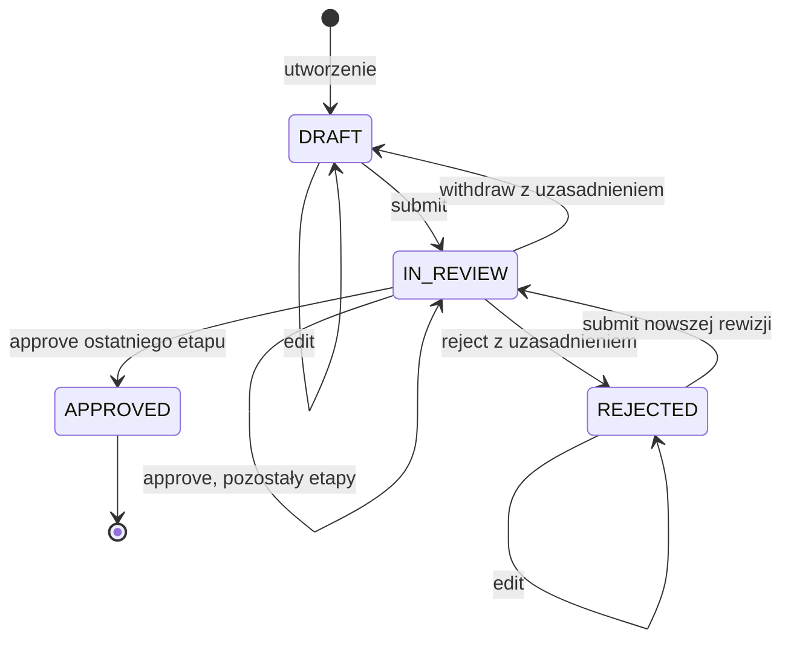

# Akceptacja dokumentów

Archiwalny projekt edukacyjny w czystej Javie: edycja dokumentu i wieloetapowa akceptacja z wersjonowaniem, tokenami przeglądu oraz niemutowalną historią. Stan jest w pamięci; operacje wykonuje jeden wątek.

## Rdzeń techniczny

[Document](src/main/java/pl/jakubtworek/lld/workflow/domain/Document.java) kontroluje stan, uprawnienia i kolejność operacji. Każda przyjęta zmiana dopisuje WorkflowEvent; jego numer odpowiada wersji dokumentu. Rewizje treści są osobnym archiwum z autorem i czasem.

HistoryVector jest trwałym drzewem binarnym indeksowanym numerem elementu. Dopisanie kopiuje tylko ścieżkę; certyfikowany prefiks historii pozwala nie walidować całej listy przy każdej zmianie. Publiczne utworzenie snapshotu ze zwykłych list nadal sprawdza pełną spójność.

H to liczba zdarzeń, R rewizji treści, S koszt danych etapów i ich dotychczasowych akceptacji.

| Operacja | Koszt |
| --- | --- |
| Dopisanie zmiany | O(log(H + 1) + log(R + 1) + S), osobno dane nowej treści |
| Pobranie bieżącego snapshotu | O(1) |
| Odczyt rewizji po indeksie | O(log(R + 1)) |
| Przejście historii | O(H) |
| Publiczna walidacja list historii | Liniowa względem wejściowych danych |

Snapshoty współdzielą niemutowalne węzły. Zachowanie kolejnych korzeni utrzymuje ścieżki zmian i teksty rewizji; pamięć nie jest ograniczana automatycznie. Ciągłość numeracji, zgodność rewizji i tożsamości dokumentu są częścią walidacji historii.

### Trzy liczniki i dwie historie

Wersja dokumentu zwiększa się przy każdej przyjętej zmianie, rewizja treści
wyłącznie przy edycji, a numer rundy przy zgłoszeniu do przeglądu. Zatwierdzenie
etapu zmienia wersję, ale nie tekst i jego rewizję. Wycofanie zachowuje treść,
kończy aktualną rundę i nie pozwala ponownie użyć jej tokenu.

Token identyfikuje dokładny przedmiot decyzji. Sam etap REVIEWER nie wystarcza:
opóźniona akceptacja starego tekstu nie może zaakceptować nowej rewizji lub rundy.
ExpectedVersion dodatkowo chroni decyzję opartą na nieaktualnym widoku dokumentu.

Zdarzenia opisują kolejne operacje; archiwum rewizji przechowuje pełne wersje
tytułu i treści. Zachowanie jedynie ostatniej treści przy numerach dawnych
rewizji uniemożliwiłoby odczytanie tego, co rzeczywiście oceniano.

HistoryVector dopisuje element przez kopiowanie ścieżki drzewa. Ciągły,
zweryfikowany prefiks nie jest skanowany ponownie przy każdym dopisaniu.
Nie oznacza to pominięcia walidacji dowolnej listy przekazanej publicznie:
bez potwierdzonego prefiksu cały dostarczony materiał musi zostać sprawdzony.

## Mechanizmy Javy i model wątkowy

### AbstractList i trwała kolekcja historii

HistoryVector rozszerza `AbstractList<E>`, ale zapisuje elementy we własnym
drzewie. Sama deklaracja List nie daje O(1) dla get(i). W tej implementacji
odczyt schodzi O(log H) poziomów, a dopisanie tworzy nową ścieżkę i korzeń.

Iterator przechodzi węzły przy użyciu ArrayDeque i nie wywołuje get dla
każdego numeru. listIterator materializuje listę pomocniczą, aby domyślne
operacje kolekcji nie wykonywały kolejnych wyszukiwań drzewa. Ta zgodność
z interfejsem ma koszt O(H) pamięci tymczasowej podczas materializacji.

Węzeł przechowuje Object z powodu generycznej reprezentacji, a odczyt
wykonuje lokalnie kontrolowane rzutowanie na E. Erasure nie sprawdza
w czasie wykonania pełnego parametru `List<WorkflowEvent>`. Dlatego pakietowy
konstruktor kolekcji i walidacja zwykłych list są istotne; raw types
i niekontrolowane rzutowania nie stanowią poprawnego sposobu budowy historii.

Rozpoznanie certyfikowanego HistoryVector pozwala zachować istniejący
prefiks bez List.copyOf całej zawartości po każdym dopisaniu. Dla wejściowej
zwykłej List sprawdzane są elementy i ich ciągłość. Optymalizacja zależy
od reprezentacji i kontroli tworzenia obiektu, a nie od samej nazwy List.

### Record, wersja i wątki

Token przeglądu jest wartością z finalnymi składowymi; nie blokuje dokumentu.
Również expectedVersion nie jest atomowym compare-and-set. Dwa równoległe
execute mogłyby ocenić ten sam stan, po czym nadpisać jeden wynik.

Obecny dokument jest jednowątkowy. Współdzielenie wymagałoby objęcia oceniania
i zatwierdzenia wspólnym mechanizmem synchronizacji, także względem odczytu
bieżącego snapshotu. Sama zamiana referencji snapshot na volatile
nie zapewniłaby wyłączności modyfikacji.
API listy: [AbstractList](https://docs.oracle.com/en/java/javase/21/docs/api/java.base/java/util/AbstractList.html).

## Zakres, reguły i niezmienniki

| ID | Reguła i obserwowalne kryterium |
| --- | --- |
| R1 | Właściciel z AUTHOR edytuje i składa DRAFT/REJECTED; tytuł i treść są niepuste |
| R2 | Plan jest niepusty, ma unikalne ID etapów; ostatnia akceptacja kończy proces |
| R3 | Decydent ma rolę etapu i inne UserId niż autor, nawet przy wielu rolach |
| R4 | REJECTED wymaga uzasadnienia; resubmit po odrzuceniu wymaga nowszej rewizji |
| R5 | IN_REVIEW blokuje edycję; APPROVED jest terminalny |
| R6 | Stan, zdarzenie i archiwum publikują się razem; odmowa nie zmienia snapshotu |
| R7 | Token musi dokładnie odpowiadać bieżącemu kontekstowi decyzji |
| R8 | Listy, zestawy i mapy odczytów są niemutowalne; dawne widoki nie zmieniają się |
| R9 | Każda mutacja wymaga expectedVersion; nieaktualna daje STALE_VERSION |
| R10 | Dostępność, ocena i wykonanie mają wspólne reguły; odczyty nie czytają Clock |
| R11 | ALLOW_REUSE dopuszcza tę samą inną osobę na etapach; DISTINCT_PER_ROUND zabrania ponownej decyzji osobie, która już zaakceptowała etap tej rundy |
| R12 | Archiwum zawiera pełną treść każdej rewizji, autora edycji i Instant |
| R13 | Autor wycofuje IN_REVIEW do DRAFT z uzasadnieniem; resubmit może użyć tej samej rewizji, ale zawsze nowej rundy |

DocumentContent normalizuje tekst przez strip. Sama zmiana otaczających spacji
daje UNCHANGED_CONTENT i nie pozwala obejść wymogu poprawy po odrzuceniu.
Nie oceniamy jakości poprawki: można po kilku edycjach przywrócić dawny tekst.

ReviewRound zamraża złożoną rewizję i treść. Edycja REJECTED nie zmienia tego
materiału. Nowy submit zaczyna od pierwszego etapu z pustymi akceptacjami.
Wycofanie usuwa bieżącą rundę ze snapshotu, ale jej decyzje zostają w historii,
a tekst w archiwum. lastRound nigdy nie wraca do zera.
Bez tej reguły stary token mógłby odzyskać znaczenie po ponownym złożeniu.

Domyślna polityka to ALLOW_REUSE. DISTINCT_PER_ROUND sprawdza tożsamości już
zapisanych akceptacji bieżącej rundy, zarówno przed approve, jak i reject.
Nowa runda zaczyna bez tych akceptacji. Polityka nie przydziela kont do etapów,
nie wymusza quorum i nie zmienia zakazu samodzielnej oceny autora.

Actor jest zaufanym wejściem. Konsolowe as symuluje role, a nie uwierzytelnianie.
Poza zakresem: baza, REST, autentykacja, podpisy, pliki binarne, powiadomienia,
SLA, delegacje, quorum, zmiana planu trwającego procesu, retry z idempotencją,
cofanie pojedynczej akceptacji i współbieżność. Historia nie jest audytem bezpieczeństwa.

## Reprezentacja stanu

Skróty mutacji przekazują polecenie
do execute; żadna mutacja publicznego API nie pomija expectedVersion.

Brak krawędzi oznacza odmowę. Każda krawędź nadal wymaga aktualnej wersji i
właściwego aktora, a decyzje także tokenu, roli i zgodności z polityką.

## Kontrakty i kolejność odmów

| Operacja | Warunki i efekt |
| --- | --- |
| new Document | AUTHOR, poprawne dane/plan/polityka; DRAFT, wersja i rewizja 1, lastRound 0, CREATED i pierwsza pozycja archiwum |
| edit(actor, expectedVersion, content) | Właściciel z AUTHOR, DRAFT/REJECTED, inna treść; nowa rewizja i wpis archiwum |
| submit(actor, expectedVersion) | Właściciel z AUTHOR, DRAFT/REJECTED; po odrzuceniu nowsza rewizja; nowa runda, pierwszy etap |
| approve(actor, expectedVersion, token) | IN_REVIEW, token, inna osoba, rola, polityka; akceptacja i kolejny etap lub APPROVED |
| reject(actor, expectedVersion, token, reason) | Warunki decyzji i niepuste uzasadnienie; REJECTED, zachowana runda |
| withdraw(actor, expectedVersion, reason) | Właściciel z AUTHOR, IN_REVIEW, uzasadnienie; DRAFT, brak bieżącej rundy, zachowane lastRound |
| assess(actor, expectedVersion, command) | Dokładna ocena danych polecenia; allowed lub jedna pierwsza odmowa, bez zmiany i Clock |
| availableOperations(actor) | Wersja raportu i ocena przygotowania każdej operacji dla aktualnego widoku |
| archivedRevision(number) | Pełna rewizja w Optional, puste dla numeru spoza archiwum |
| snapshot/definition/currentStage/reviewToken | Odczyty bez zdarzeń; etap i token obecne wyłącznie w IN_REVIEW |

Kolejność domenowych odmów:

1. expectedVersion: STALE_VERSION przed pozostałymi regułami.
2. Operacje autora: własność i AUTHOR → stan → nowsza rewizja przy submit.
3. Decyzje: IN_REVIEW → token → zakaz autora → rola etapu → polityka recenzentów.
4. Dane konkretnego polecenia: różna treść edit albo niepuste reason reject/withdraw.

Daje to m.in. FORBIDDEN przed REASON_REQUIRED dla osoby bez roli oraz
STALE_VERSION przed STALE_REVIEW, gdy oba konteksty są stare.
[WorkflowException](src/main/java/pl/jakubtworek/lld/workflow/domain/WorkflowException.java)
zawiera także WRONG_STATE, SELF_REVIEW, NEW_REVISION_REQUIRED,
UNCHANGED_CONTENT i REVIEWER_ALREADY_USED.

Niepoprawne wartości dają IllegalArgumentException, programistyczny null
NullPointerException, przepełnienie licznika ArithmeticException.
Wyjątkiem jest null/blank reason: to REASON_REQUIRED po wcześniejszych regułach.
Konstrukcja polecenia może odrzucić null treści/tokenu przed wejściem do domeny.

Dostępność oznacza możliwość przygotowania operacji: EDIT nie zna jeszcze
tekstu, REJECT/WITHDRAW uzasadnienia. assess sprawdza kompletne polecenie.
Raport używa bieżącego tokenu, więc nie zastępuje sprawdzenia tokenu klienta.
Oba odczyty używają guard; execute ponownie wywołuje assess.
Ocena uzyskana przed cudzą zmianą nie rezerwuje prawa do wykonania.

Po ocenie execute czyta Clock raz, buduje kandydata wraz z historią i archiwum,
a dopiero potem wykonuje `snapshot = candidate`. Akceptacja/zdarzenie oraz
edycja/wpis archiwum mają ten sam Instant. Odmowa reguł nie czyta Clock;
awaria zegara lub budowy kandydata pozostawia wcześniejszy snapshot.

## Prześledź krytyczny scenariusz

| Działanie | Wersja | Rewizja | lastRound | Stan / etap |
| --- | --- | --- | --- | --- |
| Utworzenie | 1 | 1 | 0 | DRAFT |
| submit z expectedVersion=1 | 2 | 1 | 1 | IN_REVIEW / technical |
| approve innej osoby z wersją 2 | 3 | 1 | 1 | IN_REVIEW / manager |
| withdraw autora z wersją 3 i powodem | 4 | 1 | 1 | DRAFT, brak bieżącej rundy |
| submit z wersją 4, bez edycji | 5 | 1 | 2 | IN_REVIEW / technical |
| approve ze starą wersją 2 | 5 | 1 | 2 | STALE_VERSION |
| approve z wersją 5 i tokenem rundy 1 | 5 | 1 | 2 | STALE_REVIEW |
| nowe approve technical z wersją 5 | 6 | 1 | 2 | IN_REVIEW / manager |
| nowe approve manager z wersją 6 | 7 | 1 | 2 | APPROVED |

Historia ma 7 zdarzeń, archiwum jedną treść. Dwie odmowy nie zwiększają liczników.
Dla DISTINCT_PER_ROUND ostatnie dwie akceptacje wykonują różne osoby.
Po reject zamiast withdraw potrzebna byłaby edycja przed ponownym submit.

## Uruchomienie

Java 21; z katalogu low-level-design/archive/document-workflow:

~~~powershell
.\mvnw.cmd --batch-mode --no-transfer-progress clean verify
& "$env:JAVA_HOME/bin/java.exe" -jar target/document-workflow-1.0.0-SNAPSHOT.jar
~~~

Demo ma użytkowników alice, bob, carol, dave i guest oraz stały czas 2026-10-21T12:00:00Z. Polecenia obejmują as, show, plan, submit, approve, reject, withdraw, edit, history, archive, actions, expect, latest i policy. help podaje argumenty, q kończy program.

## Testy i weryfikacja

[Testy](src/test/java/pl/jakubtworek/lld/workflow) obejmują role, wersje, rundy, stare tokeny, rozdzielenie osób i historię. WorkflowModelTest porównuje 150 historii po 100 poleceń z niezależnym modelem, a HistoryVectorTest kontroluje granice drzewa i stare widoki.

| Reguły | Dowód | Granica wniosku |
| --- | --- | --- |
| R1–R5 | transitionMatrix, rejectionRequiresCorrectionAndRestartsEveryStageWithoutLosingHistory | 16 pierwotnych par stan/operacja i scenariusz restartu |
| R3/R7 | authorCannotReviewEvenWithAllRolesAndNewActorInstance, tokenMustMatchEveryComponent | Tożsamość i każde pole tokenu, bez uwierzytelniania |
| R6/R8 | clockFailureDoesNotPublishPartialTransition, snapshotsRolesAndDefinitionCannotBeMutatedThroughCollections | Odmowy, awaria Clock, stare widoki, jeden wątek |
| R9/R10 | everyMutationRequiresVersionAndStaleIntentCannotOverwriteNewText, availabilityIsPreparationAndAssessmentChecksActualPayload | Wszystkie pięć mutacji i nieaktualna ocena |
| R11 | reviewerPolicyChangesReuseButNeverAuthorProhibition | Obie polityki, approve/reject, reset w nowej rundzie |
| R12 | archiveKeepsFullTextAndMetadataAndOldViewsCannotChange | Treści po odrzuceniu, metadane, dawne listy, brak numeru |
| R13 | withdrawalPreservesRoundCounterInvalidatesTokensAndNeedsNoContentEdit | Wielokrotne wycofanie, brak edycji, unieważnienie tokenu |
| Model | generatedCommandsAgreeWithIndependentModel | Dwa warianty, po 150 historii do 100 komend, koniec przy APPROVED |
| Adapter | versionsWithdrawalArchiveAndPolicyCanBeExploredFromConsole | Parser, błędy wersji/tokenów, polityka, historia, archiwum |

## Ograniczenia

Brak trwałości, podpisów, powiadomień i synchronizacji. Role są deklarowane w wejściu, bez integracji z uwierzytelnianiem. Wycofanie przeglądu nie usuwa historii ani nie cofa wersji.
