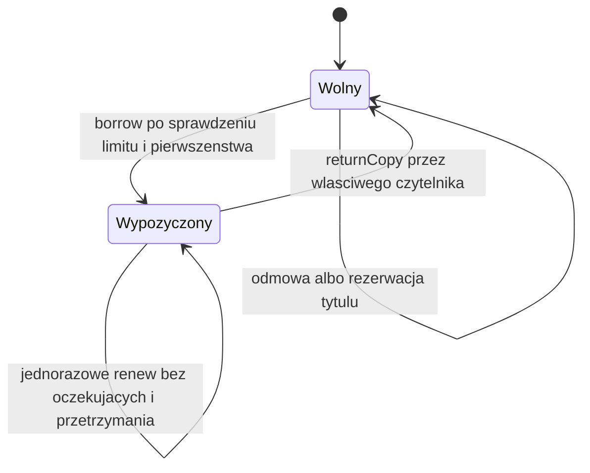

# Biblioteka

Projekt edukacyjny w czystej Javie: wypożyczanie egzemplarzy, rezerwacje FIFO i przedłużanie terminów. Najważniejsze elementy implementacji to indeks wolnych egzemplarzy oraz kolejka pozwalająca szybko ustalić pozycję czytelnika. Stan jest w pamięci, operacje są jednowątkowe.

## Rdzeń techniczny

[Library](src/main/java/pl/jakubtworek/lld/library/Library.java) utrzymuje mapę pożyczek po egzemplarzu, zbiory wypożyczonych tytułów czytelnika i TreeSet wolnych egzemplarzy każdego tytułu.

[ReservationQueue](src/main/java/pl/jakubtworek/lld/library/ReservationQueue.java) łączy AVL po numerze kolejności z mapą czytelnik → węzeł. Każdy węzeł zna rodzica, wysokość i rozmiar poddrzewa. Dzięki temu pozycja w kolejce nie wymaga skanowania. Usunięcie węzła z dwojgiem dzieci przenosi rzeczywisty węzeł następnika, zachowując zgodność mapy z drzewem.

C oznacza liczbę egzemplarzy tytułu, Q długość jego kolejki, S rozmiar całego stanu.

| Operacja | Koszt |
| --- | --- |
| Dodanie / anulowanie rezerwacji, odczyt rangi | O(log(Q + 1)) w AVL; wyszukanie w mapie średnio O(1) |
| Wypożyczenie | O(log(C + 1) + log(Q + 1)) oraz średnio stałe operacje map |
| Zwrot | O(log(C + 1)) |
| Przedłużenie | Średnio O(1) |
| Snapshot | O(S) po zmianie, O(1) bez kolejnej zmiany |

Metody rezerwacji zwracające pełny snapshot ponoszą także koszt jego materializacji. Odczyt minimum TreeSet nie jest stałoczasowy. Indeksy zajmują pamięć liniową względem stanu; starsze snapshoty przechowują własne niemutowalne kopie.

### Dlaczego kolejka potrzebuje rangi

Przy trzech rezerwacjach i dwóch wolnych egzemplarzach nie pytamy wyłącznie
o pierwszy element FIFO. Musimy ustalić, czy konkretny czytelnik należy do
pierwszych dwóch osób. Zwykła lista wymagałaby przejścia do jego pozycji.

W AVL rozmiar lewego poddrzewa daje liczbę wcześniejszych rezerwacji. Idąc
od węzła czytelnika do korzenia, dodajemy rozmiary pominiętych lewych poddrzew
i ich rodziców. Ranga liczona od zera jest uprawniona, gdy jest mniejsza od
liczby wolnych egzemplarzy. Rotacje muszą aktualizować nie tylko wysokość,
ale również rozmiary i odnośniki do rodziców.

Mapa czytelnik → węzeł nie może wskazywać usuniętego obiektu. Przy usuwaniu
węzła z dwojgiem dzieci fizycznie przenoszony jest następnik. Samo przepisanie
jego wartości do innego węzła rozjechałoby tożsamości w mapie.

Czytelnik z limitem wypożyczeń nadal zajmuje pozycję. System nie pomija go
automatycznie, ale przy dwóch wolnych egzemplarzach druga uprawniona osoba
może skorzystać z własnego miejsca. To celowa reguła dostępu do wielu kopii,
a nie automatyczne przydzielanie konkretnego egzemplarza w momencie rezerwacji.

## Mechanizmy Javy i model wątkowy

### Własne węzły AVL i kolekcje standardowe

TreeSet daje uporządkowane wolne egzemplarze, lecz zwykły TreeSet nie udostępnia
rangi elementu w O(log Q). Jego publiczne API nie przechowuje dla nas rozmiarów
poddrzew. Dlatego ReservationQueue ma własny Node z polami parent, left,
right, size i height oraz mapę MemberId → Node.

Tożsamość węzła ma tu znaczenie techniczne. Mapa wskazuje konkretny obiekt,
a nie kopię danych. Rotacja przepina referencje i aktualizuje rodziców;
usunięcie musi zachować prawidłowe uchwyty osób. Cykl parent–child sam
w sobie nie blokuje GC: problemem byłaby nadal osiągalna referencja
z members do węzła, który miał już zniknąć.

Przy budowie snapshotu iteracyjne przejście używa `ArrayDeque<Node>` jako stosu.
push/pop dotyczą końca deque i mają koszt amortyzowany O(1). Nie powstaje
osobny węzeł LinkedList na każdy element stosu; ewentualne powiększenie
wewnętrznej tablicy nadal kosztuje kopiowanie referencji.

Wynik jest budowany w ArrayList z początkową pojemnością size(), a potem
List.copyOf odcina mutację struktury. Snapshot kopiuje zawartość kolejki,
więc późniejsza rotacja mutowalnego AVL nie zmienia dawnego porządku.
Nie próbujemy wystawiać iteratora żywego drzewa jako stabilnej historii.

### Dlaczego ConcurrentHashMap nie wystarczy

borrow zmienia wolne kopie, aktywne pożyczki, indeks czytelnika i AVL.
Wątkowo bezpieczna mapa nie zabezpieczyłaby rodziców węzłów ani wspólnej
aktualizacji tych struktur. Nawet odczyt rank podczas rotacji mógłby
zobaczyć niezgodne rozmiary i połączenia. Aktualny model wymaga jednego
wątku; granicą ewentualnej synchronizacji byłaby cała operacja biblioteki.

Kontrakt stosu: [ArrayDeque](https://docs.oracle.com/en/java/javase/21/docs/api/java.base/java/util/ArrayDeque.html).

## Zakres, reguły i niezmienniki

- Jeden egzemplarz ma najwyżej jedno aktywne wypożyczenie.
- Czytelnik nie może jednocześnie wypożyczyć dwóch egzemplarzy tego samego tytułu.
- STANDARD: maksymalnie 2 egzemplarze na 14 dób; EXTENDED: 5 na 28 dób.
- Rezerwacja dotyczy tytułu. Ta sama osoba może wystąpić raz w jego kolejce.
- Nie można rezerwować tytułu już wypożyczonego przez siebie.
- Rezerwacja jest dozwolona także przy wolnych egzemplarzach i osiągniętym limicie.
- Przy F wolnych egzemplarzach pierwsze F osób z kolejki ma pierwszeństwo.
- Czytelnik spoza kolejki może wypożyczyć, gdy F jest większe od długości kolejki.
- Osiągnięty limit nie usuwa rezerwacji i nie przepuszcza kolejnych osób na jej
  miejsce. Anulowanie lub wypożyczenie usuwa własny wpis i przesuwa kolejkę.
- Zwrot zwiększa dostępność, ale nie tworzy automatycznie nowego wypożyczenia.
- Nowe wypożyczenie dostaje nowy LoanId; przedłużenie zachowuje identyfikator.
  Zwrot i przedłużenie wymagają MemberId, CopyId oraz LoanId aktywnej relacji.
- Można przedłużyć raz, o okres kategorii liczony od obecnego terminu, jeżeli
  termin nie minął i nikt nie czeka na tytuł. Równość z terminem pozwala przedłużyć.
  Nawet rezerwacja przy innej wolnej kopii blokuje przedłużenie.
- Termin to Instant + Duration (doby po 24 godziny). Brak kar, blokady nowych
  wypożyczeń za przetrzymanie, wygasania rezerwacji, trwałości, I/O i współbieżności.
- Odmowa i błąd obliczeń pozostawiają ten sam obiekt snapshotu.

MemberId jest identyfikatorem, nie mechanizmem uwierzytelnienia.
Katalog i czytelnicy są ustalani przy tworzeniu Library; nie ma edycji katalogu.
Puste listy i tytuły bez egzemplarzy są poprawną konfiguracją, ale nie dają
możliwości wypożyczenia nieistniejącego zasobu.

| ID | Gwarancja | Przykład odmowy |
| --- | --- | --- |
| R1 | Kody są unikalne w swoim rodzaju; egzemplarz wskazuje istniejący tytuł | Dwie kopie C1 lub kopia nieznanego B9 → IllegalArgumentException |
| R2 | Każdy egzemplarz ma najwyżej jeden aktywny Loan | Brak wolnych kopii → NO_COPY_AVAILABLE |
| R3 | Czytelnik ma najwyżej jeden aktywny egzemplarz danego tytułu | Drugi egzemplarz lub rezerwacja własnego tytułu → ALREADY_BORROWED_TITLE |
| R4 | Limit to 2 lub 5 aktywnych wypożyczeń, według Membership | Kolejny różny tytuł na limicie → LOAN_LIMIT_REACHED |
| R5 | Rezerwacje tytułu są uporządkowane, bez powtórzeń czytelnika | Ponowny wpis → ALREADY_RESERVED |
| R6 | Pierwsze F osób ma pierwszeństwo przy F wolnych kopiach | Pominięcie uprawnionych bez nadwyżki → RESERVATION_PRIORITY |
| R7 | Udany odbiór usuwa własną rezerwację; anulowanie zachowuje kolejność pozostałych | Anulowanie brakującego wpisu → NO_RESERVATION |
| R8 | Zwrot i przedłużenie wymagają aktywnego Loan tego czytelnika, z pasującym LoanId | NOT_BORROWER, COPY_NOT_ON_LOAN albo STALE_LOAN |
| R9 | Termin przy odbiorze ustalamy z jednego odczytu Clock plus 14/28 dób; renew sprawdza czas i dodaje okres do starego terminu | Błąd zegara lub przepełnienie daty → brak publikacji |
| R10 | Stare widoki i ich kolekcje są niemutowalne; odmowa zachowuje ten sam snapshot | Próba zmiany mapy lub kolejki → UnsupportedOperationException |
| R11 | Przedłużenie jest jednorazowe, bez przetrzymania i oczekujących, od starego terminu | ALREADY_RENEWED, LOAN_OVERDUE albo WAITING_RESERVATIONS |

Loan zawiera ID relacji, warunki wypożyczenia i flagę wykorzystania przedłużenia.
Nie przechowuje identyfikatora polecenia ani historii zwrotów. Po zwrocie znika z aktualnej mapy.
Zachowany obiekt Loan lub stary snapshot pozostaje opisem przeszłego stanu.
`isPastDueAt(now)` sprawdza wyłącznie datę: równość z dueAt nie jest spóźnieniem.
To nie sprawdzenie, czy wypożyczenie nadal jest aktywne. Nie blokujemy
nowych wypożyczeń za przetrzymanie i nie naliczamy opłat. Przetrzymanie blokuje
jedynie przedłużenie konkretnego Loan.

## Reprezentacja stanu

Źródłem aktywnych wypożyczeń jest Map<CopyId,Loan>. Właściciel utrzymuje też
TreeSet wolnych egzemplarzy i indeks czytelnik→tytuły. Zmiana musi uaktualnić
wszystkie te struktury po udanej walidacji. Kolejki w rdzeniu to
Map<BookId,ReservationQueue> z AVL; snapshot zamienia je na niezmienne listy.
Oddzielna biznesowa klasa Reservation nie wnosi obecnie potrzebnych danych.

## Kontrakty, kolejność walidacji i krytyczny przepływ

| Operacja | Kolejność sprawdzania | Efekt sukcesu |
| --- | --- | --- |
| borrow(member,book) | null, znany czytelnik, znany tytuł, brak własnego tytułu, limit, wolna kopia, pierwszeństwo, Clock i data | Loan i zaktualizowane indeksy, usunięcie własnej rezerwacji, unieważnienie cache widoku |
| returnCopy(member,copy,loanId) | null, znany czytelnik, znana kopia, aktywne wypożyczenie, właściciel, zgodne LoanId | Usunięcie Loan, reszta kolejek bez zmian |
| renew(member,copy,loanId) | jak przy zwrocie, brak kolejki, Clock, brak poprzedniego przedłużenia, czas nie przed odbiorem, termin nieprzekroczony, obliczenie nowego terminu | Nowa wersja Loan z tym samym ID i renewed=true |
| reserve(member,book) | null, znany czytelnik, znany tytuł, brak własnego tytułu, brak duplikatu | Dopisanie na końcu kolejki |
| cancelReservation(member,book) | null, znany czytelnik, znany tytuł, obecność w kolejce | Usunięcie wyłącznie własnego wpisu |

Przy kilku naruszeniach obowiązuje pierwszy warunek w tabeli. Null jest
błędem programisty (`NullPointerException`); niepoprawna wartość lub katalog
dają `IllegalArgumentException`. Odrzucenie reguły daje LibraryException
z kodem reason, a awaria daty lub zegara propaguje jako błąd obliczeń.
Także te błędy nie zmieniają publikacji. Przy przedłużeniu odczyt Clock przed
borrowedAt daje IllegalStateException: nie traktujemy cofnięcia zegara jako
poprawnego momentu zmiany wypożyczenia. LoanId.parse przyjmuje zapis UUID.

Kwerendy `availableCopies`, `queueFor` i `activeLoans` odrzucają nieznany ID,
zamiast udawać pusty zasób. Listy kopii i wypożyczeń są sortowane leksykograficznie
według kodu. C10 jest przed C2: to jawna reguła powtarzalności, nie kolejność
liczbowa ani dobór egzemplarza według stanu fizycznego.

Prześledź udane wypożyczenie z rezerwacją:

1. M1 czeka na B1; ranga pochodzi z drzewa kolejki.
2. Library odczytuje limit z indeksu czytelnika, rozmiar zbioru wolnych kopii i jego minimum.
3. Jeden odczyt Clock daje borrowedAt; termin i nowy Loan powstają przed zmianą indeksów.
4. Zmniejszamy zbiór wolnych kopii, zapisujemy Loan i tytuł u czytelnika, usuwamy M1 z kolejki.
5. Unieważniamy zapamiętany widok. Snapshot dopiero na żądanie kopiuje mapy i listy kolejek.
6. Stary snapshot nadal zawiera dawną kolejkę, bo nie współdzieli mutowalnego AVL.

Gdy krok 3 zgłosi błąd, rezerwacja i egzemplarz pozostają nietknięte.
Walidacja i arytmetyka poprzedzają aktualizację indeksów. Model jest jednowątkowy;
nie obiecujemy rollback po wyczerpaniu pamięci ani synchronizacji między klientami.

### Pierwszeństwo przy wielu egzemplarzach

| Wolne kopie | Kolejka | Kto może odebrać, o ile pozwala jego limit |
| --- | --- | --- |
| 1 | M1, M2 | M1 |
| 2 | M1, M2, M3 | M1 lub M2, w dowolnej kolejności odbioru |
| 2 | M1 | M1 lub osoba spoza kolejki, która zużyje nadwyżkę |
| 1 | M1 na limicie, M2 | Nikt do czasu zwolnienia limitu M1 lub anulowania przez M1 |
| 2 | M1 na limicie, M2 | M2; druga kopia pozostaje objęta pierwszeństwem M1 |

Po każdym wypożyczeniu liczba wolnych kopii maleje o jeden. Jeżeli odbiorca
był w kolejce, znika jeden wpis. Pozostali uprawnieni zachowują pierwszeństwo.
Osoba spoza kolejki może zużyć tylko nadwyżkę, więc nie zabiera kopii
potrzebnej do pokrycia istniejących rezerwacji. Wpisy nie wygasają: świadomie
akceptujemy możliwość blokowania zasobu, dopóki czytelnik nie anuluje rezerwacji.

Rezerwacja jest osobną relacją do tytułu, a nie trzecim stanem konkretnej kopii.
Nie zapisujemy trwale przypisania rezerwacji do C1; uprawnienie wynika z bieżącego
zasobu i kolejki. Pełna maszyna stanów z gotowością odbioru i wygaśnięciem byłaby
innym wymaganiem.

## Uruchomienie

Java 21; z katalogu low-level-design/library:

~~~powershell
.\mvnw.cmd --batch-mode --no-transfer-progress clean verify
& "$env:JAVA_HOME/bin/java.exe" -jar target/library-1.0.0-SNAPSHOT.jar
~~~

Demo udostępnia M1 i M2 ze STANDARD oraz M3 z EXTENDED. B1 ma C1 i C2, B2 ma C3, B3 ma C4. Polecenia: `borrow MEMBER BOOK`, `reserve MEMBER BOOK`, `cancel MEMBER BOOK`, `return MEMBER COPY LOAN_UUID`, `renew MEMBER COPY LOAN_UUID`, `status`, `help`, `q`.

## Testy i weryfikacja

[Testy](src/test/java/pl/jakubtworek/lld/library) obejmują limity, uprawnienia kolejki, stare identyfikatory pożyczek, granice czasu i niezmienność widoków. ReservationQueueTest porównuje 8000 operacji z ArrayList oraz sprawdza wysokość po 10000 uporządkowanych wstawieniach. GeneratedHistoryTest sprawdza sekwencje poleceń względem niezależnego modelu.

| Reguła | Test / plik | Granica dowodu |
| --- | --- | --- |
| R1: wartości, tożsamość i referencje | [ValueObjectsTest](src/test/java/pl/jakubtworek/lld/library/ValueObjectsTest.java) | Walidacja przykładów, znormalizowane duplikaty i nieznany tytuł kopii |
| R2–R3: kopie i wykluczenie własnego tytułu | LibraryTest: copiesAreIndependentAndReturnFreesExactlyOneResource, sameReaderCannotBorrowOrReserveAnotherCopyOfOwnedTitle | Dwa egzemplarze tego samego tytułu |
| R4: różne limity i odblokowanie po zwrocie | LibraryTest: membershipControlsLimitAndReturnRestoresCapacity | Obie kategorie, tytuły odrębne |
| R5–R7: pierwszeństwo jednej i wielu kopii | LibraryTest: firstReservationHasPriorityWhenOnlyOneCopyIsFree, twoFreeCopiesAllowSecondQueuedReaderToCollectFirst, walkInCanBorrowOnlySurplusBeyondReservations | Konkretne kolejki 1..3 osób |
| R6: limit nie usuwa wpisu | LibraryTest: readerAtLimitKeepsPriorityUntilCancellation, blockedFirstReaderDoesNotBlockSecondEntitledCopy | Blokada jednej kopii bez zablokowania drugiej |
| R7–R8: anulowanie i zwrot | LibraryTest: cancellingMiddleEntryPreservesOtherPositionsAndAllowsRejoiningAtEnd, returnRejectsWrongOwnerAndRepeatedReturn | Zachowanie kolejności i tożsamości właściciela |
| R9: granica terminu i błąd czasu | LibraryTest: dueDateUsesOneClockReadAndExactDuration, clockFailureAndDeadlineOverflowKeepReservationAndCopyUntouched, returnDoesNotDependOnWorkingClock | Równość, +1 ns, awaria odczytu i przekroczenie Instant.MAX |
| R10: kolekcje i odmowy | LibraryTest: ownershipIncludesNestedQueuesAndSourceCollections, unknownReferencesAndNullArgumentsDoNotPublishState | Także listy wewnątrz mapy rezerwacji |
| R8: tożsamość relacji | [LoanLifecycleTest](src/test/java/pl/jakubtworek/lld/library/LoanLifecycleTest.java): staleReturnAndRenewalCannotModifyNewLoanOfSameCopyToSameReader, identifierFromAnotherLibraryCannotCloseMatchingCopyAndReader | Stary i obcy token nie zamykają nowego aktywnego Loan |
| R11: jednorazowość i ochrona oczekujących | ten sam plik: renewalExtendsOriginalDeadlineOnceAndKeepsIdentityAndOccupancy, waitingReaderBlocksRenewalEvenWithSpareCopyAndCancellationUnblocksIt, reservationForAnotherTitleDoesNotBlockRenewal | Obie kategorie, ta sama relacja i kolejka konkretnego tytułu |
| R9–R11: czas przedłużenia | ten sam plik: renewalAtDeadlineSucceedsButOneNanosecondLaterFails, failedClockReversedTimeAndOverflowKeepLoanAndRenewalAllowance | Równość, +1 ns, awaria Clock, cofnięcie i przepełnienie daty |
| R2–R6: minimum kodu bez sortowania | ten sam plik: copyChoiceAndPriorityAreIndependentOfCatalogInsertionOrder | 40 przetasowań konfiguracji; celowo C10 przed C2 |
| R2–R10: próbka historii | [GeneratedHistoryTest](src/test/java/pl/jakubtworek/lld/library/GeneratedHistoryTest.java) | 3 ziarna × 400 poleceń, 3 tytuły, 4 egzemplarze, 3 czytelników |
| Adapter tekstowy i zakończenie rozmowy | [LibraryConsoleTest](src/test/java/pl/jakubtworek/lld/library/console/LibraryConsoleTest.java) | Strumienie w pamięci, bez testowania terminala systemowego |

## Ograniczenia

Brak trwałej historii zamkniętych pożyczek, opłat, dostaw książek i synchronizacji. UUID identyfikuje pożyczkę; nie zastępuje uwierzytelniania.
