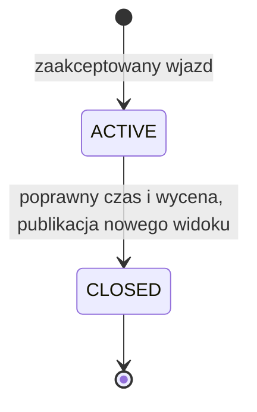

# Parking

Projekt edukacyjny w czystej Javie: przydzielanie miejsc, ewidencja aktywnych biletów i naliczanie opłat. Stan znajduje się w pamięci; operacje wykonuje jeden wątek.

Materiały do nauki: [lektury i źródła tego ćwiczenia](../MATERIALY.md#parking).

## Rdzeń techniczny

[ParkingLot](src/main/java/pl/jakubtworek/lld/parkinglot/ParkingLot.java) utrzymuje mapę historii i indeks aktywnych tablic. Wolne miejsca są w [FreeSpotIndex](src/main/java/pl/jakubtworek/lld/parkinglot/FreeSpotIndex.java): osobnym TreeSet dla każdego rozmiaru, uporządkowanym po piętrze i ID.

S oznacza liczbę miejsc, A aktywnych biletów, H wszystkich biletów.

| Operacja | Koszt i istotny warunek |
| --- | --- |
| Wjazd / wyjazd | O(log S) aktualizacji drzew; dostęp do map średnio O(1); osobno koszt kalkulatora opłaty |
| Wybór miejsca | Porównanie minimów najwyżej trzech zbiorów; pobranie minimum TreeSet kosztuje O(log S) |
| Własny wybór przez listę kandydatów | Może wymagać O(S log S) przygotowania listy |
| Snapshot | O(H + S) po zmianie, O(1) przy ponownym pobraniu bez zmiany |
| Zapytania widoku | Mogą skanować H biletów i sortować A aktywnych: O(H + A log A) |

Wolny zbiór jest dopełnieniem zajętych miejsc. Walidacja wszystkich zależności poprzedza aktualizację indeksów. Historia zajmuje O(H), indeksy O(S + A). Snapshoty są niemutowalne i zachowują dawny stan.

### Spójność indeksów i koszt odczytu

Historia biletów odpowiada na pytanie, co wydarzyło się na parkingu. Mapa aktywnych
rejestracji odpowiada wyłącznie na pytanie, czy pojazd już parkuje. Zbiory wolnych
miejsc odpowiadają za wybór następnego miejsca. Te trzy reprezentacje muszą
zmieniać się razem: udany wjazd dodaje bilet i aktywną rejestrację oraz usuwa
wolne miejsce; wyjazd zachowuje zamknięty bilet, usuwa rejestrację i przywraca miejsce.

Nie wystarczy sprawdzić, czy zwrócone ID istnieje. Wynik wyboru musi odpowiadać
całemu opisowi miejsca z katalogu i nadal występować w indeksie wolnych. Inaczej
dodatkowy algorytm mógłby zwrócić miejsce z podmienionym rozmiarem lub piętrem.

Snapshot jest tworzony dopiero na żądanie po zmianie. Dzięki temu wiele wjazdów
bez pełnego raportowania nie kopiuje historii po każdym bilecie. Zachowany
obiekt biletu opisuje moment jego utworzenia: po wyjeździe aktualną, zamkniętą
wersję trzeba pobrać z parkingu. Dawny bilet nie zmienia się w rękach czytelnika.

## Mechanizmy Javy i model wątkowy

### Kolekcje Javy: tożsamość, porządek i kopie

HashMap wyszukuje klucze przez hashCode i equals. LicensePlate jest kluczem
aktywnego postoju, dlatego jego wartość nie może zmienić się po wstawieniu.
W przeciwnym razie wpis mógłby pozostać w innym kubełku niż ten, w którym
później szukamy pojazdu. Średnie O(1) zakłada poprawne rozproszenie skrótów;
pojedynczy zapis może także uruchomić powiększanie tablicy mapy.

EnumMap w FreeSpotIndex odpowiada małemu, zamkniętemu zbiorowi SpotType.
JDK reprezentuje tę mapę tablicowo. Wartościami są jednak mutowalne TreeSet:
final przy referencji do EnumMap nie zamraża zbiorów znajdujących się w środku.

TreeSet rozpoznaje duplikaty przez wynik komparatora równy zero. Porządek
floor, a następnie id musi odróżniać wszystkie miejsca katalogu. Samo piętro
usunęłoby logicznie drugie miejsce na tej samej kondygnacji. Konfiguracja
odrzuca powtórzone ID, a niemutowalne ParkingSpot nie zmienia pozycji w drzewie.

Map.copyOf i List.copyOf odcinają możliwość zmiany struktury snapshotu,
ale nie klonują elementów i nie obiecują nowej instancji przy każdym wywołaniu.
Tutaj elementy też są niemutowalne. Kolejność mapy nie służy prezentacji;
uporządkowana lista aktywnych biletów wymaga jawnego sortowania.

### Wątki: jedna operacja obejmuje kilka indeksów

Wjazd to sprawdzenie mapy, wybór z drzewa i aktualizacja obu indeksów oraz
historii. Dwa równoległe wywołania mogłyby zobaczyć to samo wolne miejsce.
ConcurrentHashMap chroniłaby pojedynczą mapę, lecz nie cały ten przebieg.
Obecny kod wymaga jednego wątku; ewentualna blokada musiałaby obejmować
pełną operację i odczyt snapshotu względem aktualizacji.

Samo volatile przy cached nie zabezpieczyłoby mutowalnych indeksów.
Widoczność opublikowanego widoku i wyłączność zmiany stanu to osobne problemy.
Podstawy kontraktów: [HashMap](https://docs.oracle.com/en/java/javase/21/docs/api/java.base/java/util/HashMap.html)
i [EnumMap](https://docs.oracle.com/en/java/javase/21/docs/api/java.base/java/util/EnumMap.html).

## Zakres, reguły i niezmienniki

| ID | Wymaganie | Kryterium akceptacji |
| --- | --- | --- |
| R1 | Stała konfiguracja miejsc | Parking jest niepusty, ID miejsc są unikalne, piętra nieujemne |
| R2 | Zgodność pojazdu i miejsca | MOTORCYCLE pasuje wszędzie, CAR do COMPACT/LARGE, VAN tylko do LARGE |
| R3 | Jednoznaczny aktywny postój | Jedna rejestracja ma najwyżej jeden aktywny bilet, a miejsce najwyżej jeden aktywny postój |
| R4 | Wjazd w całości albo odmowa | Sukces wydaje bilet; brak pasującego miejsca i duplikat nie zmieniają stanu ani numeracji |
| R5 | Kontrolowany wyjazd | Tylko własny aktywny bilet można zamknąć; miejsce staje się wolne razem z zamknięciem |
| R6 | Historyczne rozliczenie | Zamknięty bilet zachowuje czas i kwotę; ponowny exit jest odmową |
| R7 | Jednoznaczny czas | Źródłem jest Clock; czas operacji nie cofa się względem ostatniej udanej operacji parkingu |
| R8 | Dokładna wycena | Nieujemne grosze PLN, odjęty okres bezpłatny, każda rozpoczęta godzina w górę; przepełnienie jest błędem |
| R9 | Wymienność polityk | first/best-fit oraz hourly/flat działają bez zmian w enter/exit |
| R10 | Bezpieczny odczyt i odmowy | Kolekcje i bilety nie dają prawa do mutacji; błąd wyceny/polityki nie publikuje nowego stanu |
| R11 | Zweryfikowane wejście wyceny | Wszystkie polityki przyjmują nie-null PricingContext, którego wyjazd nie poprzedza wjazdu |
| R12 | Opcjonalny limit należności | Wynik to min(poprawna cena bazowa, limit całego postoju); błędy delegata pozostają błędami |

Macierz zgodności jest jawna, niezależna od kolejności elementów enum:

| Rodzaj miejsca | MOTORCYCLE | CAR | VAN |
| --- | --- | --- | --- |
| MOTORCYCLE | tak | nie | nie |
| COMPACT | tak | tak | nie |
| LARGE | tak | tak | tak |

Domyślny porządek kandydatów to piętro rosnąco, a potem ID leksykograficznie.
Nie jest to pomiar odległości od bramy. `BestFitAllocation` najpierw porównuje
rozmiar miejsca, a dopiero potem ten sam porządek piętra i ID.

**Poza zakresem:** prawdziwe płatności, rezerwacje na przyszłość, bilety zgubione,
przepustki, abonamenty, VAT, multi-currency, urządzenia, sieć, baza, restart,
wielowątkowość, zmiana cennika w trakcie postoju i administracyjne usuwanie miejsc.
Kod ma wyjaśniać model, nie deklaruje obsługi rzeczywistego parkingu.

Parking jest jedynym właścicielem aktualnej mapy biletów. Różne bilety mogą
dotyczyć tej samej rejestracji lub miejsca w historii, ale najwyżej jeden taki
bilet może być aktywny. Zamkniętych biletów nie usuwamy. Bilet jest aktywny
wtedy i tylko wtedy, gdy nie ma rozliczenia; nie ma dodatkowej flagi stanu.

`TicketId` łączy UUID parkingu i kolejny numer lokalny. Dwa parkingi mogą mieć
bilet nr 1, lecz nie jest to ten sam identyfikator. UUID losujemy przy tworzeniu
parkingu; nie służy do autoryzacji. Odmowa pozostawia ten sam opublikowany snapshot.

Opis miejsca i wartości są niemutowalne. Bilet oraz snapshot są klasami `final`
z kontrolowanym tworzeniem i bez setterów. `List.copyOf`, `Map.copyOf` oraz
niemutowalne elementy tworzą stabilny odczyt. Samo prywatne pole lub `final`
przy referencji do mapy nie zapewniłoby tej gwarancji.



Odmowa nie jest osobnym stanem biletu. Ponowny wjazd po wyjeździe tworzy nowy
numer i nowy postój; nie otwiera poprzedniego biletu. Stary obiekt wydany przy
wjeździe nadal jest aktywną migawką z tamtej chwili, nawet gdy bieżący widok
zawiera już jego zamkniętą wersję. Aktualny stan należy odczytać z parkingu.

Rejestracje są przycinane i zamieniane na wielkie litery przez Locale.ROOT.
Dozwolone jest 1–20 znaków A–Z, cyfr lub myślnika. ID miejsc są przycinane,
ale rozróżniają wielkość liter. To lokalne reguły identyfikacji danych demo.

## Kontrakty i kolejność operacji

### Wjazd

1. Sprawdź argument i aktywną rejestrację w mapie hash.
2. Wbudowana polityka porównuje minima zgodnych typów w FreeSpotIndex.
3. Zweryfikuj pełną wartość wskazanego miejsca i jego obecność w indeksie wolnych.
4. Pobierz i sprawdź czas, utwórz numer oraz kompletny bilet.
5. Zaktualizuj historię, indeks rejestracji i wolnych miejsc; unieważnij cache widoku.
6. Snapshot materializuje kopię dopiero na żądanie. Odmowa przed zatwierdzeniem zachowuje poprzedni widok.

### Wyjazd

1. Sprawdź nie-null ID, obecność biletu w tym parkingu oraz jego aktywność.
2. Pobierz czas i sprawdź brak cofnięcia względem ostatniej udanej operacji.
3. Utwórz poprawny `PricingContext` z danych postoju i wylicz opłatę. Błąd lub null z polityki zatrzymuje przepływ przed publikacją.
4. Utwórz rozliczenie i nową, zamkniętą wersję biletu.
5. Zapisz zamknięty bilet, usuń aktywną rejestrację i przywróć miejsce do FreeSpotIndex. Unieważnij cache widoku.

| Operacja | Odmowy domenowe w kolejności sprawdzania | Błędy użycia lub implementacji |
| --- | --- | --- |
| `enter(vehicle)` | `VEHICLE_ALREADY_PARKED`, `NO_COMPATIBLE_SPOT`, `CLOCK_MOVED_BACKWARDS` | null → NPE; niepoprawny wynik polityki → `IllegalStateException` lub NPE |
| `exit(ticketId)` | `UNKNOWN_TICKET`, `TICKET_ALREADY_CLOSED`, `CLOCK_MOVED_BACKWARDS` | null → NPE; błąd wyceny propagowany; przepełnienie → `ArithmeticException` |
| konstrukcja wartości | Brak kodów domenowych | Niepoprawna konfiguracja → `IllegalArgumentException`; null → NPE |
| `snapshot()` i odczyty | Brak efektów ubocznych | Próba modyfikacji kolekcji → `UnsupportedOperationException` |
| `snapshot.hasActiveVehicle(plate)` | Prawda tylko dla aktualnie aktywnego postoju tej rejestracji | null → NPE; stare widoki zachowują dawną odpowiedź |
| `new PricingContext(...)` | Niezmienny opis przedziału do wyceny, bez zapisu w parkingu | null → NPE; wyjazd przed wjazdem → `IllegalArgumentException` |

NPE oznacza `NullPointerException`. W `enter` walidacja kontraktu polityki
jest przed odczytem czasu. Przy poprawnych politykach powyższa kolejność
określa, którą odmowę dostanie żądanie naruszające kilka reguł jednocześnie.
Polityki i cenniki muszą być czyste i niereentrantne. Parking nie cofa
efektów ubocznych ani reentrantnego wywołania wykonanego przez wadliwą politykę.

API wyceny ma postać `FeePolicy.calculate(PricingContext)`: obliczenie otrzymuje jeden zweryfikowany kontekst.
Kontekst można utworzyć do hipotetycznej wyceny, ale nie rezerwuje miejsca,
nie potwierdza aktywności i nie jest dokumentem zamknięcia. Te reguły należą
do parkingu, który przed utworzeniem kontekstu weryfikuje bilet i zegar.

## Czas i pieniądze krok po kroku

`Instant` identyfikuje chwilę, a `Duration.between` mierzy upływ czasu.
Zmiana z godziny 01:30 na 03:30 przy historycznym przejściu DST nie musi
oznaczać dwóch godzin postoju. Test dla 2024-03-31 w `Europe/Warsaw` sprawdza
rzeczywistą jedną godzinę i jedną stawkę.

Równe chwile są dozwolone. Cofnięcie Clock przed **ostatnią udaną operację
całego parkingu** jest odmową. Sprawdzenie tylko czasu wjazdu byłoby słabsze:
po innym późniejszym wjeździe można by dopuścić zapis ze starszą datą.
To prosta reguła laboratorium, bez automatycznego leczenia zegara ściennego.

Domyślny cennik to 500 groszy za rozpoczętą godzinę po odjęciu 10 minut:

```text
czas płatny = max(0, czas wyjazdu - czas wjazdu - 10 minut)
należność = 500 groszy × ceil(czas płatny / 1 godzina)
```

| Czas postoju | Czas płatny | Należność |
| --- | --- | --- |
| 0 lub 10 min | 0 | 0.00 PLN |
| 10 min + 1 ns | 1 ns | 5.00 PLN |
| 70 min | 60 min | 5.00 PLN |
| 70 min + 1 ns | 60 min + 1 ns | 10.00 PLN |
| 130 min | 120 min | 10.00 PLN |

Algorytm dzieli sekundy przez 3600 i bada resztę sekund oraz nanosekundy.
Nie używa `double`, nie ucina ułamka przez samo `toHours()` i nie konwertuje
całego czasu do nanosekund, co mogłoby przepełnić `long` dla dużego Duration.
`Money.times` używa `Math.multiplyExact`. Przepełnienie nie zamyka biletu.

Alternatywny `FlatFeePolicy` ustala stałe 1200 groszy także dla postoju zerowego.
Polityki wybieramy przy tworzeniu parkingu. Nie ma publicznego przełączania
stawki w trakcie działania. Zamknięte rozliczenie przechowuje już ustaloną kwotę.

## Ograniczenie należności za cały postój

CappedFeePolicy otrzymuje bazowy cennik i limit. Najpierw wywołuje wycenę
dokładnie raz z tym samym PricingContext, sprawdza wynik i dopiero wtedy
zwraca min(cena bazowa, limit). Nie powiela obliczeń godzin ani okresu bezpłatnego.

Dla ceny 5 PLN i limitu 15 PLN wynik to 5 PLN; dla ceny 25 PLN ten sam limit
daje 15 PLN. Limit dotyczy całego postoju, również wielodniowego. Nie odnawia
się o północy ani po kolejnych 24 godzinach.

Limit zero nadal wymaga poprawnej wyceny bazowej. Null, wyjątek lub przepełnienie
nie zamieniają się w darmowy, udany wyjazd. Dzięki temu ograniczenie ceny
nie ukrywa awarii kalkulatora i nie zwalnia miejsca mimo nieudanego rozliczenia.

Dwa ograniczenia 15 i 20 PLN dają łącznie 15 PLN. Wynika to z własności minimum;
nie jest ogólną gwarancją przemienności dowolnych działań na cenie.

## Pełny scenariusz do prześledzenia

Konfiguracja demo: L1/LARGE na piętrze 0, M1/MOTORCYCLE na 0, C1/COMPACT na 1.
Zegar zaczyna od 2026-01-01T10:00:00Z — to ustalony czas symulacji.

| Krok przy best-fit | Obserwowalny skutek | Chroniona reguła |
| --- | --- | --- |
| `enter CAR WX1` | Bilet 1, miejsce C1 | Samochód nie zużywa większego miejsca bez potrzeby |
| `enter VAN WX2` | Bilet 2, miejsce L1 | Van wymaga LARGE |
| `enter CAR wx1` | `VEHICLE_ALREADY_PARKED`, nadal dwa bilety | Normalizacja i jedna tożsamość aktywnego pojazdu |
| `exit 99` | `UNKNOWN_TICKET`, miejsca nadal zajęte | Nieznany dokument nie zwalnia miejsca |
| `advance 70` | Przesuwa tylko źródło czasu demo | Czas kontrolowany bez sleep i mutowania biletów |
| `exit 1` | Bilet 1 zamknięty, 5.00 PLN, C1 wolne | Rozliczenie i zwolnienie publikowane razem |
| `exit 1` | `TICKET_ALREADY_CLOSED`, poprzednia kwota bez zmian | Jeden cykl zamknięcia |
| `enter CAR WX1` | Nowy bilet 3 na C1 | Zamknięta historia nie zabrania nowego postoju |

Przy first-available pierwszy samochód trafiłby na L1, a van dostałby odmowę,
choć M1 i C1 byłyby wolne. Obie polityki respektują zgodność; różnią się
jakością lokalnego wyboru. Porównanie jest wykonywalne w `AllocationStrategyTest`.

## Uruchomienie

Java 21; Maven Wrapper i JUnit mają wersje przypięte w pom.xml. Z katalogu low-level-design/parking-lot:

~~~powershell
.\mvnw.cmd --batch-mode --no-transfer-progress clean verify
& "$env:JAVA_HOME/bin/java.exe" -jar target/parking-lot-1.0.0-SNAPSHOT.jar
~~~

Parametry demo: `[first|best-fit] [hourly|flat] [capGrosz]`. Polecenia: `enter TYPE PLATE`, `exit NUMBER`, `advance MINUTES`, `status`, `help`, `q`. Domyślnie wybierane są first i hourly.

## Testy i weryfikacja

[Testy](src/test/java/pl/jakubtworek/lld/parkinglot) obejmują cykl biletów, odmowy bez zmian stanu, cofanie czasu, zaokrąglenia, limit opłaty i przepełnienia. FreeSpotIndexTest porównuje 3000 wygenerowanych stanów zajętości z wyborem przez listy; testy historii kontrolują zgodność indeksów po sekwencjach operacji.

| Reguła | Plik i test | Granica wniosku |
| --- | --- | --- |
| R3–R6, R10: pełny postój i dawne widoki | [ParkingLotTest](src/test/java/pl/jakubtworek/lld/parkinglot/ParkingLotTest.java): `entryExitReleasesSpotAndPreservesOldTicketAndSnapshot` | Odczyt nie oznacza dostępu do mutacji |
| R3–R4: duplikat, normalizacja i numeracja | ten sam plik: `duplicatePlateIsRejectedEvenWithDifferentTypeAndDoesNotConsumeNumber` | Tożsamość to rejestracja, nie cały Vehicle |
| R2, R4: wolne a zgodne | ten sam plik: `noCompatibleSpotIsDifferentFromNoFreeSpots` | Dwa wolne miejsca nie gwarantują miejsca dla vana |
| R3–R6: cykl życia i obcy identyfikator | ten sam plik: `capacityCannotBeExceededAndExitAllowsReentryWithNewTicket`, `foreignTicketWithSameLocalNumberCannotCloseOwnTicket`, `repeatedExitIsRejectedAndHistoricalFeeDoesNotChange` | Brak reaktywacji starego biletu |
| R7: czas parkingu | ten sam plik: `clockRollbackUsesLastSuccessfulOperationOfWholeParking` | Odrzucamy cofnięcie, nie naprawiamy zegara |
| R8, R10: nieudana wycena | ten sam plik: `failedPricingDoesNotCloseTicketOrReleasePlace`, `overflowDuringPricingPreservesActiveStay`, `nullFeeIsNotTreatedAsSuccessfulExit` | Lokalne efekty, czyste współpracujące polityki |
| R1, R10: konfiguracja i kolekcje | ten sam plik: `rejectsEmptyParkingAndDuplicateSpotIdentity`, `sourceAndReturnedCollectionsCannotMutateParking` | Brak administracyjnej zmiany miejsc |
| R2, R9: macierz i korzyść best-fit | [AllocationStrategyTest](src/test/java/pl/jakubtworek/lld/parkinglot/AllocationStrategyTest.java): `compatibilityIsExplicitForEveryPair`, `preservesLargeSpotForLaterVan` | Heurystyka, nie optymalizacja przyszłości |
| R9–R10: kontrakt polityki | ten sam plik: `candidateListIsFilteredSortedAndImmutable`, `inventedOrIncompatibleSpotCannotBeAllocated`, `strategyCannotKeepReturningPreviouslyOccupiedSpot`, `emptyOrNullResponseDoesNotHideBrokenStrategy` | Wynik walidowany, cudze I/O nieodwracalne |
| R7–R8: granice opłat, DST i duży czas | [FeePolicyTest](src/test/java/pl/jakubtworek/lld/parkinglot/FeePolicyTest.java): `chargesEachStartedHourAfterSubtractingGracePeriod`, `elapsedTimeAcrossDstUsesInstantsNotLocalHours`, `largeDurationDoesNotRequireConversionToNanos` | Ustalony model opłat i jedna waluta |
| R8–R9: drugi cennik | ten sam plik: `flatFeeCanReplaceHourlyPolicyWithoutChangingLifecycle` | Stała cena także przy zerowym czasie |
| Poprawne wartości | [ValueObjectsTest](src/test/java/pl/jakubtworek/lld/parkinglot/ValueObjectsTest.java) | Format rejestracji jest uproszczony |
| Dłuższe historie i stare widoki | [GeneratedLifecycleTest](src/test/java/pl/jakubtworek/lld/parkinglot/GeneratedLifecycleTest.java): `generatedCommandsAgreeWithReferenceAndKeepArchivedViewsStable` | Próbka, nie przegląd wszystkich możliwych historii |
| Adapter, odmowy i zegar demo | [ParkingConsoleTest](src/test/java/pl/jakubtworek/lld/parkinglot/console/ParkingConsoleTest.java) | Strumienie w pamięci, bez awarii rzeczywistego terminala |
| Zapytanie o obecność aktywnego pojazdu | [ParkingLotTest](src/test/java/pl/jakubtworek/lld/parkinglot/ParkingLotTest.java): `activeVehicleQueryIgnoresClosedHistoryAndKeepsOldViewStable` | Odczyt aktualny lub historyczny, bez sortowania |
| Awaria Clock i ponowienie | ten sam plik: `clockReadFailureDuringEntryPreservesStateAndNumberAndAllowsRetry`, `clockReadFailureDuringExitDoesNotReleaseSpotAndAllowsRetry` | Wyjątek źródła czasu nie zmienia stanu; po przywróceniu zegara operację można wykonać |
| R11: kontrakt wyceny | [PricingContextTest](src/test/java/pl/jakubtworek/lld/parkinglot/PricingContextTest.java) | Przedział i nie-null sprawdzone; kontekst nie kontroluje cyklu biletu |
| R12: granice, złożenie i błędy limitu | [CappedFeePolicyTest](src/test/java/pl/jakubtworek/lld/parkinglot/CappedFeePolicyTest.java) | Cena bazowa, potem limit całego postoju; błędy delegata nadal propagowane |
| Własności ceny i konfiguracji | [ParkingPropertiesTest](src/test/java/pl/jakubtworek/lld/parkinglot/ParkingPropertiesTest.java) | Rosnące próbki czasu i wszystkie 6 permutacji konfiguracji demo, nie dowód dla dowolnych polityk |

## Ograniczenia

Brak płatności, trwałego zapisu i synchronizacji. Historia rośnie do końca życia obiektu; q kończy demo bez zamykania aktywnych biletów.
