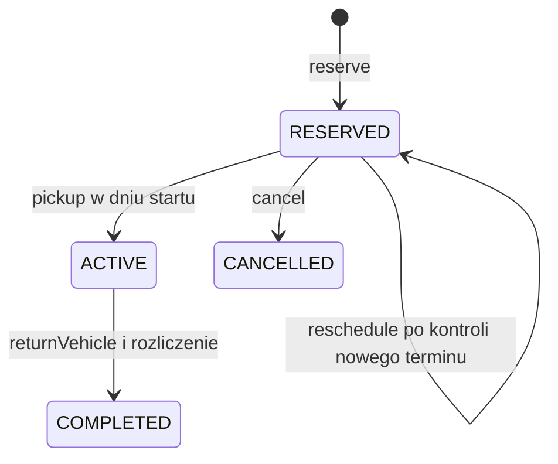

# Wypożyczalnia samochodów

Projekt edukacyjny w czystej Javie: rezerwacje aut, odbiór, zwrot, zmiana terminu i blokady serwisowe. Najważniejsze elementy to indeks przedziałów oraz rozdzielenie planowanego wynajmu od faktycznie odebranego auta. Stan jest w pamięci, obsługa jednowątkowa.

## Rdzeń techniczny

[RentalAgency](src/main/java/pl/jakubtworek/lld/carrental/RentalAgency.java) przechowuje historię w mapach. [CalendarIndex](src/main/java/pl/jakubtworek/lld/carrental/CalendarIndex.java) utrzymuje po dwa indeksy przedziałów na auto: rezerwacje i serwis. Osobna mapa auto → aktywna rezerwacja chroni rzeczywisty odbiór.

Usunięcie aktywnego wpisu sprawdza także ID rezerwacji. Anulowanie przyszłego wynajmu nie może usunąć informacji o innym, aktualnie odebranym aucie.

V oznacza liczbę aut, H rozmiar historii, B liczbę indeksowanych przedziałów.

| Operacja | Koszt |
| --- | --- |
| Konflikt / zapis dla jednego auta | O(log(B auta + 1)), dostęp do historii średnio O(1) |
| Lista dostępnych aut | O(V log(Bmax + 1) + V log V), z uporządkowaniem wyniku |
| Odczyt aktywnego wynajmu | Średnio O(1), bez skanowania historii |
| Snapshot | O(H + V + B log(B + 1)) z odbudową indeksów widoku; kolejne pobranie bez zmiany O(1) |

Pamięć bieżącego stanu jest liniowa względem katalogu, historii i wpisów indeksu. Starsze widoki zachowują własny stan, a historia zakończonych rezerwacji nie jest automatycznie usuwana.

### Planowany okres i rzeczywista dostępność

Dla każdego auta są dwa kalendarze: rezerwacje oraz serwis. Każdy przechowuje
niepokrywające się przedziały i może sprawdzić sąsiadów w TreeMap. Wyszukiwanie
dostępności sprawdza oba; kolejność raportowania rodzaju konfliktu jest jawna.

Aktywnego wynajmu nie wolno utożsamiać z przedziałem obejmującym dzisiejszą datę.
Klient może przetrzymać auto poza planowanym końcem. Mapa auto → aktywny wynajem
blokuje kolejny odbiór, nawet gdy przedziały rezerwacji już się nie przecinają.

Zmiana terminu pomija wyłącznie własne ID. Całkowite pominięcie auta podczas
szukania kolizji dopuściłoby nakładanie z inną rezerwacją. Nowy okres i cena
muszą być gotowe przed usunięciem starego wpisu; odmowa nie zwalnia terminu.

Zwrot wcześniejszej rezerwacji usuwa wpis aktywności tylko przy zgodnym ID.
Anulowanie przyszłej rezerwacji tego samego auta nie może odblokować auta,
które nadal jest u poprzedniego klienta. To odrębny niezmiennik od braku
nakładających się planowanych okresów.

## Mechanizmy Javy i model wątkowy

### LocalDate, klucze map i odczyt bez skanowania

LocalDate jest niemutowalną datą, bez godziny i strefy w samym obiekcie.
LocalDate.now(clock) wyznacza ją z chwili i strefy zegara; porównanie
przedziałów odbywa się już po datach. Dni nie są przeliczane na
24 × 3600 sekund, więc zmiana DST nie tworzy ułamka dnia w indeksie.

TreeMap przechowuje początki planowanych okresów. HashMap historii
odnajduje rezerwację po ID, a mapa aktywności po ID auta. Ta ostatnia
przechowuje jedną relację, której usunięcie wymaga zgodności także wartości.
Operacja remove(key, expectedValue) wyraża „usuń tylko ten wpis”;
w zwykłej HashMap nie jest przez to atomowa wobec innych wątków.

UUID i identyfikatory opakowane w wartości mają stabilne equals/hashCode.
ID nie jest pozycją na liście: usunięcie innego wpisu nie przesuwa tożsamości
rezerwacji. Z kolei porządek prezentacji pojazdów jest jawnie sortowany,
bo iteracja HashMap go nie zapewnia.

Snapshot kopiuje mapy i buduje własne indeksy do odczytu. Nie wystarczy
otoczyć bieżącej mapy Collections.unmodifiableMap: byłby to odczytowy
widok źródła i dalsze zapisy nadal mogłyby być w nim widoczne.
Kopie są płytkie, a bezpieczeństwo wnętrza opiera się na niemutowalnych
wartościach Reservation i blokad.

### Wątki: rozdzielenie indeksów nie rozdziela transakcji

Odbiór zmienia historię i indeks fizycznej aktywności, a zwrot dodatkowo
dostępność planowaną. Zablokowanie tylko kalendarza nie zabezpieczyłoby
sprawdzenia i zapisania aktywnego wynajmu. Aktualna instancja wymaga
jednego wątku, również przy równoczesnym odczycie snapshotu.

Różnicę między kopią a widokiem opisuje [Collections.unmodifiableMap](https://docs.oracle.com/en/java/javase/21/docs/api/java.base/java/util/Collections.html#unmodifiableMap(java.util.Map)).

## Zakres, reguły i niezmienniki

CustomerId identyfikuje dane żądania, bez uwierzytelniania. Indeksy ograniczają
nakładanie rezerwacji jednego auta, nie wszystkich rezerwacji klienta.

| ID | Gwarancja | Przykład odmowy |
| --- | --- | --- |
| R1 | Unikalne kody aut i klientów; niepuste opisy; start < end | Duplikat kodu lub pusty przedział → IllegalArgumentException |
| R2 | Umowy RESERVED/ACTIVE tego samego auta nie nakładają swoich planowanych okresów | RESERVATION_CONFLICT |
| R3 | Serwis nie nakłada się z blokującą umową ani innym serwisem auta | MAINTENANCE_CONFLICT lub RESERVATION_CONFLICT |
| R4 | Początek nowego planu nie poprzedza bieżącej daty Clock | PAST_PERIOD |
| R5 | Cykl zmieniamy po ID konkretnej umowy i tylko dla właściwego klienta | UNKNOWN_RESERVATION albo NOT_CUSTOMER |
| R6 | Odbiór wymaga RESERVED, daty początku i braku innej umowy ACTIVE auta | INVALID_STATUS, PICKUP_DATE_MISMATCH albo VEHICLE_NOT_RETURNED |
| R7 | Zwrot wymaga ACTIVE, a anulowanie RESERVED | INVALID_STATUS |
| R8 | Cena planowana i stawka są zachowane; dopłata to max(0, data zwrotu − koniec) × stawka | Przepełnienie Money → ArithmeticException przed publikacją |
| R9 | Odmowa i błąd czasu zachowują ten sam snapshot; stare wartości są stabilne | Błąd Clock nie tworzy częściowej umowy |
| R10 | Mapa umów zachowuje także COMPLETED/CANCELLED, które nie blokują kalendarza | Stare ID nie wskazuje nowego wynajmu tej samej pary klient–auto |
| R11 | Reschedule zmienia wyłącznie RESERVED, zachowuje ID/stawkę i nie usuwa starej umowy przed sukcesem | Konflikt, błąd daty lub czasu → ten sam snapshot i stary termin |
| R12 | Konflikt wskazuje rodzaj, ID, auto i pełny blokujący przedział; wybór jest deterministyczny | Kod odmowy i dane źródła nie mogą wskazywać różnych rodzajów |

Daty kalendarzowe interpretujemy według strefy Clock. Demo używa UTC.
Nie ma rozliczenia części dnia, bufora na mycie ani godzin przekazania.
Na granicy końca najpierw trzeba faktycznie zwrócić poprzednie auto, dopiero
potem wydać je następnej osobie. Brak godziny nie oznacza równoczesnego posiadania.

## Reprezentacja stanu i cykl życia



Pozostałe przejścia są odrzucane. Nie wygaszamy automatycznie nieodebranych
umów: operator może je anulować. Mapa zachowuje stare ID i wyniki zakończonych
umów, lecz nie historię każdej pośredniej wersji. Klient może zachować stare
snapshoty na własny koszt pamięci.

Konstruktor Reservation jest prywatny. Metody pakietowe pilnują przejść
i tworzą nową wersję; spoza modelu nie da się ustawić ACTIVE setterem.
RentalAgency sprawdza relacje między umowami, klientem, autem i serwisem.
Finalne pola same nie wystarczyłyby dla map: RentalSnapshot dodatkowo je kopiuje.
Niemutowalne wartości umów i blokad pozostają bezpieczne również po skopiowaniu mapy;
widok nie współdzieli mutowalnego wnętrza z bieżącym kalendarzem.

## Kolizja, kontrakty i krytyczny przepływ

Dwa niepuste przedziały A i B nakładają się wtedy i tylko wtedy, gdy:

```text
A.start < B.end && B.start < A.end
```

Negacja oznacza, że jeden skończył się przed początkiem drugiego lub dokładnie
na tej granicy. Ścisłość porównań pozwala na sąsiedztwo. Sprawdzenie tylko,
czy B.start leży wewnątrz A, nie wykryje sytuacji, gdy B całkowicie zawiera A.
Algorytm ma stały czas i nie rozwija przedziału do listy dni. Enumeracja dni
jest celowo użyta tylko jako niezależna wyrocznia małych testów.

| Komenda | Kolejność walidacji | Sukces |
| --- | --- | --- |
| reserve | null, znany klient, znane auto, data nie w przeszłości, konflikt umowy, konflikt serwisu, wycena | Nowa umowa z nowym UUID |
| cancel | null, znany klient, znana umowa, właściciel, RESERVED | CANCELLED, bez odczytu Clock |
| reschedule | null nowego okresu i ID, znany klient, znana umowa, właściciel, RESERVED, nowa data nie w przeszłości, konflikt bez własnego ID, wycena | Ten sam ID i stawka, nowy okres i cena planowana |
| pickup | jak cancel do właściciela, RESERVED, brak ACTIVE tego auta, data początku | ACTIVE |
| returnVehicle | jak cancel do właściciela, ACTIVE, data nie przed odbiorem, rozliczenie | COMPLETED i RentalReceipt |
| scheduleMaintenance | null i opis, znane auto, data nie w przeszłości, konflikt umowy, konflikt serwisu | Nowe wyłączenie serwisowe |
| removeMaintenance | null, znane ID serwisu | Usunięcie wyłączenia, bez odczytu Clock |

Null daje NullPointerException, niepoprawna wartość IllegalArgumentException.
Odmowa reguły daje RentalException.reason(). Przepełnienie Money i awaria
Clock propagują. Zwrot przed datą odbioru daje IllegalStateException.
Przy kilku naruszeniach wygrywa pierwszy warunek z tabeli. Kwerendy nie zmieniają
stanu; nieznany pojazd w isAvailable daje UNKNOWN_VEHICLE zamiast false.

### Zmiana terminu i opis konfliktu

`reschedule(customerId, reservationId, replacement)` nie wykonuje cancel+reserve.
Stara umowa blokuje swój termin aż do zbudowania całego poprawnego kandydata.
Przy kontroli nowego okresu pomijamy dokładnie jej ID. Inne umowy tego samego
klienta nadal blokują auto. Nowy okres może częściowo pokrywać stary, być z nim
identyczny lub sąsiadować z inną umową. Identyczny okres również publikuje nowy
widok; nie obiecujemy braku publikacji dla udanej komendy bez zmiany wartości.

Zmiana zachowuje auto, klienta, UUID i zapisaną stawkę, a cenę liczy jako
stawka × pełna długość nowego okresu. Zmiana ACTIVE, COMPLETED i CANCELLED
jest odrzucana. Można przesunąć nieodebraną umowę po no-show, jeśli nowy
początek nie jest w przeszłości. ID nie jest numerem wersji: nie chronimy
przed starym poleceniem zmiany terminu odnoszącym się do tej samej umowy.

Publiczne `snapshot.conflict(vehicleId, period)` zwraca Optional typowanego
CalendarConflict. Wariant ReservationConflict ma ReservationId, a wariant
MaintenanceConflict MaintenanceId; oba podają auto, pełny okres i kod przyczyny.
Pusty Optional oznacza brak konfliktu w planie, nie fizyczną obecność auta.
RentalException.conflict() niesie te same dane przy odmowie komendy, a przy
innych odmowach jest pusty. Konsola pokazuje ID i daty także w komunikacie błędu.

Jeśli zapytanie obejmuje kilka blokad, wybieramy umowę przed serwisem,
następnie najwcześniejszy początek. Nieprzecinające się wpisy wykluczają remis
początku w jednym kalendarzu. Poprzednik i następnik z TreeMap zastępują skan
historii. Wynik nadal jest pojedynczym deterministycznym konfliktem.

Scenariusz krytyczny:

1. U1 rezerwuje V1 na [19,22); sprawdzamy ID i datę z Clock.
2. CalendarIndex znajduje potencjalną kolizję w drzewie auta.
3. Obliczamy cenę i tworzymy kompletną umowę.
4. Aktualizujemy indeksy i historię; odczyt snapshotu wykona kopię osobno.
5. Odbiór wymaga braku V1 w mapie aktywnych wydań.
6. Zwrot 23. dnia wylicza dopłatę, a po sukcesie usuwa aktywną blokadę i zapisuje COMPLETED.

Błąd w krokach obliczeń nie wymaga rollbacku, bo nie opublikowano częściowego
stanu. To lokalna gwarancja jednowątkowa, bez transakcji bazy lub cofania efektu
fizycznego wydania auta. RentalReceipt nie potwierdza płatności.

### Plan a rzeczywisty odbiór

ACTIVE blokuje planowany przedział w kalendarzu, ale faktyczne posiadanie auta
może trwać dłużej. Dostępność przyszłego przedziału może więc być planowo poprawna,
a odbiór i tak odmówi VEHICLE_NOT_RETURNED. Nie przesuwamy automatycznie kolejnych
umów i nie naliczamy fikcyjnego zwrotu. Klient musi rzeczywiście oddać auto
przez returnVehicle, a operator rozstrzygnąć ewentualną nieobecność następnej osoby.

Serwis jest również planem. Nie implementujemy potwierdzeń rozpoczęcia ani
zakończenia naprawy, więc harmonogram nie dowodzi, że spóźniony pojazd dotarł
już do warsztatu. Przyszłe rezerwacje mogą być przyjmowane zgodnie z planem,
ale nie dostają gwarancji fizycznej obecności auta.

## Uruchomienie

Java 21; z katalogu low-level-design/resource-calendar:

~~~powershell
.\mvnw.cmd --batch-mode --no-transfer-progress clean verify
& "$env:JAVA_HOME/bin/java.exe" -cp target/resource-calendar-1.0.0-SNAPSHOT.jar pl.jakubtworek.lld.carrental.console.ConsoleMain 2026-10-24
~~~

Opcjonalny argument ustala datę demo. Polecenia obejmują status, available, reserve, reschedule, conflict, pickup, return, cancel, service i unservice. `help` podaje argumenty i format dat; `q` kończy program.

## Testy i weryfikacja

[Testy](src/test/java/pl/jakubtworek/lld/carrental) sprawdzają sąsiedztwo okresów, cenę, odbiór i zwrot, zmiany terminu oraz blokady serwisowe. Testy generowane porównują kalendarz i cykle wynajmu z niezależnymi modelami. ActiveVehicleIndexTest sprawdza ochronę aktywnego najmu przed anulowaniem innej rezerwacji.

| Reguła | Test / plik | Granica dowodu |
| --- | --- | --- |
| R1–R3: przedziały, zawieranie i sąsiedztwo | RentalPeriodTest: all225PairsOfSmallPeriodsAgreeWithDaySetIntersection, adjacencyIsAllowedButContainmentIsConflict | Wszystkie 225 par z sześciu granic dni, nie wszystkie daty |
| R1, R8: wartości i arytmetyka | [ValueObjectsTest](src/test/java/pl/jakubtworek/lld/carrental/ValueObjectsTest.java) | Kody, UUID, duplikaty i przepełnienia Money oraz sumy receipt |
| R2: cena i zasób w okresie | RentalAgencyTest: reservationCapturesPriceAndBlocksOnlyItsVehicleAndPeriod | Dwie kategorie i sąsiadujące umowy |
| R3: serwis w obu kierunkach | RentalAgencyTest: maintenanceAndReservationsRejectConflictsInBothDirections | Serwis–umowa, umowa–serwis i serwis–serwis |
| R4, R6: daty i fizyczne przekazanie | RentalAgencyTest: pastPlansAreRejectedButReadQueriesMayDescribePastDates, pickupMustBeOnStartDateAndNoShowCanStillBeCancelled, plannedAvailabilityDoesNotGuaranteePickupBeforePreviousPhysicalReturn | Daty początku i blokada przez inny ACTIVE |
| R5–R7, R10: tożsamość i przejścia | RentalAgencyTest: cancellationFreesPeriodAndOldCommandCannotAffectNewReservation, activeRentalCannotBeCancelledOrPickedUpTwice, unknownReferencesOwnershipAndNullInputsLeaveSamePublication | Brak wpływu starego ID i niewłaściwego klienta |
| R8: rozliczenie | RentalAgencyTest: earlyOnTimeAndLateReturnsUsePinnedDailyRate | Pięć dat zwrotu, plan 3 dni, dopłata tylko po końcu |
| R9: zegar i niemutowalność | RentalAgencyTest: clockFailureDoesNotPublishAndCancellationDoesNotNeedClock, reversedClockCannotReturnBeforePickup, clockZoneDefinesCalendarDate, inputCollectionsAndHistoricalViewsCannotBeChangedFromOutside | Odmowy, cofnięta data, stały offset i stare widoki |
| R2–R3, R9: próbka kalendarza | [GeneratedCalendarTest](src/test/java/pl/jakubtworek/lld/carrental/GeneratedCalendarTest.java) | 3 ziarna × 300 poleceń, dwa auta, siedem komórek dat |
| R11: zmiana terminu i odmowy | [RescheduleTest](src/test/java/pl/jakubtworek/lld/carrental/RescheduleTest.java) | Własny okres, inna umowa tego samego klienta, serwis, stany terminalne, błędy Clock i stare widoki |
| R12: deterministyczna diagnostyka | [CalendarConflictTest](src/test/java/pl/jakubtworek/lld/carrental/CalendarConflictTest.java) | Zgodność kwerendy i wyjątku, wiele blokad, priorytet rodzaju i daty, dawne snapshoty |
| R2–R12: próbka całego cyklu | [GeneratedLifecycleTest](src/test/java/pl/jakubtworek/lld/carrental/GeneratedLifecycleTest.java) | 4 ziarna × 400 poleceń, czas, reschedule, wydanie, rozliczenie i stare widoki |
| Adapter i tokeny | [RentalConsoleTest](src/test/java/pl/jakubtworek/lld/carrental/console/RentalConsoleTest.java) | Strumienie w pamięci, cykl, serwis, błędy, EOF i awaria wejścia |

## Ograniczenia

Brak płatności, kaucji, trwałości i synchronizacji. Rezerwacja jest przypisana do konkretnego auta; kalendarz nie planuje automatycznie zastępstw przy opóźnionym zwrocie.
