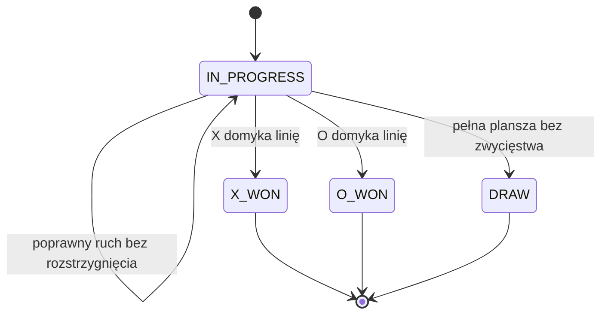

# Kółko i krzyżyk

Projekt edukacyjny w czystej Javie: gra na planszy N×N z wygraną przez K kolejnych znaków. Implementacja obejmuje walidację ruchów, wykrywanie wyniku, niemutowalne widoki i konsolę. Stan pozostaje w pamięci, obsługa jest jednowątkowa.

## Rdzeń techniczny

[Board](src/main/java/pl/jakubtworek/lld/tictactoe/Board.java) przechowuje rzadkie, niemutowalne drzewo słów po 64 pola. Liść zawiera dwie maski long, osobno dla X i O. Indeks pola to row × N + column; przesunięcie o 6 bitów wybiera słowo, a sześć najmłodszych bitów pozycję w masce.

Aktualizacja kopiuje wyłącznie ścieżkę do liścia. Starsze korzenie pozostają poprawne. [TicTacToeGame](src/main/java/pl/jakubtworek/lld/tictactoe/TicTacToeGame.java) sprawdza linie przechodzące przez ostatni ruch; nie przegląda całej planszy.

W = ceil(N² / 64), H oznacza liczbę zachowanych wersji.

| Operacja | Koszt |
| --- | --- |
| Utworzenie pustej planszy | O(1), bez alokacji wszystkich pól |
| Odczyt / zapis pola | O(log(W + 1)); zapis tworzy tylko węzły ścieżki |
| Sprawdzenie wygranej | O(K log(W + 1)); najwyżej K − 1 pól w każdym kierunku czterech osi |
| Sprawdzenie zapełnienia | O(1), licznik zajętych pól |
| Wyświetlenie planszy | O(N² log(W + 1)), wraz z odczytami pól |

Aktualna plansza wymaga najwyżej O(W) pamięci. Zachowanie H wersji kosztuje O(W + H log(W + 1)). Dla maksymalnego rozmiaru jeden ruch tworzy najwyżej dziewięć węzłów. Niemutowalny widok chroni stan, ale nie wprowadza automatycznie porównywania całych snapshotów po zawartości.

### Słowa bitowe, kopiowanie i wykrywanie linii

Dla pola (r,c) obliczamy indeks r × N + c. Numer słowa to index >>> 6,
a bit to 1L << (index & 63). Dwie maski w liściu nie mogą mieć wspólnego
ustawionego bitu. Zajętość liczymy osobno, aby nie sumować bitów wszystkich
słów przy każdym sprawdzeniu remisu.

Drzewo nie tworzy liści dla pustych fragmentów. Zapis tworzy nowy liść
i kopiuje węzły na drodze do niego. Pozostałe gałęzie współdzieli ze starą
planszą. Dzięki temu publikacja nowego ruchu nie zmienia już zwróconych widoków.

Sprawdzanie wygranej zaczyna się od ostatnio zajętego pola. Dla każdej
z czterech osi liczymy zgodne znaki po obu stronach i dodajemy sam ruch.
Wystarczy osiągnąć K; dalej odległe pola nie mogą zmienić odpowiedzi.
Linia mogła powstać tylko przez bieżący ruch, ponieważ poprzednia pozycja
była poprawną, niezakończoną grą.

Ta optymalizacja zakłada budowanie pozycji wyłącznie przez dozwolone ruchy.
Nie jest walidatorem dowolnej importowanej planszy. Pełna wyrocznia testowa
skanuje wszystkie okna, aby nie powtarzać założenia badanego algorytmu.

## Mechanizmy Javy i model wątkowy

### Operacje bitowe Javy i reprezentacja wartości

Maskę tworzy 1L << (index & 63). Litera L wymusza long przed przesunięciem.
Bez niej przesunięcie zachodziłoby na int, a dopiero późniejsza konwersja
na long nie odzyskałaby utraconych bitów. Java maskuje odległość przesunięcia:
dla long używa sześciu najmłodszych bitów, więc 1L << 64 powtarza bit zero.

Bit 63 jest bitem znaku, ale jego ustawienie nie psuje maski zbioru.
Sprawdzenie przecięcia używa != 0, nie > 0. >>> przesuwa bez powielania
bitu znaku; w obliczeniu numeru słowa dodatni indeks jest dzielony przez 64.

Dwie wartości long w liściu zastępują referencje do obiektów dla każdego pola.
Własne węzły drzewa nadal są obiektami na stercie; koszt ruchu obejmuje
alokacje nowej ścieżki, a nie tylko instrukcję OR. Puste gałęzie są null
i nie wymagają osobnego węzła na każde niezajęte pole.

GameRules i Position jako recordy mają równość składowych. Board oraz
GameSnapshot nie obiecują takiej równości strukturalnej: identyczna zawartość
dwóch plansz nie oznacza automatycznie board1.equals(board2). Testy porównują
pola i wynik, zamiast zakładać zachowanie równości na podstawie niemutowalności.

### Finalny korzeń i mutowalna rozgrywka

Pola węzłów są finalne, lecz TicTacToeGame podmienia bieżący snapshot.
Odczyt starej planszy nie wykonuje zapisu, natomiast dwa równoległe play
mogłyby oba zaakceptować ruch z tej samej tury i utracić jeden wynik.

Projekt pozostaje jednowątkowy. Sam volatile na referencji state poprawiłby
widoczność publikacji, lecz nie połączyłby walidacji tury i zatwierdzenia
w jedną operację. Również niezmienna plansza nie synchronizuje właściciela gry.
Szczegóły operatorów: [JLS 15.19](https://docs.oracle.com/javase/specs/jls/se21/html/jls-15.html#jls-15.19).

## Zakres, reguły i niezmienniki

Aktorami są uczestnicy X i O. Znak identyfikuje uczestnika w ramach partii;
nie modelujemy kont użytkowników. Klient przekazuje znak, który chce wykonać
ruch, oraz pozycję `(row, column)` liczoną od zera.

| ID | Wymaganie | Kryterium akceptacji |
| --- | --- | --- |
| R1 | Nowa partia ma pustą planszę i rozpoczyna ją X | Wszystkie pola puste; status `IN_PROGRESS`, `nextPlayer = X` |
| R2 | Uczestnicy wykonują ruchy na przemian | Po poprawnym ruchu X kolejny ruch należy do O |
| R3 | Ruch wymaga wolnego pola w granicach planszy | Zajęte pole, ujemna współrzędna lub współrzędna N powoduje odmowę |
| R4 | Odmowa nie zmienia stanu | Poprzedni widok jest nadal aktualnym widokiem gry; tura nie przepada |
| R5 | Wygrywa co najmniej K kolejnych znaków na jednej osi | Wiersz, kolumna i obie przekątne; puste pole lub przeciwnik przerywa ciąg |
| R6 | Pełna plansza bez zwycięstwa oznacza remis | Status `DRAW`, brak zwycięzcy i kolejnego gracza |
| R7 | Zakończonej partii nie można kontynuować | Każdy ruch z argumentami różnymi od `null` jest odrzucany jako `GAME_FINISHED` |
| R8 | Zewnętrzny odczyt nie pozwala zmieniać partii | Nie ma setterów ani dostępu do tablicy; stare widoki pozostają stabilne |
| R9 | Rozmiar N i długość K ustalamy przy utworzeniu gry | `1 <= K <= N <= 100`; klasyczny wariant to N=3, K=3 |

**Założenia:** jeden proces, pamięć operacyjna, dostęp jednowątkowy, dwie strony,
X zaczyna, brak zegara, pieniędzy i operacji I/O w domenie. Linie są proste,
poziome, pionowe lub ukośne pod kątem 45°; nie zawijają się na krawędziach.
Warunek to „co najmniej K”, a nie „dokładnie K”.

**Poza zakresem:** AI, sieć, uwierzytelnianie graczy, zapis partii, cofanie ruchu,
import dowolnej pozycji, turnieje, GUI i równoległe polecenia.
Każda nowa partia jest nową instancją; obiekt nie ma operacji resetowania.
Adapter konsoli obsługuje jedną partię, wejście `wiersz kolumna`, błędy formatu,
odmowy domenowe, zakończenie przez `q` lub koniec strumienia oraz wynik gry.

- Na jednym polu znajduje się najwyżej jeden znak; raz zajętego pola nie nadpisujemy.
- Znak X ma tyle samo ruchów co O albo o jeden więcej; tylko X zaczyna.
- Aktywna partia ma dokładnie jednego następnego gracza. Zakończona nie ma żadnego.
- `X_WON` i `O_WON` jednoznacznie kodują zwycięzcę; remis nie może mieć zwycięzcy.
- Po stanie terminalnym nie powstają kolejne stany partii.
- Nieudane polecenie zachowuje tę samą planszę, turę i wynik.
- Zwrócony wcześniej widok nie zmienia się pod wpływem późniejszych ruchów.

Przykład odmowy: po X na `(0,0)` uczestnik O próbuje zagrać na `(0,0)`.
Otrzymuje `OCCUPIED`, nadal może wykonać swoją turę na `(1,1)`.
Przykład graniczny: na planszy 1 × 1 pierwszy ruch daje zwycięstwo X,
chociaż jednocześnie zapełnia planszę. Zwycięstwo ma pierwszeństwo przed remisem.

## Przykład: poprawny ruch i odmowa

Uruchom w katalogu projektu:

```powershell
.\mvnw.cmd --batch-mode --no-transfer-progress '-Dtest=TicTacToeGameTest' test
```

Prześledź poniższą sekwencję przez publiczne API. To przykład dydaktyczny
łączący scenariusze odmowy i zwycięstwa z testów, nie dodatkowa metoda modelu.

| Krok | Polecenie | Wynik / przyczyna | Następny gracz i stan |
| --- | --- | --- | --- |
| 0 | `new TicTacToeGame()` | Pusta plansza | X, `IN_PROGRESS` |
| 1 | `play(X, (0,0))` | Powstaje nowa plansza z X | O, `IN_PROGRESS` |
| 2 | `play(O, (0,0))` | `OCCUPIED`, brak nowego widoku | Nadal O, identyczny stan jak po kroku 1 |
| 3 | `play(O, (1,0))` | O zajmuje inne pole | X, `IN_PROGRESS` |
| 4 | `play(X, (0,1))` | Dwa X obok siebie jeszcze nie wygrywają | O, `IN_PROGRESS` |
| 5 | `play(O, (1,1))` | Dwa O w drugim wierszu | X, `IN_PROGRESS` |
| 6 | `play(X, (0,2))` | Trzy X w pierwszym wierszu | Brak kolejnego gracza, `X_WON` |
| 7 | `play(O, (2,2))` | `GAME_FINISHED`, mimo że pole jest wolne | Nadal `X_WON`, brak nowego widoku |

Skrót `(r,c)` w tabeli oznacza `new Position(r,c)`. Zatrzymaj się na kroku 2:
`Board.afterMove` zgłasza odmowę przed kopiowaniem, więc `play` nie dochodzi do
przypisania `state`. O pozostaje uczestnikiem, który ma teraz wykonać ruch.
W kroku 6 nie ma wyjątkowej „metody zakończenia”: wynik powstaje w tym samym
przepływie, który publikuje planszę i informację o turze.

### Co dzieje się z referencjami planszy

Po ruchu powstaje nowy korzeń i droga do zmienionego słowa. Pozostałe gałęzie
są współdzielone. Klasyczna plansza mieści się w jednym liściu z dwiema maskami long.

To bezpieczne współdzielenie niezmiennych węzłów. Testy starych widoków
sprawdzają wszystkie pola po wykonaniu dalszych ruchów, a nie tylko bieżący wynik.

## Reprezentacja stanu

`TicTacToeGame` ma tożsamość jednej rozgrywki w pamięci i jest jedynym
mutowalnym właścicielem jej bieżącego stanu. `GameRules` i `Position` są value
objects. `Board` jest niemutowalnym obiektem bez publicznej operacji zapisu;
nie implementuje równości strukturalnej, więc porównanie dwóch osobno utworzonych
plansz wymaga porównania pól. `GameSnapshot` jest widokiem odczytowym, a nie
formatem importu lub dowodem legalności dowolnej pozycji. Gra nie przyjmuje
zewnętrznego widoku jako swojego stanu.

`GameSnapshot` jest klasą `final`, z prywatnymi polami `final`, metodami odczytu
`board()`, `status()` i `nextPlayer()` oraz konstruktorem o widoczności pakietowej.
Klient spoza domeny nie może sam utworzyć takiego widoku.
Nie oferujemy równości strukturalnej snapshotów; reprezentują konkretne chwile
partii. Kod wewnątrz pakietu domeny pozostaje zaufany — widoczność pakietowa
nie jest mechanizmem ochrony przed refleksją lub celowo szkodliwym kodem.

Adapter `ConsoleGame` znajduje się w oddzielnym pakiecie i otrzymuje `Reader`
oraz `PrintWriter` od wywołującego. Nie wykonuje
odrębnej walidacji reguł gry, nie ustawia pól planszy i nie tworzy snapshotów.

## Kontrakty i przepływ

| Operacja | Wynik / efekt | Odmowa |
| --- | --- | --- |
| `new TicTacToeGame()` | Klasyczna nowa partia 3 × 3 / K=3 | Brak argumentów |
| `new TicTacToeGame(rules)` | Partia z niezmiennymi regułami | `null` → `NullPointerException` |
| `new GameRules(N, K)` | Poprawna konfiguracja | N lub K poza zakresem → `IllegalArgumentException` |
| `play(mark, position)` | Nowy widok, zajęte pole, aktualizacja wyniku i tury | `IllegalMoveException` z kodem; stan bez zmian |
| `snapshot()` | Aktualny niemutowalny widok | Brak efektów ubocznych |
| `board.markAt(position)` | Znak albo `Optional.empty()` | Poza planszą → `OUT_OF_BOUNDS`; `null` → `NullPointerException` |
| `status.winner()` | X, O lub brak zwycięzcy | Brak efektów ubocznych |

Kolejność odmów `play` jest określona: najpierw `null` jako błąd użycia API,
potem `GAME_FINISHED`, `WRONG_TURN`, `OUT_OF_BOUNDS`, `OCCUPIED`.
Gdy kilka warunków jest naruszonych, zwracamy pierwszy z tej listy.
Komunikaty są po polsku; do obsługi programowej służy `exception.reason()`.

Krytyczny przepływ poprawnego ruchu:

1. Gra sprawdza argumenty, stan terminalny i turę.
2. `Board.afterMove` sprawdza granice i zajętość, następnie tworzy kopię z nowym znakiem.
3. `WinningLines` sprawdza cztery osie przechodzące przez ostatni ruch.
4. Gra ustala zwycięstwo, następnie remis, a w pozostałym przypadku kolejną turę.
5. Powstaje kompletny `GameSnapshot`; pojedyncze przypisanie publikuje nowy stan.



Odmowa jest brakiem przejścia, nie dodatkowym stanem partii. Stany terminalne
nie obsługują ruchów. Brak zegara oznacza również brak automatycznego zakończenia
partii przez timeout.

## Algorytm zwycięstwa

Przed zaakceptowanym ruchem nie było zwycięzcy: inaczej `play` odrzuciłoby
polecenie. Zmieniło się jedno pole, więc każda nowa zwycięska linia musi przez
nie przechodzić. Nie trzeba ponownie sprawdzać wszystkich linii całej planszy.

Dla osi `(dr, dc)` liczymy:

```text
1 + kolejne własne znaki w kierunku (dr, dc)
  + kolejne własne znaki w kierunku (-dr, -dc)
```

Badamy `(0,1)`, `(1,0)`, `(1,1)`, `(1,-1)`. Granica, puste pole i przeciwnik
przerywają ciąg. Liczenie obu stron jest konieczne dla ruchu wypełniającego lukę:
`X X _ X X` po dołożeniu środka daje linię długości 5, która spełnia także K=4.
Nie sumujemy rozłącznych fragmentów i nie ograniczamy przekątnych do narożników.

Koszt operacji, pamięci i materializacji widoków opisuje [rdzeń techniczny](#rdzeń-techniczny).

Współdzielenie jest bezpieczne, ponieważ Node jest niemutowalnym rekordem.
Aktualizacja odtwarza ścieżkę; nie zmienia pól w węzłach starego korzenia.
Klient otrzymuje jedynie odczyt pola, bez uchwytu do wewnętrznej reprezentacji.

Gra zachowuje bieżący korzeń. Rzadkie drzewo nie alokuje z góry wszystkich pól;
pamięć rośnie wraz z zajętymi słowami i drogami do nich. Retencja starych
korzeni utrzymuje współdzielone węzły, zgodnie z analizą rdzenia technicznego.

## Uruchomienie

Java 21; z katalogu low-level-design/tic-tac-toe:

~~~powershell
.\mvnw.cmd --batch-mode --no-transfer-progress clean verify
& "$env:JAVA_HOME/bin/java.exe" -jar target/tic-tac-toe-1.0.0-SNAPSHOT.jar
~~~

Opcjonalne argumenty to N i K. Konsola przyjmuje `wiersz kolumna`, indeksowane od zera; `q` lub EOF kończy program. Błąd składni nie zużywa tury.

## Testy i weryfikacja

[Testy](src/test/java/pl/jakubtworek/lld/tictactoe) sprawdzają granice 63/64, stare widoki, konfigurację N/K i pierwszeństwo wygranej przed remisem. ClassicGameTreeTest przechodzi wszystkie 255168 zakończonych historii klasycznego 3×3. GeneratedGameTest używa niezależnego sprawdzania pełnych okien i symetrii; ten test obejmuje próbkę większych konfiguracji.

| Reguła | Klasa / operacja | Test zachowania | Granica gwarancji |
| --- | --- | --- | --- |
| R1–R2: start i tury | `TicTacToeGame.play` | `startsWithEmptyBoardAndXThenAlternatesTurns` | Dwie strony, X zaczyna |
| R3–R4: odmowa bez zmiany | `play`, `Board.afterMove` | `rejectedMovesPreserveEntireStateAndDoNotConsumeTurn` | Wyjątki domenowe, kontrakt jednowątkowy |
| R5: osiem linii 3 × 3 | `WinningLines.completesLine` | `detectsEveryClassicWinningAxisIncludingMoveInMiddle` | Osobny przypadek dla każdej linii |
| R5: zwycięstwo O | `GameStatus.wonBy` | `oCanWinAndNoMoveIsAcceptedAfterwards` | O również kończy partię |
| R5: przerwanie ciągłości | `WinningLines.count` | `opponentsMarkInterruptsLineEvenIfTotalNumberOfXsIsEnough` | Liczba znaków bez sąsiedztwa nie wystarcza |
| R5–R6: pierwszeństwo wygranej | `play` | `winningOnLastFreeCellTakesPrecedenceOverDraw` | Pełna plansza może mieć zwycięzcę |
| R6–R7: remis i blokada ruchu | `play` | `fullBoardWithoutWinnerIsDrawAndRejectsFurtherMoves` | Terminalny stan nie ma następnej tury |
| R8: stabilny odczyt | `Board`, `GameSnapshot` | `archivedSnapshotRemainsUnchangedAfterLaterMoves` | Brak gwarancji równoległego zapisu |
| R8: niezależność partii | `TicTacToeGame` | `separateGamesDoNotShareState` | Brak globalnego stanu |
| R9: poprawność konfiguracji | `GameRules` | `rejectsImpossibleConfiguration` | Jawny limit N=100 |
| R9: N > K i przekątne poboczne | `GameRules`, `WinningLines` | `detectsLengthFourOnFiveByFiveBoard` | Cztery osie, nie osiem stałych linii |
| R9: połączenie dwóch fragmentów | `WinningLines.lineLength` | `fillingGapCanCreateLineLongerThanRequired` | Co najmniej K, nie dokładnie K |
| R9: minimalny wariant | `play` | `oneCellBoardEndsWithWinRatherThanDraw` | N=K=1 |
| R1–R7: legalne historie klasyczne | publiczne API gry | `everyLegalClassicHistoryAgreesWithIndependentFullBoardOracle` | Wyczerpująco dla 3 × 3 / K=3, nie dla każdego N i K |
| R5–R9: różne N i K, stabilność historii | publiczne API, `Board.afterMove` | `generatedGamesAgreeWithFullBoardOracleAndPreserveArchivedViews` | 1152 powtarzalne partie, 1 ≤ K ≤ N ≤ 8 |
| R5: symetrie geometrii | `WinningLines`, publiczne API | `rotationsAndReflectionsPreserveEveryIntermediateResult` | Osiem symetrii, cztery konfiguracje, po 12 historii |
| Adapter: wejście a reguły | `ConsoleGame` | `malformedAndIllegalInputDoesNotConsumeTurnAndGameCanContinue` | Błąd formatu i odmowa nie zużywają tury |
| Adapter: zakończenie wejścia | `ConsoleGame` | `eofAndQuitLeaveUnfinishedGameUnchanged` | EOF/q nie tworzą terminalnego stanu domeny |
| Adapter: pełny przepływ | `ConsoleGame`, `BoardRenderer` | `playsFullGameAndPrintsFinalBoardAndWinner`, `printsDrawForFullBoardWithoutWinner`, `consoleUsesConfiguredBoardAndWinningLength` | Klasyczna wygrana, remis oraz N=5 / K=4 |

## Ograniczenia

Brak AI, cofania ruchów, importu pozycji i zapisu partii. Koszty dotyczą struktur i liczby odwiedzin; testy nie są pomiarem wydajności JVM.
