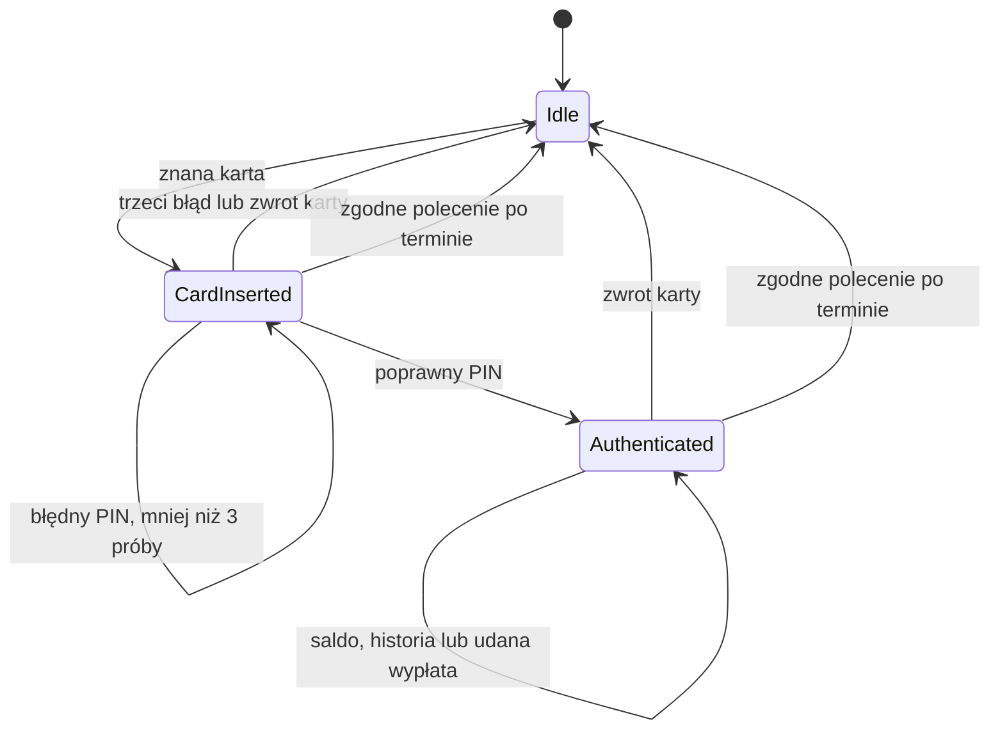

# Bankomat

Projekt edukacyjny w czystej Javie: sesje karty, weryfikacja PIN, wypłaty z ograniczonego zapasu banknotów oraz bezpieczne ponawianie żądań. Stan kont, gotówki i historii jest przechowywany w pamięci; operacje wykonuje jeden wątek.

## Rdzeń techniczny

[Atm](src/main/java/pl/jakubtworek/lld/atm/Atm.java) rozdziela walidację sesji, przygotowanie wypłaty i zatwierdzenie. Konta i klucze mają indeksy hash; historia jest dopisywana do listy i indeksowana według konta.

Planer minimalizuje liczbę banknotów przez DP z kolejką monotoniczną. Jednostką obliczeń jest 10 PLN, więc maksymalna kwota wymaga 200 jednostek. D oznacza liczbę nominałów, U kwotę w tych jednostkach, A liczbę kont, H liczbę wypłat.

| Operacja | Koszt |
| --- | --- |
| Plan wypłaty | O(D × U) czasu i pamięci decyzji |
| Zatwierdzenie / odnalezienie ponowienia | Średnio O(1) indeksów, dopisanie historii amortyzowane O(1), osobno koszt planera |
| Zmiana sesji | O(1) |
| Historia konta | O(H konta), bez skanowania całej historii |
| Snapshot | O(A + H) po zmianie, O(1) przy ponownym pobraniu |

Indeks kluczy i historia rosną wraz z liczbą udanych wypłat. Snapshoty są niemutowalne; nie są zapisem pozwalającym odtworzyć proces po restarcie.

### Kwota zapisana na koncie i fizyczne nominały

Saldo konta, wartość kasety i możliwość wydania to trzy różne warunki.
Dla wypłaty 60 PLN konto może mieć 1000 PLN, kaseta 100 PLN, a mimo tego
wypłata jest niemożliwa, jeśli w kasecie są wyłącznie dwa banknoty 50 PLN.

Planer otrzymuje kwotę po przeliczeniu na jednostki 10 PLN i ograniczone
liczności banknotów. Oddzielne warstwy DP zabraniają wielokrotnego zużycia
tego samego banknotu. Zapamiętane decyzje odtwarzają konkretny zestaw,
który kaseta może bezpiecznie odjąć.

Obciążenie konta jest najpierw kandydatem. Dopiero poprawne saldo, plan,
pomniejszona kaseta i paragon umożliwiają wspólne zatwierdzenie. Odmowa
wydania nie wymaga dopisywania kompensującej wpłaty do historii, ponieważ
obciążenie nie zostało jeszcze opublikowane.

## Mechanizmy Javy i model wątkowy

### Indeksy hash, ArrayList i kontrolowana mutowalność

Klucz ponowienia jest złożoną wartością konta i klucza operacji. HashMap
porównuje taką parę przez equals/hashCode; identyczny napis dla innego konta
oznacza inny wpis. Wartości klucza muszą pozostać stałe po dodaniu do mapy.
Kolejność iteracji mapy nie wyznacza kolejności wypłat.

Historia jest dopisywana do ArrayList i indeksowana według konta. Lista
przechowuje referencje w tablicy: dopisanie jest amortyzowane O(1), ale
powiększenie pojemności kopiuje dotychczasowe referencje. Nie klonuje
paragonów. Kopia listy w snapshotcie również ma koszt zależny od liczby wpisów.

Nominały mają reprezentację enum, a kaseta przechowuje liczności. Integer
w mapie oznacza opakowanie wartości; w DP liczności i stany są int[].
Saldo jest long w groszach, więc odejmowanie musi być dokładne i sprawdzone
przed publikacją. Niemutowalny Account pozwala przygotować obciążenie
bez modyfikowania obiektu widocznego w starym snapshotcie.

Session to sealed zestaw recordów. Wybór wariantu określa, jakie dane są
dostępne: Authenticated posiada konto, a Idle nie niesie starej karty.
Pin kopiuje tablicę wejściową; finalna referencja bez kopii nie chroniłaby
jej przed zmianą przez wywołującego.

### Sesja i retry nie są blokadą wątkową

SessionId rozpoznaje opóźnione polecenie, a OperationKey duplikat intencji.
Żaden z tych identyfikatorów nie zapewnia wzajemnego wykluczania wątków.
Dwa wywołania mogłyby równocześnie nie znaleźć klucza, obliczyć wypłatę
i zmienić kasetę. Kontrakt pozostaje jednowątkowy, także podczas sprawdzania
klucza i odczytu zegara. Oddzielne blokady mapy kont i kasety nie zapewniłyby
wspólnego zatwierdzenia wszystkich indeksów.

Model pamięci i synchronizację opisuje [JLS 17](https://docs.oracle.com/javase/specs/jls/se21/html/jls-17.html).

## Zakres, reguły i niezmienniki

- Klient wkłada znaną kartę, podaje PIN, sprawdza saldo lub wypłaca środki i zwraca kartę.
- Konfiguracja kart i kont jest stała. Kilka kart może wskazywać jedno konto.
- Jedna aktywna sesja. Każde jej polecenie wymaga SessionId; brak metod domenowych
  samodzielnie pobierających token aktualnie włożonej karty za klienta.
- Karta i konto mają umowne kody ASCII, np. C1 i A1, nie rzeczywiste numery bankowe.
- PIN ma cztery cyfry ASCII. Błędny format jest błędem danych przed wywołaniem enterPin;
  nie zużywa próby weryfikacji. Zły poprawnie zbudowany PIN zużywa jedną próbę.
- Po trzech błędnych próbach karta jest zwracana. Ponowne włożenie zaczyna świeżą sesję;
  nie ma globalnej blokady karty, zatrzymania fizycznej karty ani limitu między sesjami.
- Autoryzator zwraca boolean. Jego wyjątek propaguje bez zmiany stanu domeny.
- Salda i kwoty są w groszach PLN. Konto może mieć część ułamkową złotego, np. 100.01 PLN,
  ale wypłata wymaga dodatniej wielokrotności 10 PLN, najwyżej 2000 PLN.
- Limit dotyczy jednej wypłaty; brak limitu dziennego, opłat, kredytu i przewalutowania.
- Kaseta obsługuje 10, 20, 50, 100 i 200 PLN. Zero sztuk i pusta kaseta są poprawne.
- Plan minimalizuje liczbę banknotów w granicach dostępnych liczności. Nie dobiera reszty.
- Uwierzytelniona sesja pozwala na wiele wypłat. Jawny klucz i ta sama kwota zwracają
  pierwotne potwierdzenie; inna kwota daje IDEMPOTENCY_CONFLICT. Wariant bez klucza
  tworzy przy każdym wywołaniu nową intencję.
- Historia udostępniona przez history dotyczy konta bieżącej sesji; snapshot jest diagnostycznym
  widokiem całego ćwiczenia i zawiera również pozostałe konta.
- Clock jest wstrzykiwany, a TTL dodatni. Ważność kończy się przy `now >= expiresAt`.
  Nie ma wątków ani zadań okresowych; sprawdzamy ją podczas operacji.
- Brak prawdziwego banku i urządzenia wydającego gotówkę. „Wypłata” oznacza zmianę modelu
  i zwrócenie potwierdzenia z banknotami, bez I/O w domenie.

- R1: identyfikatory i kwoty są poprawne, karty wskazują istniejące konta.
- R2: tylko jedna karta naraz; autoryzacja poprzedza saldo i wypłatę.
- R3: błędny PIN zwiększa licznik, trzeci zwraca kartę; awaria autoryzatora nie zużywa próby.
- R4: wypłata nie przekracza salda ani ustalonego limitu i musi być reprezentowalna banknotami.
- R5: plan ma dokładną kwotę i nie zużywa więcej banknotów niż kaseta posiada.
- R6: sukces zmniejsza saldo i kasetę o tę samą kwotę, dodaje dokładnie jedno potwierdzenie.
- R7: odmowa kwoty, środków lub podziału nie zmienia stanu; wygaśnięcie sesji zmienia tylko sesję, bez częściowego obciążenia.
- R8: snapshoty i wnętrza ich kolekcji są niemutowalne; historia nie zawiera PIN-u.
- R9: zwrot karty kończy sesję, ale nie cofa zatwierdzonych wypłat.
- R10: niezgodne SessionId daje STALE_SESSION bez zmiany stanu i bez odczytu Clock.
- R11: zgodne, wygasłe ID kończy sesję i daje SESSION_EXPIRED; pieniądze i rejestr wyników pozostają bez zmian.
- R12: przyjęta wypłata i jej klucz wchodzą do jednego snapshotu; błędy nie rezerwują kluczy.
- R13: retry wymaga aktualnej uwierzytelnionej sesji, również po zmianie karty lub ponownym logowaniu.

## Reprezentacja stanu

Idle, CardInserted i Authenticated to zagnieżdżone recordy Session. Active jest
sealed podinterfejsem z ID, kartą i terminem ważności. Nie można
utworzyć sesji „uwierzytelniona, ale bez konta” ani CardInserted z trzema błędami.
Warianty sealed interface ograniczają zestaw możliwych reprezentacji sesji.

Pin kopiuje tablicę i maskuje toString, lecz adapter demo przechowuje wartości
PIN w pamięci i porównuje je wprost. To celowo prosta zależność testowa, bez
hashowania, sprzętowej weryfikacji czy gwarancji wymazania z pamięci. Konsola
przyjmuje tekst i nie ukrywa jego wpisywania. Snapshot oraz potwierdzenia
nie zawierają PIN-u. Korzystamy wyłącznie z fikcyjnych danych opisanych niżej.

## Kontrakty i przepływ

| Operacja | Kolejność warunków | Wynik i efekt |
| --- | --- | --- |
| insertCard | null, jeden odczyt Clock, brak niewygasłej sesji, znana karta, obliczenie terminu | Nowe SessionId, CardInserted i licznik zero; może atomowo zastąpić wygasłą sesję |
| enterPin | null, aktywna sesja, zgodne ID, termin, CardInserted, wynik autoryzatora | Authenticated z tym samym ID/terminem, zwiększony licznik lub Idle po trzecim błędzie |
| balance / history | aktywna sesja, zgodne ID, termin, Authenticated | Odczyt konta; wygasanie może zakończyć sesję |
| withdraw | null, aktywna sesja, zgodne ID, termin, Authenticated, kontrola klucza, poprawna kwota i limit, środki konta, gotówka, dokładny plan | Nowe konto, kaseta, jedno potwierdzenie i klucz albo pierwotny wynik bez publikacji |
| ejectCard | aktywna sesja, zgodne ID, termin | Zwrócony kod karty i Idle; przy wygaśnięciu Idle i SESSION_EXPIRED |
| snapshot | brak walidacji sesji | Niemutowalny widok diagnostyczny |

Brak sesji lub jej niewłaściwy wariant daje INVALID_SESSION_STATE. W aktywnej
sesji najpierw sprawdzamy ID (STALE_SESSION), potem termin (SESSION_EXPIRED),
a dopiero potem wymagany wariant i reguły operacji. Stare ID nie zmieni nawet
faktycznie wygasłej nowej sesji. Nieznana karta daje
UNKNOWN_CARD. Niepoprawna kwota → INVALID_AMOUNT, dopiero potem badamy limit
AMOUNT_LIMIT_EXCEEDED. Następnie INSUFFICIENT_FUNDS, INSUFFICIENT_CASH i
CANNOT_DISPENSE w kolejności z tabeli. Dla kilku naruszeń wygrywa wcześniejsze.
Na przykład 2000.01 PLN daje INVALID_AMOUNT, a 2010 PLN przekroczenie limitu.
Dotyczy to nowego klucza: zajęty klucz z inną kwotą daje wcześniej
IDEMPOTENCY_CONFLICT. Znane retry zwraca wynik przed sprawdzeniem dzisiejszego
salda, gotówki i limitu kwoty, ale zawsze po kontroli sesji i uwierzytelnienia.

Null jest błędem programisty (NullPointerException), wadliwa konfiguracja lub
wartość IllegalArgumentException. Awaria autoryzatora propaguje bez zużycia
próby. REJECTED i CARD_EJECTED są wynikami zmieniającymi stan sesji, więc nie
nazywamy każdej nieudanej autoryzacji odmową bez zmiany.

### Przejścia sesji

Włożenie kolejnej karty, wypłata przed autoryzacją i ponowne podanie PIN-u po
autoryzacji są odrzucane. Zakończenie sesji nie przywraca pieniędzy wypłaconych
w jej trakcie. Nie ma oddzielnej autoryzacji każdej kolejnej wypłaty.

### Scenariusz krok po kroku

1. C1 wskazuje A1 z saldem 1000 PLN. Kaseta ma łącznie 600 PLN, sesja Idle.
2. insertCard(C1) zwraca SessionId i tworzy CardInserted z tym ID, licznikiem zero i expiresAt.
3. enterPin z ID i 1234 pyta CardAuthenticator; sukces tworzy Authenticated(C1, A1), zachowując ID i termin.
4. withdraw z ID, kluczem i kwotą 6000 groszy sprawdza sesję, rejestr, kwotę i konto. Account.debit tworzy
   nieopublikowanego kandydata z saldem 940 PLN.
5. Planer wyznacza 50+10 PLN, kaseta buduje kopię pomniejszoną o te banknoty.
6. Powstaje potwierdzenie z UUID, kwotą, kontem, banknotami i saldem po wypłacie.
7. Zatwierdzamy konto 940 PLN, gotówkę 540 PLN, wpis historii i klucz. Snapshot na żądanie kopiuje spójny stan.
8. ejectCard z ID kończy sesję, ale zachowuje zmiany pieniędzy, potwierdzenie i klucz.

Przy dwóch banknotach 50 PLN wypłata 60 PLN daje CANNOT_DISPENSE, mimo że
kaseta ma 100 PLN. Kandydat konta nie trafia do stanu. Snapshot pozostaje tym
samym obiektem; saldo i historia nie zmieniają się. Konto, kaseta i historia
nie mają niezależnych mutowalnych setterów.

### Tożsamość sesji i kolejność kontroli czasu

Każde włożenie karty dostaje nowy SessionId, również dla tej samej karty.
enterPin, balance, history, withdraw i ejectCard wymagają jawnego ID.
Przy zgodnym ID jedna obserwacja Clock rozstrzyga ważność. Przy niezgodnym
odmawiamy przed odczytem zegara, więc opóźniony zwrot starej karty nie zamknie
nowej sesji i nie uruchomi jej wygasania.

Termin `expiresAt = czas_włożenia + TTL` jest stały. Poprawny lub błędny PIN,
saldo, wypłata i retry go nie odnawiają. Dokładnie przy now == expiresAt sesja
jest już nieważna: zgodne polecenie publikuje Idle i zgłasza SESSION_EXPIRED.
Nie zużywa przy tym banknotów, nie zmienia kont, historii ani rejestru kluczy.
Dotyczy to także próby ponowienia zatwierdzonej wypłaty.

Sprawdzamy ważność na wejściu do operacji, przed lokalnym synchronicznym
autoryzatorem; nie przerywamy w połowie rozpoczętej weryfikacji. To wyraźny
kontrakt momentu oceny, nie mechanizm przerywania zdalnego I/O. Zegar jest
zaufany; nie modelujemy jego cofania. Dodatni Duration jest wymagany przez
konstruktor, a przepełnienie Instant przy włożeniu karty nie publikuje zmiany.

Nie ma zadania w tle: snapshot i status mogą pokazać dawną sesję z minionym
expiresAt, dopóki nie nadejdzie operacja. Nie oznacza to, że dostanie zgodę na
wypłatę. Znana karta może jednym insert zastąpić już wygasłą sesję nowym ID.
Nieznana karta i błąd obliczenia nowego terminu pozostawiają dawny widok.

### Retry wypłaty i granice gwarancji

`withdraw(sessionId, operationKey, amount)` porównuje kwotę z wynikiem
zapamiętanym pod parą `(AccountId, OperationKey)`. Klucz po strip ma 1..64
znaków `[A-Za-z0-9._:-]` i rozróżnia wielkość liter. Nie zależy od bieżącej
karty ani SessionId. Dwie karty tego samego konta współdzielą rejestr, a inne
konto może użyć tego samego napisu niezależnie.

Identyczne retry zwraca ten sam obiekt WithdrawalReceipt bez nowego snapshotu,
obciążenia, planowania i historii. Jego balanceAfter jest historycznym saldem
po pierwotnej wypłacie; bieżące saldo odczytujemy oddzielnym balance.
Inna kwota daje IDEMPOTENCY_CONFLICT. Nieudane operacje nie zajmują klucza:
można poprawić kwotę i użyć go ponownie. Pamiętamy tylko przyjęte wyniki.

Najpierw kontrolujemy ID, termin i Authenticated. Nie ma dostępu do starego
potwierdzenia bez logowania. Po ponownej autoryzacji do tego samego konta nowa
sesja może ponowić dawny klucz. Po wygaśnięciu starego ID nie może tego zrobić.
Wariant `withdraw(sessionId, amount)` generuje świeży klucz i oznacza nową
intencję za każdym wywołaniem. Nie deduplikuje identycznych kwot.

Rejestr operations jest częścią tego samego kandydata co konto, kaseta i historia.
Przetrwa zwrot karty w tej instancji, lecz nie restart. Nie ma wygaszania kluczy,
trwałości ani ochrony przed wyścigiem wątków. Snapshot udostępnia niemutowalną
mapę wyników diagnostycznych, nadal nie jest API kontroli dostępu.

## Dobór banknotów

Prosty wariant zakładałby dostępność odpowiednich nominałów i dobierał największe
banknoty. Rozszerzenie wymaga skończonej liczności każdego nominału oraz dokładnej
kwoty. Dla 60 PLN i zasobu 50×1, 20×3, 10×0 zachłanny wybór 50 utknie na 10,
a poprawny plan to trzy banknoty 20 PLN. Błędnego greedy nie udostępniamy w API.

Adapter BoundedCashPlanner wywołuje wspólny BoundedChangePlanner; algorytm DP:

1. Dzieli kwotę i nominały przez 1000 groszy, czyli jednostkę 10 PLN. Limit
   daje najwyżej 200 jednostek i nie zależy od wielkości salda konta.
2. Zaczyna od osiągalnej kwoty zero z zerem banknotów; inne kwoty są nieosiągalne.
3. Dla każdego nominału tworzy **nową warstwę**; kolejka monotoniczna
   wybiera minimum z okna dozwolonych liczności, bez enumeracji wszystkich sztuk.
4. Zapisuje liczbę wybranych sztuk dla każdej kwoty i warstwy.
5. Jeśli docelowa kwota nie jest osiągalna, zwraca Optional.empty.
6. Inaczej odtwarza zestaw od ostatniej warstwy, odejmując użyte jednostki.

Przejścia obejmują wszystkie dozwolone liczności danego nominału, więc poprawny
plan nie zależy od zachłannego pierwszego wyboru. Osobne warstwy chronią przed
traktowaniem jednej sztuki jako nieograniczonego zasobu. Przy tej samej minimalnej
liczbie banknotów zostaje pierwszy wynik stałej kolejności iteracji; nie obiecujemy
dodatkowej optymalizacji liczności konkretnego nominału między wypłatami.

Zmiana dotyczy planera i jawnych liczności kasety. Session, CardAuthenticator
i znaczenie Account.debit pozostają niezależne od algorytmu rozdzielania kwoty.
Interfejs autoryzacji jest portem zależności; nie tworzymy interfejsu planera,
bo obecnie mamy jeden działający algorytm i nie potrzebujemy sztucznej wymienności.

## Uruchomienie

Java 21; z katalogu low-level-design/vending-machine:

~~~powershell
.\mvnw.cmd --batch-mode --no-transfer-progress clean verify
& "$env:JAVA_HOME/bin/java.exe" -cp target/vending-machine-1.0.0-SNAPSHOT.jar pl.jakubtworek.lld.atm.console.ConsoleMain
~~~

Opcjonalny argument ustala TTL w sekundach. Demo: karta C1 / PIN 1234 / saldo 1000 PLN oraz C2 / PIN 4321 / saldo 400 PLN; początkowa kasa ma 600 PLN. Przebieg: `insert C1`, `pin 1234`, `balance`, `withdraw-key k1 10000`, `history`. Konsola zapamiętuje ID sesji; można też wskazać je jawnie, np. `withdraw-for UUID k1 10000`. `help` podaje pełną składnię; kwoty wypłat są w groszach. q lub EOF kończy sesję.

## Testy i weryfikacja

[Testy](src/test/java/pl/jakubtworek/lld/atm) obejmują granicę TTL, stare ID, błędy PIN, ponowienia po zmianie salda i niezmienność stanu przy odmowie. CashPlannerTest porównuje 1280 przypadków z enumeracją. Testy generowane kontrolują zgodność salda, banknotów, paragonów i kluczy po sekwencjach operacji.

| Reguła | Test / plik | Granica dowodu |
| --- | --- | --- |
| R1: wartości i własność danych | [ValueObjectsTest](src/test/java/pl/jakubtworek/lld/atm/ValueObjectsTest.java) | Kopie PIN/kasety, kwoty, overflow Money, identyfikatory i lokalne stany |
| R2–R3: sesja i zależność | AtmTest: invalidSessionTransitionsAndUnknownCardsRejectWithoutChange, threeBadPinsEjectCardAndReinsertionStartsFreshSession, authFailureDoesNotConsumeAttemptOrPublishAnything | Zabronione przejścia, trzeci błąd i wyjątek weryfikacji |
| R4–R5: dokładny podział | [CashPlannerTest](src/test/java/pl/jakubtworek/lld/atm/CashPlannerTest.java) | 1280 konfiguracji, kontrprzykład greedy, limit kwoty i ogromne liczności |
| R6–R7: publikacja pieniędzy | AtmTest: loginWithdrawAndEjectPublishConsistentMoneyAndHistory, moneyAmountBalanceCashAndExactCompositionHaveSeparateRefusals | Ubytek obu zasobów, potwierdzenie i ten sam snapshot po odmowie |
| R8: snapshoty i zakres historii | AtmTest: configurationInputAndOldViewsCannotBeMutated, accountHistoryIsFilteredAndSharedCardsSeeSameAccount | Kopie kolekcji, wspólne konto dla kart i filtr historii |
| R2–R9: dłuższe historie | [GeneratedAtmTest](src/test/java/pl/jakubtworek/lld/atm/GeneratedAtmTest.java) | 4 ziarna × 250 komend, niezależne salda i zasoby, stare widoki |
| R10–R13: ID, czas i retry | [SessionRetryTest](src/test/java/pl/jakubtworek/lld/atm/SessionRetryTest.java) | Stare polecenia także po terminie nowej sesji, granica TTL, pusty zasób po udanej wypłacie, konflikty i reautoryzacja |
| R6–R13: połączone rundy | [GeneratedSessionRetryTest](src/test/java/pl/jakubtworek/lld/atm/GeneratedSessionRetryTest.java) | 4 ziarna × 100 rund, dwa konta, powtórne klucze, przeterminowane i stare tokeny |
| R9: adapter i zakończenie | [AtmConsoleTest](src/test/java/pl/jakubtworek/lld/atm/console/AtmConsoleTest.java) | Rozmowa, q/EOF, błędne dane i IOException po przyjętej wypłacie |

## Ograniczenia

Brak integracji bankowej, trwałości, sprzętu i współbieżności. SessionId identyfikuje kontekst operacji; sam nie zastępuje uwierzytelnienia. Klucze ponowień żyją tylko tak długo jak obiekt bankomatu.
