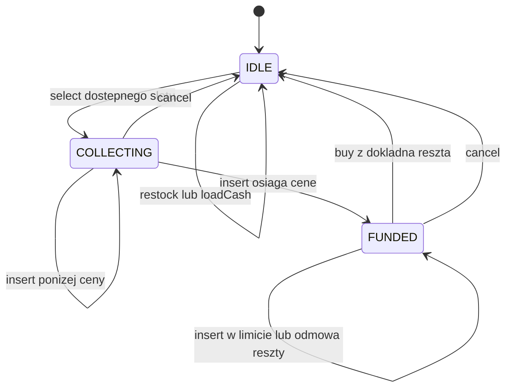

# Automat sprzedażowy

Edukacyjna implementacja automatu w czystej Javie. Obsługuje wybór produktu, depozyt monet, wydawanie reszty, zwrot depozytu i uzupełnianie zapasów. Operacje są jednowątkowe, stan pozostaje w pamięci.

## Rdzeń techniczny

[VendingMachine](src/main/java/pl/jakubtworek/lld/vendingmachine/VendingMachine.java) odpowiada za kolejność walidacji i zatwierdzenie sprzedaży. CoinBundle przechowuje liczbę monet każdego nominału, a sesja rozdziela depozyt od zasobów automatu.

[ExactChangePlanner](src/main/java/pl/jakubtworek/lld/vendingmachine/ExactChangePlanner.java) znajduje dowolną dokładną kombinację. [MinimumCoinChangePlanner](src/main/java/pl/jakubtworek/lld/vendingmachine/MinimumCoinChangePlanner.java) wywołuje planer DP z kolejką monotoniczną, aby zminimalizować liczbę wydawanych monet. Wybrany wynik jest sprawdzany przed zmianą stanu.

D oznacza liczbę nominałów, A kwotę reszty w groszach, S liczbę slotów.

| Operacja | Koszt |
| --- | --- |
| Obliczenie reszty | O(D × A); planer minimum przechowuje O(D × A) decyzji |
| Rozliczenie monet | O(D), bez rozwijania liczności do list pojedynczych monet |
| Przygotowanie nowego stanu zapasu | O(S + D), koszt kopiowania oddzielny od DP |
| Anulowanie | Zwrot depozytu według liczności nominałów |

Podstawowy niezmiennik to zachowanie gotówki: kasa i depozyt mogą zmienić łączną wartość tylko o przyjęte monety, wydaną resztę lub zwrot. Przychód rośnie wyłącznie o cenę udanej sprzedaży. Brak rozwiązania DP nie może powodować częściowego wydania.

### Wartość monet a możliwość wydania

Zasób o wartości co najmniej A nie musi pozwalać wydać A: pojedyncza moneta
50 gr nie daje reszty 30 gr. Również wybór największych monet może zawieść:
z monet 50,20,20,20 kwotę 60 da się wydać jako 20+20+20, lecz po pobraniu
50 pozostaje nieosiągalne 10.

Oddzielenie depozytu od kasy pozwala odrzucić zakup bez odwracania wcześniejszej
wpłaty. Dopiero udany zakup rozlicza oba zasoby. Gdy reszta wykorzystuje
wrzucone monety, jest to część zatwierdzanej sprzedaży; anulowanie nadal
zwraca oryginalny depozyt zamiast szukać równowartości w całej kasecie.

Własny planer nie może spowodować wydania niedostępnych monet ani zmienić
wartości reszty. Automat weryfikuje taki wynik, ale nie rozwiązuje zadania
drugi raz w celu potwierdzenia minimum. Własność optymalności sprawdzają
testy planera wobec niezależnej enumeracji.

## Mechanizmy Javy i model wątkowy

### EnumMap, record i koszt kopiowania stanu

CoinBundle grupuje liczbę monet według enum Coin. EnumMap nadaje się do
takiego zamkniętego zbioru kluczy; nie tworzymy osobnego elementu listy dla
każdej monety. Wartości Integer nadal oznaczają boxing liczności — tablicowa
reprezentacja EnumMap nie zamienia ich automatycznie na int. Sam DP operuje
już na tablicach prymitywnych.

Zmiana stanu tworzy kandydacką HashMap zapasu i nowe wartości. Map.copyOf
w snapshotcie zabezpiecza strukturę mapy, natomiast StockItem i pozostałe
typy chronią jej zawartość. Kopia mapy jest płytka: bezpieczeństwo wynika
z niemutowalności elementów, a nie z rekurencyjnego klonowania.

Sealed PurchaseSession ogranicza dozwolone warianty, a record Selected
łączy slot i depozyt w jedną wartość. Nie występuje kombinacja pustego slotu
z osobno ustawioną flagą „wybrano produkt”. Record zapewnia finalne pola
i wygenerowaną równość, lecz sam nie zamroziłby przekazanej mutowalnej mapy.

Dlatego zakup ponosi nie tylko koszt DP. new HashMap<>(state.stock())
kopiuje wpisy zapasu; przy dużym S ta część pozostaje liniowa. Kolekcja
zapobiega zmianie starego widoku, ale nie czyni tworzenia nowego darmowym.

### Publikacja stanu a współbieżność

state = candidate jest lokalnym punktem zatwierdzenia po poprawnych
obliczeniach. Nie jest operacją compare-and-set. Dwa równoległe zakupy
mogłyby przygotować kandydatów z tej samej wersji i nadpisać wzajemnie wynik.
Obiekt nie używa monitora ani volatile i jest obsługiwany przez jeden wątek.
Sama zmiana pola na volatile zapewniałaby widoczność, lecz nadal nie
rozstrzygałaby konkurujących zapisów.

Kontrakt kopiowania: [Map.copyOf](https://docs.oracle.com/en/java/javase/21/docs/api/java.base/java/util/Map.html#copyOf(java.util.Map)).

## Zakres, reguły i niezmienniki

| ID | Reguła / kryterium akceptacji |
| --- | --- |
| R1 | Katalog ma co najmniej jeden unikalny kod slotu, dodatnie ceny nie większe niż 100 PLN i nieujemne ilości |
| R2 | Insert, buy i cancel wymagają aktywnego wyboru; nowy wybór i serwis wymagają IDLE |
| R3 | Depozyt zachowuje rzeczywiste nominały; sam insert nie zmienia kasety ani przychodu |
| R4 | Za mała wpłata powoduje INSUFFICIENT_FUNDS i nie zabiera produktu |
| R5 | Reszta ma dokładną wartość, a liczba wydanych monet nie przekracza zasobu kaseta + depozyt |
| R6 | Sukces zmniejsza zapas o jeden, zwiększa przychód o cenę i wraca do IDLE z pustym depozytem |
| R7 | Brak reszty pozostawia ten sam snapshot, cancel zwraca oryginalny depozyt także po odmowie |
| R8 | Odczyt i stare snapshoty nie pozwalają zmieniać stanu; przepełnienia nie publikują częściowej zmiany |
| R9 | Restock i loadCash są dozwolone tylko bez aktywnej sesji; wpłata serwisowa nie jest przychodem |
| R10 | Przyjęty kredyt nie przekracza 10000 groszy; nadmiarowa moneta jest odrzucana bez zmiany depozytu |
| R11 | Obie polityki znajdują dokładną resztę, jeżeli istnieje; MinimumCoinChangePlanner dodatkowo minimalizuje liczbę sztuk |

Obsługiwane monety w groszach: **1, 2, 5, 10, 20, 50, 100, 200 i 500**.
Cena może być dowolną dodatnią liczbą groszy do limitu. Moneta 30 gr nie
istnieje w tym zbiorze, mimo że Money(30) jest poprawną kwotą. Liczby sztuk
używają nieujemnego int; przychód i wartości pieniężne long z dokładną arytmetyką.
Kody slotów normalizujemy przez strip i Locale.ROOT do 1..8 liter A-Z lub cyfr.

Poza zakresem są banknoty, karty, płatności zewnętrzne, zmiana ceny w sesji,
uwierzytelnianie serwisu, wiele równoległych klientów, trwałość po restarcie,
czas i timeouty, fiskalizacja oraz sterowanie sprzętem. Nie wprowadzamy Clock,
ponieważ żadna reguła tego zadania nie zależy od czasu.

## Reprezentacja stanu i stany

Idle i Selected są zagnieżdżonymi recordami pakietowego PurchaseSession.
Sealed interface ogranicza warianty sesji. Idle nie ma pola z monetami;
Selected zawsze ma kod i depozyt. Faza odczytowa jest wyprowadzana:

- IDLE — nie wybrano produktu;
- COLLECTING — wybrano produkt, lecz kredyt jest mniejszy od ceny, także zero;
- FUNDED — kredyt wystarcza, ale dokładna reszta może być nadal niemożliwa.



Odmowa poza wskazaną pętlą również nie zmienia stanu. Nie ma osobnej flagi
paid ani ręcznie ustawianej fazy. Nie ma też obserwowalnego DISPENSING,
ponieważ model nie wykonuje asynchronicznej operacji sprzętowej.

## Kontrakty i kolejność walidacji

| Polecenie | Kolejność sprawdzania | Sukces |
| --- | --- | --- |
| select(slot) | null, PURCHASE_IN_PROGRESS, UNKNOWN_SLOT, OUT_OF_STOCK | Nowa sesja z pustym depozytem |
| insert(coin) | null, NO_ACTIVE_PURCHASE, CREDIT_LIMIT_EXCEEDED | Powiększa wyłącznie depozyt |
| buy() | NO_ACTIVE_PURCHASE, INSUFFICIENT_FUNDS, przepełnienie kaseta+depozyt, planowanie lub NO_EXACT_CHANGE, walidacja planu i kandydata | Produkt, reszta i nowy kompletny stan |
| cancel() | NO_ACTIVE_PURCHASE | Zwraca depozyt, resetuje sesję |
| restock(slot,n) | null, n<=0 jako IllegalArgumentException, PURCHASE_IN_PROGRESS, UNKNOWN_SLOT, przepełnienie | Nowy zapas |
| loadCash(coins) | null, PURCHASE_IN_PROGRESS, przepełnienie | Nowy zasób kasety, przychód bez zmian |

Argument null jest błędem użycia API (`NullPointerException`). Niepoprawne
wartości i konfiguracja dają `IllegalArgumentException`, przepełnienie
`ArithmeticException`. Odmowy reguł mają `VendingException.reason()`;
komunikat po polsku służy człowiekowi. Przy naruszeniu kilku warunków wygrywa
pierwszy z tabeli. Pusta wpłata serwisowa jest dozwoloną operacją bez zmiany zasobów.

Najważniejszy przepływ buy:

1. Ustal wybrany slot i sprawdź kredyt względem ceny.
2. Oblicz kwotę reszty i kandydacki zasób kaseta + depozyt.
3. Znajdź dokładny plan. Przy braku rozwiązania zgłoś odmowę przed zmianą magazynu.
4. Utwórz wynik, nowy zapas, kasetę po reszcie, przychód i pustą sesję.
5. Opublikuj kompletny snapshot jednym przypisaniem.

Konstruktor `(items, initialCash)` wybiera domyślny algorytm dokładnej reszty.
Wariant `(items, initialCash, ChangePolicy)` pozwala jawnie wskazać planer. Polityka
jest ustalana na cały cykl życia automatu, bez podmiany w sesji. Zwróconą kwotę
sprawdza SaleReceipt, a dostępność konkretnych monet CoinBundle.minus.
Wyjątek lub wadliwy wynik polityki nie publikuje zmiany. Automat nie rozwiązuje
problemu ponownie, by dowieść kompletności lub minimum — to kontrakt implementacji,
sprawdzany przez jej testy. Polityki mają działać bez efektów ubocznych i I/O.

Zwrócone elementy i kolekcje są niemutowalne. `Map.copyOf` chroni mapę,
a recordy i CoinBundle jej wnętrze. Samo `final` przy Map nie wystarczyłoby.
Snapshot porównywany przez `==` oznacza tę samą publikację, nie równość strukturalną.
lastSale przechowuje tylko ostatni udany zakup i pozostaje po anulowaniu nowej
sesji. Nie jest historią wszystkich zakupów; klient może zachować własne wyniki.

## Zachowanie pieniędzy i przykład zakupu

Wartości w poniższych równaniach są w groszach:

```text
udany zakup:
  kaseta_po + reszta = kaseta_przed + depozyt_przed
  depozyt_przed - reszta = cena
  kaseta_po - kaseta_przed = cena
  przychod_po - przychod_przed = cena
  zapas_po = zapas_przed - 1, depozyt_po = 0

anulowanie:
  zwrot = depozyt_przed (takze identyczne nominaly)
  kaseta_po = kaseta_przed, przychod_po = przychod_przed

przez cala historie:
  wartosc_kasety = kasa_poczatkowa + uzupelnienia_serwisowe + przychod
```

Zapas automatu zmniejszamy dopiero po znalezieniu reszty. Wybór slotu nie
jest rezerwacją dla wielu klientów: model obsługuje jedną sesję i nie pozwala
w tym czasie serwisować magazynu. Nie potrzebujemy drugiego licznika rezerwacji.

| Scenariusz przy pustej kasecie, produkt A1 za 2.50 PLN | Stan i wynik |
| --- | --- |
| select A1 | COLLECTING, kredyt zero, zapas bez zmian |
| insert 500 | FUNDED, depozyt PLN5, kaseta nadal pusta |
| buy | NO_EXACT_CHANGE: nie da się wypłacić 250 gr z samej monety 500 gr |
| cancel | Zwrot dokładnie PLN5, IDLE, zapas i przychód bez zmian |
| select A1, insert 200, insert 50, buy | Zakup dokładny bez reszty: zapas -1, kaseta 250 gr, przychód 250 gr |

Po odmowie można również dopłacić. To nie gwarantuje sukcesu dla dowolnego
nominału. Dla ceny 100 gr i depozytu PLN2 brak reszty 100 gr. Dopłata PLN1
pozwala już oddać PLN2, zostawiając 100 gr ceny. Testy pokazują zarówno taką
udaną dopłatę, jak i kolejną odmowę z bezpiecznym anulowaniem.

## Algorytmy dokładnej reszty

### Dowolne dokładne rozwiązanie — ExactChangePlanner

Wariant „weź największą monetę” nie jest poprawny dla ograniczonej kasety.
Dla reszty 60 gr przy monetach 50,20,20,20 wybierze 50 i utknie na 10,
chociaż istnieje poprawne rozwiązanie 20+20+20. Dla demo produkt A2 kosztuje
440 gr, klient wpłaca PLN5, a zasób `greedy-trap` zawiera właśnie te monety.

Algorytm przetwarza nominały od największego. Dla każdej kwoty 0..A pamięta:

- reachable — czy kwotę da się uzyskać po poprzednich nominałach;
- remaining — ile sztuk bieżącego nominału pozostało w osiągalnej ścieżce;
- used — ile sztuk bieżącego nominału tworzy daną kwotę, do późniejszej rekonstrukcji.

Jeśli kwota była osiągalna wcześniej, bieżący nominał pozostaje nietknięty.
Inaczej można dołożyć monetę do kwoty mniejszej o jej nominał, ale tylko gdy
remaining jest dodatnie. To zapobiega traktowaniu jednej monety jak zasobu
nieograniczonego. Po ostatnim nominale nieosiągalne A oznacza brak reszty.
Dla osiągalnego A cofamy się po used, odejmując wybrane monety i kwotę.

Niezmiennik warstwy: po przetworzeniu nominału reachable opisuje dokładnie
kwoty możliwe z dotychczasowych rodzajów, z zachowaniem limitów sztuk. Kwota
zero jest osiągalna pustym zestawem. Dwie ścieżki przejścia powyżej obejmują
użycie zera lub dodatniej liczby bieżących monet. Rekonstrukcja wybiera jedną
z dopuszczalnych ścieżek, nie obiecuje najmniejszej liczby monet.

Dla D=9 nominałów i kwoty A czas i pamięć wynoszą O(D*A). Liczba monet w
kasecie nie jest długością dodatkowej pętli. Limit A=10000 ogranicza rozmiar
tablic, także dla samodzielnego wywołania planera. Automat nie przyjmie większej
wpłaty. To świadoma granica laboratorium, nie reguła waluty PLN.

Obie polityki przed alokacją tablic sprawdzają `amount > available.total()`.
Wtedy brak rozwiązania wynika już z wartości zasobu. To warunek konieczny,
nie wystarczający: moneta 50 gr nie pozwala wydać 30 gr. Najpierw nadal
obowiązuje walidacja null i limitu kwoty; szybka odmowa nie ukrywa błędnego
argumentu. Zero zwraca pusty plan. Nie wykonano benchmarku: stwierdzamy
pominięcie tablic i pętli DP, bez deklaracji zmierzonego przyspieszenia.

### Minimum liczby monet — MinimumCoinChangePlanner

Wariant minimum wybiera spośród dokładnych planów ten z najmniejszą liczbą sztuk. Dla 60 gr i zasobu 50,20,20,20,10 domyślny planer
wyznacza plan 20+20+20. Druga polityka wybiera 50+10.
Oba spełniają zachowanie wartości; tylko druga minimalizuje liczbę monet.

1. Dla każdego nominału podziel kwoty według reszty modulo jego wartości.
2. Przejdź rosnąco po indeksie t; w kolejce zachowaj tylko poprzedniki z okna t−limit..t.
3. Usuń z końca zdominowane koszty best[r+j*w]−j.
4. Minimum z początku wyznacza optimum bieżącej kwoty.
5. Zachowaj liczbę użytych monet w warstwie i zrekonstruuj plan wstecz.

Niezmiennik: kolejka zawiera osiągalnych, niewygasłych poprzedników w porządku
niepogarszającego się kosztu. Usunięty zdominowany poprzednik nie może dać
lepszego wyniku teraz ani w przyszłym szerszym t. Warstwy oddzielają nominały.
Czas obu planerów wynosi O(D*A), pamięć rekonstrukcji O(D*A).
Minimum monet nie jest gwarancją najlepszego zasobu dla przyszłych klientów.

## Uruchomienie

Java 21; z katalogu low-level-design/vending-machine:

~~~powershell
.\mvnw.cmd --batch-mode --no-transfer-progress clean verify
& "$env:JAVA_HOME/bin/java.exe" -jar target/vending-machine-1.0.0-SNAPSHOT.jar no-change min-coins
~~~

Argumenty: `[normal|no-change|greedy-trap] [any|min-coins]`, domyślnie normal i any. Polecenia obejmują `select A1`, `insert 500`, `buy`, `cancel`, `status` oraz serwisowe restock i load; `help` podaje składnię, `q` kończy program.

## Testy i weryfikacja

[Testy](src/test/java/pl/jakubtworek/lld/vendingmachine) sprawdzają zachowanie zapasu i wartości monet, błędne plany, limity kredytu, przepełnienia, anulowanie i sekwencje poleceń. ExactChangePlannerTest porównuje 81 małych zapasów dla kwot 0–40 z enumeracją; GeneratedCommandsTest kontroluje stan po historii zakupów.

| Reguła | Plik / test | Granica dowodu |
| --- | --- | --- |
| R1, R3: poprawne wartości i własność monet | [CoinBundleTest](src/test/java/pl/jakubtworek/lld/vendingmachine/CoinBundleTest.java) | Dokładne nominały, kopie map, walidacja i przepełnienie |
| R5: zachłanność nie wystarcza | [ExactChangePlannerTest](src/test/java/pl/jakubtworek/lld/vendingmachine/ExactChangePlannerTest.java): findsSolutionThatGreedyLargestFirstMisses | Jeden konkretny kontrprzykład |
| R5: ograniczony zasób i rekonstrukcja | ten sam plik: allSmallInventoriesAndAmountsAgreeWithIndependentEnumeration | Wyczerpująco tylko 81 małych kaset i kwoty 0..40 |
| R5, R11: wspólny kontrakt i minimum | [ChangePolicyTest](src/test/java/pl/jakubtworek/lld/vendingmachine/ChangePolicyTest.java): everySubsetOfAllNineDenominationsAgreesWithIndependentMinimum | 512 kaset po 0/1 sztuce wszystkich dziewięciu nominałów, 35 wybranych kwot na kasetę i politykę |
| R11: powtarzające się monety i monotoniczność | ten sam plik: repeatedCoinsAndAddingResourcesPreserveFeasibility | 160 kaset po 0..2 sztuki; dodanie monet zachowuje wykonalność i nie pogarsza minimum |
| R11: wymiana polityki w zakupie | VendingMachineTest: strategiesDifferInCoinCountButPreserveTheSameSaleInvariants | Dwie polityki, jednakowe cena, depozyt i kaseta; porównanie wyników 3 i 2 monety |
| R2–R6: pełny zakup | [VendingMachineTest](src/test/java/pl/jakubtworek/lld/vendingmachine/VendingMachineTest.java): exactPaymentCommitsProductMoneyAndReceiptTogether | Logiczna publikacja bez I/O |
| R3–R7: reszta z wpłaty i zwrot po odmowie | ten sam plik: insertedCoinsMayContributeToChangeOnlyDuringSuccessfulCommit, unavailableChangePreservesEverythingAndCancellationReturnsOriginalCoin | Kaseta i depozyt pozostają oddzielne do sukcesu |
| R4–R7: dopłata | ten sam plik: additionalMatchingCoinCanResolveEarlierChangeFailure, additionalCoinsAfterChangeFailureStayRefundableEvenIfChangeStillImpossible | Dopłata może pomóc, ale nie musi |
| R2, R9: odrzucane polecenia i serwis | ten sam plik: illegalCommandsDoNotChangePhaseOrResources, serviceAddsStockAndCashButNeverSalesRevenue | Jeden klient i serwis w IDLE |
| R8–R10: limity, kopie i przepełnienie | ten sam plik: maximumCreditIsAcceptedAndExcessCoinIsNotSwallowed, serviceOverflowDoesNotPublishPartialState, immutableSourceCollectionsAndIndependentMachinesProtectOwnership | Żadnych częściowych zmian |
| R7–R8: awaria zakupu i kontraktu polityki | ten sam plik: purchaseOverflowLeavesOriginalDepositRefundable, invalidOrFailingPolicyCannotPublishPartialPurchase | Zachowany snapshot i dokładny zwrot; po przepełnieniu także kolejny udany zakup |
| Wszystkie przepływy w próbce | [GeneratedCommandsTest](src/test/java/pl/jakubtworek/lld/vendingmachine/GeneratedCommandsTest.java) | 2400 poleceń dla dwóch polityk, bez dowodu dla każdej możliwej historii |
| Adapter, q/EOF i awaria wejścia | [VendingConsoleTest](src/test/java/pl/jakubtworek/lld/vendingmachine/console/VendingConsoleTest.java) | Strumienie w pamięci, bez sterowania sprzętem |

## Ograniczenia

Brak płatności elektronicznych, fizycznego wydawania monet, trwałości i synchronizacji. Wartości w konsoli podaje się w groszach.
