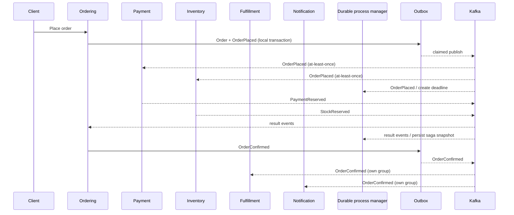

# Event Flow

Payment, Inventory i process manager mają różne grupy dla `OrderPlaced`.
Ordering i process manager mają różne grupy dla eventów wynikowych. Brak globalnej
kolejności między topicami jest częścią modelu: saga potrafi utworzyć snapshot po
pierwszym zaobserwowanym fakcie i później przyjąć spóźnione `OrderPlaced`.
