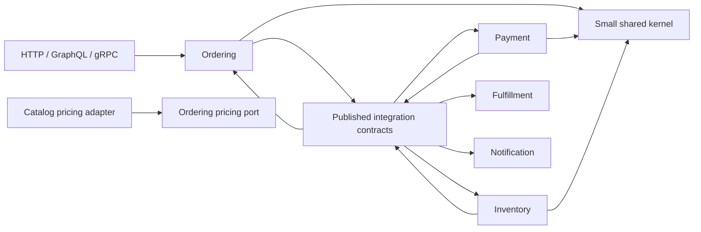

# Module Dependencies

Diagram pokazuje docelowe granice kontraktów. Pakiety domenowe nie importują modelu
domenowego innego kontekstu; adapter może implementować port należący do konsumenta.
Wewnątrz jednego artefaktu handlery aplikacyjne nadal przyjmują typ zdarzenia
producenta, po czym `OutboxEventMapper` stabilizuje jego zewnętrzny payload. Przed
wydzieleniem mikroserwisu ten parametr należy zastąpić DTO z `integration.contracts`.
To jawny extraction seam, nie współdzielenie tabel ani agregatów.
