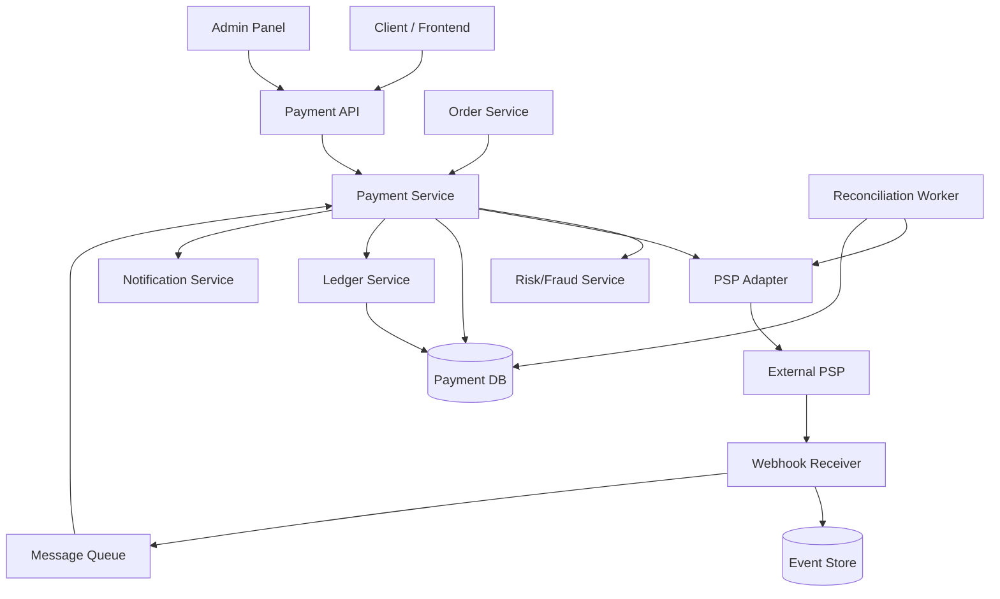
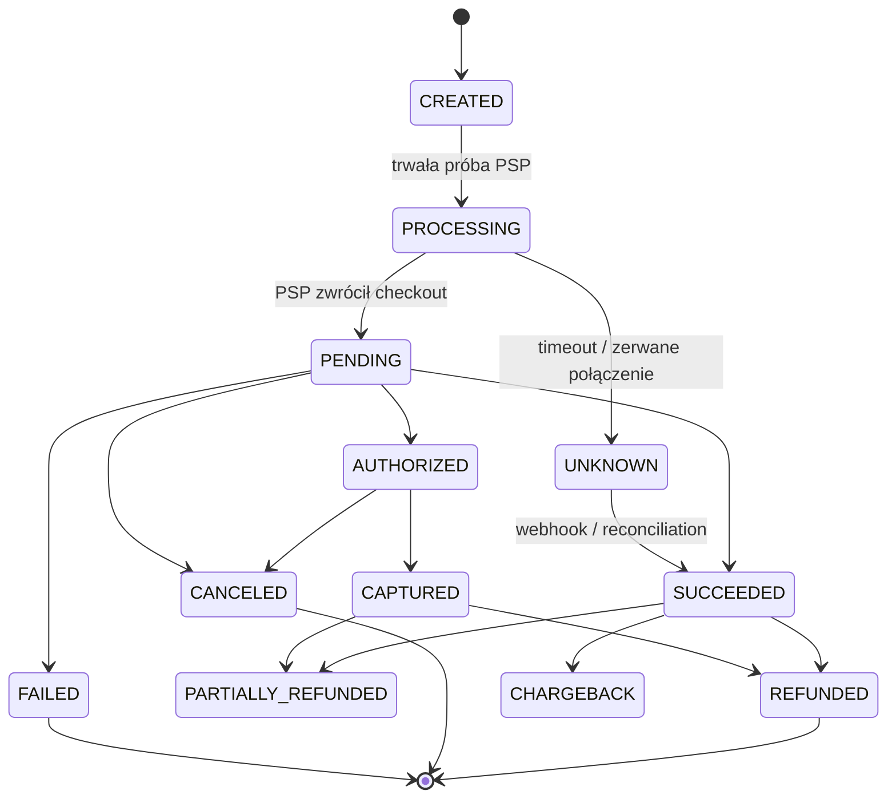
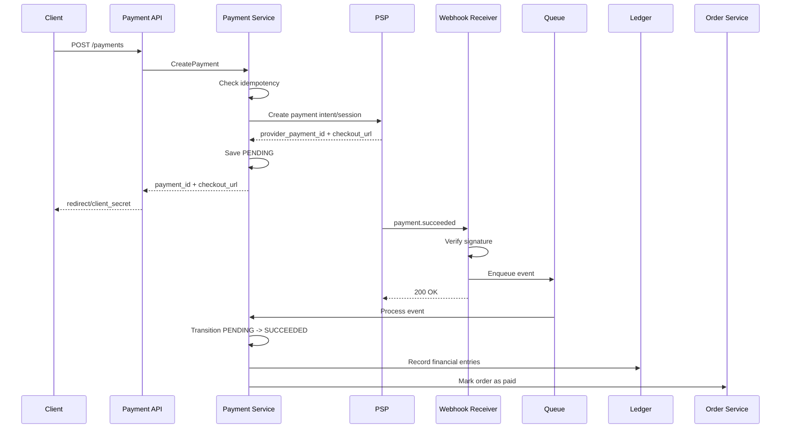
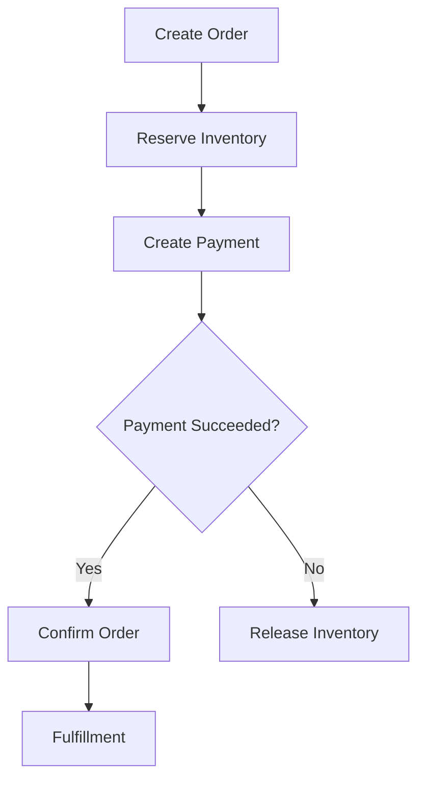
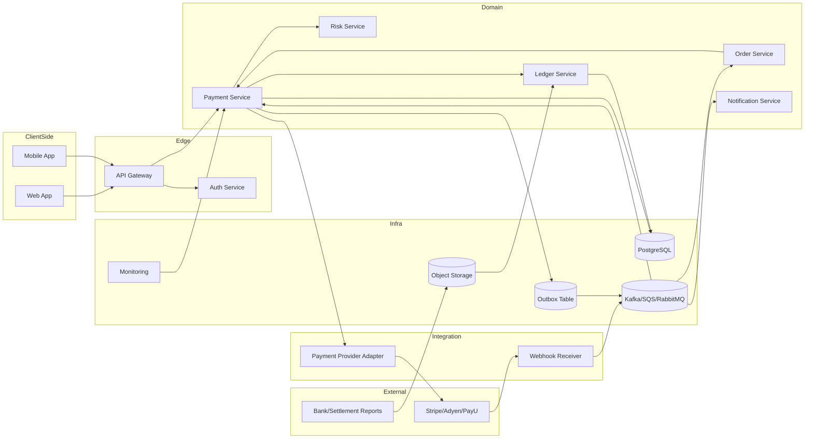

# Payment System — System Design

<!-- reading-guide:start -->
## Ścieżki czytania

| Cel czytania | Punkt wejścia |
| --- | --- |
| Teoria i model problemu | [Fundamenty teoretyczne](#fundamenty-teoretyczne) |
| Implementacja i jej dowody | [Zacznij tutaj](#zacznij-tutaj) |
| Uruchomienie i eksperymenty | [Fundamenty teoretyczne](#fundamenty-teoretyczne) |
| Ograniczenia i scenariusze awarii | [31. Błędy i edge cases](#31-błędy-i-edge-cases) |

Wspólne mechanizmy i ich testy znajdziesz w [indeksie pojęć backend-engineering](../../backend-engineering/README.md#globalny-indeks-pojęć). Tutaj śledź ich konsekwencje dla opisywanego systemu.
Diagramy docelowe i warianty rozwoju czytaj razem z mapą implementacji; sam opis architektury nie oznacza, że wszystkie jej komponenty są uruchamiane w laboratorium.
<!-- reading-guide:end -->

## Zacznij tutaj

| Pytanie | Odpowiedź |
| --- | --- |
| Najważniejszy niezmiennik | Każdy ruch pieniędzy ma zbilansowane wpisy ledgerowe, a retry komendy nie może ponownie obciążyć klienta. |
| Krytyczny przepływ | Idempotentne create → risk → routing PSP → autoryzacja/capture → ledger i outbox → settlement/refund/chargeback. |
| Rekomendowany test | `mvnw.cmd clean verify`; z Dockerem: `mvnw.cmd -Pinfrastructure-tests verify`. |
| Świadome ograniczenia | PSP, broker i bank payoutowy są deterministycznymi granicami symulacyjnymi; Basic Auth demonstruje RBAC, a `MerchantAccessPolicy` izolację tenantów, ale produkcja nadal wymaga OIDC/MFA; przykład nie spełnia samodzielnie PCI DSS ani wymagań księgowości prawnej. |

Kompleksowy projekt architektury systemu płatności dla aplikacji typu e-commerce, marketplace albo SaaS.

System modeluje wspólny lifecycle płatności kartą, BLIK/przelewem oraz portfelem cyfrowym. Działający kod używa deterministycznego adaptera PSP; nazwy Stripe, Adyen, PayU, Przelewy24, Tpay czy PayPal opisują możliwe integracje, a nie zaimplementowane SDK.

Najważniejsza zasada projektowa:

> Payment System nie powinien być traktowany jak zwykły CRUD. To system finansowy, który musi być idempotentny, audytowalny, odporny na awarie i zgodny księgowo.

## Fundamenty teoretyczne

### Uczestnicy ekosystemu płatniczego

Słowo „płatność” ukrywa kilka niezależnych systemów i odpowiedzialności. Dla
płatności kartowej typowy przepływ obejmuje:

| Uczestnik | Odpowiedzialność | Czego nie należy zakładać |
| --- | --- | --- |
| klient / cardholder | inicjuje zakup i uwierzytelnia płatność | zamknięcie przeglądarki nie oznacza anulowania płatności |
| merchant | sprzedaje produkt i definiuje kwotę zamówienia | status zamówienia nie jest statusem przepływu pieniędzy |
| Payment System | orkiestruje operację, przechowuje stan i ledger | nie jest właścicielem infrastruktury bankowej ani danych karty |
| PSP / payment gateway | udostępnia jednolite API, tokenizację i routing | odpowiedź synchroniczna nie zawsze jest wynikiem ostatecznym |
| acquirer | rozlicza płatność po stronie merchanta | udana autoryzacja nie oznacza jeszcze settlementu |
| scheme, np. Visa/Mastercard | łączy acquirera z issuerem i definiuje reguły | nie jest ledgerem aplikacji |
| issuer | bank lub instytucja wydająca instrument klientowi | może później rozpocząć chargeback |

W BLIK-u, przelewie natychmiastowym lub portfelu cyfrowym nazwy i dokładne role
są inne, lecz granica pozostaje podobna: lokalny system inicjuje operację w
zewnętrznej sieci, a wynik może nadejść później innym kanałem.

### Lifecycle pieniądza

Warto rozdzielać etapy, które w interfejsie użytkownika wyglądają jak jedno
„Zapłać”:

1. **Payment intent** zapisuje zamiar pobrania konkretnej kwoty dla zamówienia.
2. **Authorization** pyta issuera, czy instrument jest ważny i czy można
   zarezerwować środki. Powstaje hold, ale merchant jeszcze ich nie otrzymał.
3. **Capture** potwierdza, jaka część autoryzowanej kwoty ma zostać pobrana.
   Capture może być natychmiastowy, opóźniony albo częściowy.
4. **Clearing** wymienia dane transakcji i wylicza należności, opłaty oraz
   korekty pomiędzy uczestnikami sieci.
5. **Settlement** oznacza faktyczny przepływ środków między instytucjami. Może
   nastąpić długo po odpowiedzi `SUCCEEDED` widocznej dla klienta.
6. **Payout** wypłaca dostępne saldo platformy merchantowi. Nie jest tym samym
   co settlement płatności klienta.
7. **Refund** jest nową operacją finansową odwracającą całość lub część
   wcześniej pobranej kwoty; nie powinien usuwać historii capture.
8. **Chargeback** jest sporem zainicjowanym w sieci płatniczej. Nie jest zwykłym
   refundem i może pojawić się wiele tygodni później.

```text
intent -> authorization -> capture -> clearing -> settlement -> payout
                              |                         |
                              +---- refund ------------+
                              +---- chargeback ---------+
```

Każdy z tych etapów ma inny SLA, inne źródło potwierdzenia i inne okno awarii.
Dlatego jedna kolumna `status` nie zastępuje historii prób, ledgeru ani raportu
settlementowego.

### Trzy równoległe obrazy tej samej płatności

System utrzymuje co najmniej trzy różne perspektywy:

| Perspektywa | Odpowiada na pytanie | Przykład |
| --- | --- | --- |
| maszyna stanów `Payment` | co wolno teraz zrobić z płatnością? | czy można wykonać capture albo refund |
| `PaymentAttempt`/`ProviderOperation` i stan PSP | co stało się podczas konkretnego wywołania zewnętrznego? | timeout refundu pozostawił rezultat `UNKNOWN` |
| immutable ledger | jaki ruch wartości ekonomicznej już zaksięgowano? | należność klienta, saldo pending, fee platformy |

Te perspektywy nie zawsze zmieniają się jednocześnie. Payment może być
`SUCCEEDED`, mimo że payout jeszcze nie nastąpił. Próba PSP może być `UNKNOWN`,
mimo że środki zostały już pobrane. Ledger może zawierać kompensujący refund,
ale nie powinien usuwać pierwotnego capture.

Źródło prawdy zależy więc od pytania:

- lokalna baza jest źródłem prawdy dla dozwolonych operacji aplikacji;
- ledger jest źródłem prawdy dla lokalnie rozpoznanych ruchów finansowych;
- PSP i raport settlementowy są zewnętrznym dowodem wykonania operacji;
- reconciliation wykrywa i wyjaśnia różnice między tymi obrazami.

### Niezmienniki finansowe

Niezmiennik to własność, która musi pozostać prawdziwa niezależnie od retry,
timeoutu, kolejności webhooków i restartu procesu. Najważniejsze niezmienniki
tego laboratorium to:

```text
dla każdej transakcji i waluty: suma debetów = suma kredytów
captured_amount <= authorized_amount
refunded_amount <= captured_amount
jedna komenda biznesowa + jeden idempotency key <= jeden efekt zewnętrzny
jeden provider_event_id <= jeden lokalny efekt finansowy
stan terminalny nie może zostać cofnięty przez starsze zdarzenie
payout <= dostępne i jeszcze niewypłacone saldo merchanta
```

Same testy happy path nie dowodzą tych własności. Dlatego testy projektu celują
w kontrprzykłady: dwie konkurencyjne komendy, duplikat webhooka, partial
capture, timeout bez znanego wyniku i rozbieżność w reconciliation.

### Dlaczego „exactly once” nie jest właściwą obietnicą

Baza aplikacji i zewnętrzny PSP nie uczestniczą w jednej transakcji ACID. Po
wysłaniu requestu proces może utracić odpowiedź, mimo że PSP wykonał operację.
Analogicznie outbox może opublikować event, po czym proces może umrzeć przed
zapisaniem `published_at`.

Nie da się wtedy niezawodnie rozróżnić „nie wykonano” od „wykonano, ale nie
znamy odpowiedzi” wyłącznie na podstawie timeoutu. Praktyczna gwarancja brzmi:

> transport może dostarczać co najmniej raz, lecz idempotentny odbiorca,
> unikalne klucze i reconciliation mają zapewnić co najwyżej jeden efekt
> biznesowy.

Status `UNKNOWN` jest celowym elementem modelu, a nie błędem do natychmiastowego
zamiany na `FAILED`. Automatyczny retry operacji finansowej po niejednoznacznym
timeoutcie może wykonać drugi capture lub refund. Najpierw należy zapytać PSP
tym samym kluczem idempotencji albo rozstrzygnąć wynik przez webhook i
reconciliation.

### Granice transakcji i okna awarii

Transakcja bazodanowa powinna chronić lokalny niezmiennik, ale nie obejmować
powolnego wywołania sieciowego. W przeciwnym razie połączenie z bazą i blokady
pozostają zajęte przez cały czas oczekiwania na PSP.

Laboratorium dzieli `create payment` i refund na trzy fazy:

```text
krótka transakcja lokalna    wywołanie bez transakcji DB    krótka transakcja lokalna
payment + attempt(PENDING) -> PSP z idempotency key       -> finalize + ledger + outbox
```

`ProviderOperation` jest wspólnym journalem dla `AUTHORIZE`, `CAPTURE`,
`REFUND`, `CANCEL` i `PAYOUT`. Operacja powstaje przed I/O. Dopiero potwierdzony
sukces pozwala zmienić `Payment`, dopisać ledger i outbox. W szczególności
timeout refundu nie zmniejsza lokalnego salda: pozostawia `Refund.UNKNOWN`,
który musi zostać rozstrzygnięty przez query, webhook albo reconciliation.

### Autoryzacja, wiele capture i reversal

Autoryzacja jest ograniczonym czasowo holdem, a nie transferem pieniędzy.
System musi przechowywać kwotę pozostałą do capture i nie może dopuścić, aby
suma wielu capture przekroczyła autoryzację. Laboratorium wykonuje wiele
częściowych capture, nadaje każdemu własny idempotency key i osobną referencję
ledgerową. Dzięki temu drugi capture nie zostaje błędnie uznany za replay
pierwszego.

W docelowej integracji dochodzą `authorization_expires_at`, incremental
authorization oraz reversal niewykorzystanej części holda. Reversal różni się
od refundu: zwalnia rezerwację przed pobraniem, podczas gdy refund jest nową
operacją po capture. Soft decline może uzasadniać ponowne uwierzytelnienie lub
3DS/SCA; hard decline nie powinien być automatycznie ponawiany.

### Tożsamość instrumentu i transakcji

Hosted fields oraz tokenizacja ograniczają zakres PCI. Token PSP nie jest
jednak numerem karty i nie wolno zakładać, że jest przenośny między providerami.
Network token może przeżyć wymianę fizycznej karty, ale nadal wymaga kontroli
merchant-initiated transaction (MIT), customer-initiated transaction (CIT),
zgody klienta oraz lifecycle'u credential-on-file.

| Miejsce awarii | Co wiemy | Bezpieczna reakcja |
| --- | --- | --- |
| przed wysłaniem do PSP | efekt zewnętrzny nie powstał | komenda może być ponowiona |
| po wysłaniu, przed odpowiedzią | wynik jest nieznany | `UNKNOWN`, bez ślepego retry |
| po odpowiedzi PSP, przed lokalnym commitem | PSP mógł wykonać operację | reconciliation po kluczu/provider reference |
| po lokalnym commicie, przed publikacją | stan i outbox są trwałe | relay publikuje później |
| po publikacji, przed `published_at` | event mógł dotrzeć | ponowna publikacja i deduplikacja konsumenta |

### Silna i ostateczna spójność

Silna spójność jest potrzebna wewnątrz pojedynczej decyzji finansowej: blokada
wiersza i constraint muszą uniemożliwić przekroczenie dostępnej kwoty. Ostateczna
spójność jest właściwa pomiędzy systemami, których nie można objąć jedną
transakcją, na przykład Payment i Order Service albo lokalną bazą i PSP.

To rozróżnienie prowadzi do praktycznej zasady:

- lokalnie: transakcja, constraint, unique key i kontrolowana maszyna stanów;
- na granicy sieciowej: deadline, idempotency key i jawny wynik `UNKNOWN`;
- asynchronicznie: inbox/outbox, monotoniczny handler i retry z backoffem;
- po czasie: reconciliation oraz manual review dla nierozstrzygniętych różnic.

### Różnice między metodami płatności

Wspólny model nie oznacza identycznej semantyki każdej metody:

| Metoda | Typowa charakterystyka | Konsekwencja dla modelu |
| --- | --- | --- |
| karta | authorization/capture, refund, chargeback | długi lifecycle i możliwość sporu |
| BLIK / bank redirect | wynik często asynchroniczny, redirect użytkownika | frontend nie jest źródłem finalnego statusu |
| przelew | opóźnione potwierdzenie i reconciliation | dłuższy `PENDING`, ważna referencja przelewu |
| portfel cyfrowy | token instrumentu, lecz rozliczenie często kartowe | portfel nie usuwa potrzeby obsługi chargebacku |
| saldo wewnętrzne | transfer w obrębie własnego ledgeru | mniejsza zależność od PSP, większa odpowiedzialność regulacyjna |

Adapter PSP normalizuje protokół, ale nie powinien ukrywać różnic, które mają
znaczenie domenowe. Jeśli dana metoda nie wspiera capture albo chargebacku,
powinno to wynikać z capability modelu, a nie z przypadkowego wyjątku adaptera.

### Bezpieczeństwo i zakres odpowiedzialności

Tokenizacja i hosted fields ograniczają zakres danych kartowych, lecz nie
zwalniają systemu z ochrony pozostałych danych i operacji. Trzeba rozróżnić:

- **authentication** — kto wywołuje API;
- **authorization** — czy może wykonać refund, payout albo zmianę routingu;
- **integrity** — czy webhook rzeczywiście pochodzi od PSP i nie został zmieniony;
- **confidentiality** — czy dane są szyfrowane w tranzycie i w spoczynku;
- **auditability** — kto, kiedy i dlaczego wykonał operację;
- **separation of duties** — czy operacje wysokiego ryzyka wymagają zatwierdzenia
  przez drugą osobę.

PCI DSS, PSD2/SCA, retencja danych, AML/KYC i wymagania księgowe zależą od roli
firmy, rynku oraz przepływu środków. Ten projekt pokazuje granice techniczne, ale
nie stanowi kompletnej implementacji regulacyjnej.

### Co jest wykonywalne w tym laboratorium

README opisuje zarówno działający przekrój, jak i decyzje potrzebne w większym
systemie. Poniższa mapa zapobiega myleniu demonstracji z gotowym produktem:

| Gwarancja | Implementacja | Test dowodzący | Granica przykładu |
| --- | --- | --- | --- |
| jedna komenda create na klucz | `IdempotencyService` i unikalny claim DB | `PaymentGuaranteesTest.oneOfTwoConcurrentRequestsOwnsTheIdempotencyKey` | H2 dowodzi algorytmu; profil infrastrukturalny dowodzi zachowania blokad PostgreSQL |
| niejednoznaczny timeout PSP | `PaymentAttempt` i status `UNKNOWN` | `PaymentControllerTest.shouldReplayUnknownOutcomeWithoutCallingAnotherProvider` | PSP jest deterministycznym adapterem testowym |
| kontrolowana maszyna stanów | `Payment` | `PaymentInvariantTest` | nie modelujemy wszystkich stanów każdej metody płatniczej |
| double-entry per waluta | `LedgerService` | `LedgerInvariantTest` | ledger nie jest pełną księgą główną ani poradą księgową |
| wiele idempotentnych partial capture | `Capture`, limit pozostałej autoryzacji i osobne journal references | `PaymentGuaranteesTest.multiplePartialCapturesUseIndependentJournalReferencesAndCannotExceedAuthorization`, `MultipleCapturePropertyTest` | expiry i incremental authorization pozostają granicą docelowego adaptera |
| webhook at-least-once | podpis HMAC, trwały inbox i processor | `PaymentGuaranteesTest.duplicateWebhookCreatesOneFinancialEffect` | worker jest uruchamiany jawnie, bez zewnętrznego brokera |
| odzyskanie brakującej finalizacji | `ReconciliationService` | `PaymentGuaranteesTest.reconciliationRepairsOnlyMatchingProviderObservation` | raport PSP jest wejściowym fixture'em |
| publikacja zdarzeń | `OutboxRelay`, backoff, `SKIP LOCKED` i dead-letter po 8 próbach | `PaymentGuaranteesTest.outboxRelayPublishesDurableEvents`, `OutboxRelayTest` | publisher jest pamięciową granicą zamiast Kafki; replay dead-letter wymaga decyzji operatora |
| migracja i blokady | Flyway oraz PostgreSQL Testcontainers | `PaymentSchemaMigrationTest`, `PostgreSqlPaymentInfrastructureIT` | Docker jest wymagany tylko przez profil infrastrukturalny |
| semantyka metod płatności | `PaymentMethod` jako capability model | `PaymentPropertyTest.nonCardRedirectMethodsRejectManualCapture` | capabilities są uproszczone i zależą od umowy z konkretnym PSP |
| kontrakt adaptera PSP | `ProviderOperation`, pewność `NOT_SENT`/`UNKNOWN` i `Retry-After` | `PaymentProviderClientContractTest`, `ProviderOperationTest`, test niejednoznacznego refundu | transport HTTP pozostaje symulowany |
| maker–checker | jednorazowe approval związane z operacją, celem, kwotą i walutą | `ApprovalRequestTest`, testy high-value refund i manual correction w `PaymentGuaranteesTest` | progi są lokalną konfiguracją demonstracyjną |
| reconciliation settlementu | trwały manifest z identyfikatorem, checksumą i oknem raportowym | `PaymentGuaranteesTest.completeSettlementSnapshotFindsExternalAndMissingProviderTransactions`, `SettlementReportTest` | parser CSV nadal nie obsługuje quoting; manifest potwierdza kontrakt kompletności |
| izolacja merchantów | `MerchantAccessPolicy` wiąże tenant z principalem | `PaymentControllerTest.merchantCannotReadAnotherMerchantsPayment` | Basic Auth jest wyłącznie mechanizmem edukacyjnym; produkcja wymaga OIDC/JWT |
| rotacja podpisu webhooka | bieżący i poprzedni sekret w ograniczonym oknie migracji | `WebhookSignatureVerifierTest.acceptsPreviousKeyDuringRotationButSignsOnlyWithCurrentKey` | dystrybucja kluczy należy do secret managera |
| backlog operacyjny | bounded-cardinality gauges i alerty Prometheusa | kontekst Springa waliduje rejestrację binderów | dashboard nie zastępuje telemetry pipeline ani on-call ownership |
| niezmienniki dla wielu danych | generatory jqwik | `PaymentPropertyTest` | generowane są stany domenowe, nie awarie prawdziwego PSP |

### Uruchamianie

```shell
# szybkie testy domenowe, API i H2
mvnw.cmd clean verify

# kontrakty zależne od PostgreSQL i rzeczywistych blokad
mvnw.cmd -Pinfrastructure-tests verify
```

Sekrety `PAYMENT_WEBHOOK_SECRET`, `PAYMENT_OPERATOR_PASSWORD` i
`PAYMENT_ADMIN_PASSWORD` należy dostarczyć ze środowiska. Wartości domyślne są
wyłącznie lokalnym ułatwieniem i nie mogą trafić do wdrożenia.

---

## Spis treści

0. [Fundamenty teoretyczne](#fundamenty-teoretyczne)
1. [Cele systemu](#1-cele-systemu)
2. [Wymagania funkcjonalne](#2-wymagania-funkcjonalne)
3. [Wymagania niefunkcjonalne](#3-wymagania-niefunkcjonalne)
4. [Główne komponenty](#4-główne-komponenty)
5. [Podział na serwisy](#5-podział-na-serwisy)
6. [Model domenowy](#6-model-domenowy)
7. [Statusy płatności](#7-statusy-płatności)
8. [API](#8-api)
9. [Flow płatności](#9-flow-płatności)
10. [Idempotencja](#10-idempotencja)
11. [Webhook processing](#11-webhook-processing)
12. [Out-of-order events](#12-out-of-order-events)
13. [Baza danych](#13-baza-danych)
14. [Transakcje i spójność](#14-transakcje-i-spójność)
15. [Saga dla zamówienia](#15-saga-dla-zamówienia)
16. [Refund flow](#16-refund-flow)
17. [Capture flow](#17-capture-flow)
18. [Routing między PSP](#18-routing-między-psp)
19. [Fraud i Risk](#19-fraud-i-risk)
20. [Security design](#20-security-design)
21. [Reliability patterns](#21-reliability-patterns)
22. [Reconciliation](#22-reconciliation)
23. [Observability](#23-observability)
24. [Skalowanie](#24-skalowanie)
25. [Indeksy](#25-indeksy)
26. [Multi-currency](#26-multi-currency)
27. [Marketplace split payments](#27-marketplace-split-payments)
28. [Chargeback handling](#28-chargeback-handling)
29. [Payment status vs Order status](#29-payment-status-vs-order-status)
30. [Eventy domenowe](#30-eventy-domenowe)
31. [Błędy i edge cases](#31-błędy-i-edge-cases)
32. [Proponowany stack technologiczny](#32-proponowany-stack-technologiczny)
33. [Bounded contexts](#33-bounded-contexts)
34. [MVP](#34-mvp)
35. [Wersja produkcyjna](#35-wersja-produkcyjna)
36. [Decyzje architektoniczne](#36-decyzje-architektoniczne)
37. [Pytania interview](#37-pytania-interview)
38. [Ryzyka](#38-ryzyka)
39. [Docelowa architektura logiczna](#39-docelowa-architektura-logiczna)
40. [Odpowiedź na interview w 60 sekund](#40-odpowiedź-na-interview-w-60-sekund)

---

## 1. Cele systemu

System płatności ma umożliwiać:

1. Tworzenie intencji płatności.
2. Inicjowanie płatności u zewnętrznego PSP, np. Stripe, Adyen, PayU, Przelewy24.
3. Obsługę statusów płatności asynchronicznie przez webhooki.
4. Zapewnienie idempotencji — brak podwójnych obciążeń.
5. Obsługę zwrotów, anulowań i chargebacków.
6. Spójność finansową mimo awarii, timeoutów i retry.
7. Audytowalność każdej operacji.
8. Reconciliation — porównywanie księgi wewnętrznej z danymi PSP/banku.
9. Integrację z zamówieniami, fakturowaniem, subskrypcjami lub portfelem użytkownika.

Najważniejsze założenie: **Payment System nie powinien ślepo ufać synchronicznej odpowiedzi od PSP**.

Źródłem prawdy o finalnym statusie płatności powinien być kontrolowany model stanu oparty o:

- webhooki,
- polling awaryjny,
- reconciliation,
- maszynę stanów,
- ledger.

---

## 2. Wymagania funkcjonalne

### Core flow

Użytkownik wybiera metodę płatności, system tworzy `PaymentIntent`, następnie wywołuje PSP i otrzymuje URL, session albo token do płatności. Po zakończeniu transakcji PSP wysyła webhook z finalnym statusem.

System powinien obsługiwać:

- płatności jednorazowe,
- autoryzację i capture,
- płatności natychmiastowe,
- płatności asynchroniczne,
- zwroty pełne i częściowe,
- anulowanie płatności,
- retry płatności,
- webhooki,
- ledger księgowy,
- raportowanie i reconciliation,
- idempotentne API,
- audyt zdarzeń.

### Przykładowe operacje

- `CreatePayment`
- `ConfirmPayment`
- `CapturePayment`
- `CancelPayment`
- `RefundPayment`
- `GetPaymentStatus`
- `HandleWebhook`
- `ReconcilePayments`
- `ListTransactions`

---

## 3. Wymagania niefunkcjonalne

### Dostępność

Payment System powinien być wysoko dostępny, bo blokuje przychód.

Zakładany target:

- API: 99.95%+
- Webhook Receiver: 99.99%
- Reconciliation i background jobs: eventual consistency

### Spójność

Nie każda część systemu musi być silnie spójna. Natomiast operacje finansowe muszą być:

- idempotentne,
- audytowalne,
- odporne na powtórzenia,
- monotoniczne w zmianach statusu,
- zgodne z wewnętrzną księgą.

Preferowany model:

> Eventual consistency + silna kontrola przejść stanu płatności.

### Latency

Typowe cele:

- `CreatePayment`: < 300–800 ms, zależnie od PSP
- `GetPaymentStatus`: < 100 ms
- Webhook processing: szybkie potwierdzenie, cięższa logika async

Webhook endpoint powinien szybko zwracać `2xx`, po zapisaniu eventu do trwałego storage albo kolejki. Nie powinien robić całej logiki synchronicznie.

### Bezpieczeństwo

System musi brać pod uwagę:

- PCI DSS — najlepiej nie przechowywać danych kart,
- tokenizację metod płatności,
- podpisy webhooków,
- mTLS albo podpisy dla komunikacji między usługami,
- szyfrowanie danych w spoczynku i w tranzycie,
- RBAC dla paneli administracyjnych,
- audyt działań operatorów,
- ochronę przed replay attack,
- rate limiting,
- fraud detection.

### Trwałość, HA i disaster recovery

Dostępność API i trwałość pieniędzy są różnymi własnościami. Można zwrócić
kontrolowany błąd przez kilka minut, ale nie można zgubić zatwierdzonego wpisu
ledgeru. Dla ledgeru i idempotency records oczekiwane RPO jest praktycznie
zerowe; RTO określa, jak długo organizacja akceptuje brak możliwości
przetwarzania nowych płatności.

Minimalna strategia obejmuje synchroniczną replikację w obrębie regionu,
regularne backupy, point-in-time recovery i cykliczny test odtworzenia. Backup,
którego nigdy nie odtworzono, nie jest dowodem możliwości recovery. Po restore
trzeba ponownie uruchomić reconciliation, ponieważ stan bazy i zewnętrznego PSP
mógł zostać utrwalony w innych momentach.

Aktywne-active zapisy finansowe w wielu regionach dramatycznie komplikują
unikalność idempotency key, kolejność oraz ledger. Rozsądnym początkiem jest
single writer z regionalnym failoverem i jawnie przetestowaną procedurą
promocji. Ruch read-only może korzystać z replik, ale decyzje finansowe muszą
uwzględniać replication lag.

### Retencja, prywatność i audyt

Różne dane mają różny cykl życia:

- token PSP może podlegać usunięciu po zakończeniu relacji z klientem;
- surowy webhook jest potrzebny do diagnostyki, ale może zawierać PII;
- wpis ledgeru i audit log mogą podlegać wieloletniej retencji prawnej;
- idempotency record może wygasnąć dopiero po maksymalnym oknie retry klienta;
- metryki powinny używać agregatów bez identyfikatorów klientów.

Prawo do usunięcia danych nie zawsze oznacza usunięcie dowodu finansowego.
Typowym rozwiązaniem jest anonimizacja danych osobowych przy zachowaniu kwot,
referencji księgowych i podstawy prawnej. Retencja musi obejmować również
backupy, logi, read modele i eksporty analityczne. Dostęp do danych finansowych
powinien być rejestrowany, nie tylko ich modyfikacja.

### SLO i error budget

SLO powinno rozdzielać co najmniej:

- dostępność i latency `CreatePayment`;
- czas trwałego przyjęcia webhooka;
- maksymalny wiek backlogu outbox/inbox;
- czas przebywania płatności w `UNKNOWN`;
- termin zamknięcia reconciliation breaks;
- poprawność ledgeru, dla której tolerancja błędu jest równa zero.

Wysokie HTTP success rate nie dowodzi poprawności finansowej. System może
zwracać `200`, a jednocześnie gubić eventy albo podwójnie księgować. Dlatego SLI
techniczne trzeba zestawić z reconciliation rate, liczbą duplikatów efektu i
niezbilansowanych transakcji. Error budget może uzasadnić tempo zmian produktu,
ale nie legalizuje naruszenia niezmiennika pieniężnego.

---

## 4. Główne komponenty



---

## 5. Podział na serwisy

### 5.1 Payment API

Publiczne albo wewnętrzne API do zarządzania płatnościami.

Odpowiada za:

- przyjmowanie żądań płatności,
- walidację,
- autoryzację,
- idempotency key,
- routing do Payment Service,
- zwracanie statusów.

Nie powinien zawierać ciężkiej logiki finansowej.

---

### 5.2 Payment Service

Centralny serwis domenowy.

Odpowiada za:

- tworzenie płatności,
- maszynę stanów,
- obsługę capture/cancel/refund,
- walidację przejść statusów,
- zapis do bazy,
- publikację eventów,
- integrację z ledgerem,
- koordynację z Order Service.

To jest najważniejszy komponent systemu.

---

### 5.3 PSP Adapter

Warstwa antykorupcyjna między systemem a zewnętrznymi operatorami.

Powinna ukrywać różnice między PSP:

- Stripe,
- Adyen,
- PayPal,
- PayU,
- Przelewy24,
- Tpay,
- Klarna.

Adapter powinien wystawiać wspólny interfejs:

```ts
interface PaymentProvider {
  createPayment(request): ProviderPaymentResponse;
  capturePayment(providerPaymentId, amount): ProviderCaptureResponse;
  cancelPayment(providerPaymentId): ProviderCancelResponse;
  refundPayment(providerPaymentId, amount): ProviderRefundResponse;
  getPaymentStatus(providerPaymentId): ProviderStatusResponse;
  verifyWebhook(headers, body): VerifiedWebhookEvent;
}
```

Dzięki temu można dodać nowego PSP bez przebudowy domeny.

---

### 5.4 Webhook Receiver

Osobny komponent do odbierania webhooków od PSP.

Ważne zasady:

1. Zweryfikuj podpis webhooka.
2. Zapisz surowy event.
3. Nadaj mu unikalny identyfikator.
4. Odrzuć duplikaty.
5. Wrzuć event do kolejki.
6. Zwróć `2xx` jak najszybciej.

Webhooki muszą być traktowane jako **at-least-once delivery**. PSP może wysłać ten sam event wielokrotnie.

---

### 5.5 Ledger Service

Ledger jest wewnętrzną księgą zdarzeń finansowych.

Nie powinno się opierać rozliczeń wyłącznie na tabeli `payments`, bo status płatności nie jest wystarczającym modelem księgowym.

Ledger powinien przechowywać wpisy typu:

- debit,
- credit,
- authorization hold,
- capture,
- refund,
- fee,
- payout,
- adjustment,
- chargeback.

Dobrą praktyką jest model **double-entry ledger**, czyli każdy ruch finansowy ma co najmniej dwa wpisy: skąd środki wychodzą i dokąd trafiają.

Przykład płatności:

| Account | Debit | Credit |
|---|---:|---:|
| User external payment account | 100 PLN |  |
| Merchant pending balance |  | 100 PLN |

Przykład fee:

| Account | Debit | Credit |
|---|---:|---:|
| Merchant pending balance | 3 PLN |  |
| Platform fee revenue |  | 3 PLN |

---

### 5.6 Reconciliation Worker

Reconciliation sprawdza, czy stan w systemie zgadza się ze stanem PSP albo banku.

Powinien cyklicznie:

- pobierać raporty PSP,
- porównywać transakcje,
- wykrywać brakujące webhooki,
- wykrywać rozjazdy kwot,
- wykrywać błędne statusy,
- oznaczać transakcje do ręcznej weryfikacji,
- emitować korekty ledgerowe.

To jest bardzo ważny komponent. W realnych płatnościach webhooki potrafią się zgubić, przyjść z opóźnieniem albo przyjść w dziwnej kolejności.

---

## 6. Model domenowy

### Payment

Reprezentuje próbę zapłaty za konkretny obiekt biznesowy, np. order, invoice, subscription.

```json
{
  "payment_id": "pay_123",
  "merchant_id": "mer_123",
  "customer_id": "cus_123",
  "order_id": "ord_123",
  "amount": 10000,
  "currency": "PLN",
  "status": "REQUIRES_PAYMENT_METHOD",
  "provider": "stripe",
  "provider_payment_id": "pi_abc",
  "idempotency_key": "idem_123",
  "created_at": "2026-06-05T10:00:00Z",
  "updated_at": "2026-06-05T10:00:01Z"
}
```

Kwoty powinny być trzymane jako integer w najmniejszej jednostce waluty, np. grosze, eurocenty, centy. Nie używać `float`.

---

### PaymentAttempt

W modelu docelowym jeden `Payment` może mieć wiele prób, ale ponowienie nie
może arbitralnie zmienić PSP po niejednoznacznym wyniku. Laboratorium zapisuje
jedną próbę utworzenia i wymaga rozwiązania `UNKNOWN` przez webhook albo
reconciliation; rozbudowa o kolejną metodę płatności wymagałaby jawnej komendy
tworzącej następny `PaymentAttempt`.

Przykład: użytkownik najpierw próbuje kartą, potem BLIK-iem.

```json
{
  "attempt_id": "pa_123",
  "payment_id": "pay_123",
  "method": "card",
  "provider": "stripe",
  "provider_attempt_id": "pi_abc",
  "status": "FAILED",
  "failure_code": "card_declined",
  "created_at": "..."
}
```

---

### Refund

```json
{
  "refund_id": "ref_123",
  "payment_id": "pay_123",
  "amount": 5000,
  "currency": "PLN",
  "status": "PENDING",
  "reason": "customer_request",
  "provider_refund_id": "re_abc",
  "created_at": "..."
}
```

---

### WebhookEvent

```json
{
  "event_id": "evt_123",
  "provider": "stripe",
  "provider_event_id": "evt_external_123",
  "event_type": "payment.succeeded",
  "payload": {},
  "signature_valid": true,
  "processed": false,
  "received_at": "..."
}
```

---

### LedgerEntry

```json
{
  "ledger_entry_id": "le_123",
  "transaction_id": "txn_123",
  "account_id": "merchant_pending_balance",
  "direction": "credit",
  "amount": 10000,
  "currency": "PLN",
  "reference_type": "payment",
  "reference_id": "pay_123",
  "created_at": "..."
}
```

---

## 7. Statusy płatności

Przykładowa maszyna stanów:



| Status | Znaczenie |
|---|---|
| `CREATED` | Płatność utworzona lokalnie |
| `PROCESSING` | Trwa wywołanie PSP; istnieje już trwały `PaymentAttempt` |
| `UNKNOWN` | Wynik wywołania jest niejednoznaczny; nie wolno tworzyć nowej płatności u innego PSP |
| `REQUIRES_PAYMENT_METHOD` | Brakuje metody płatności |
| `PENDING` | Płatność trwa u PSP |
| `AUTHORIZED` | Środki zablokowane, ale jeszcze nie pobrane |
| `SUCCEEDED` | Płatność zakończona sukcesem |
| `CAPTURED` | Środki pobrane po wcześniejszej autoryzacji |
| `FAILED` | Płatność nieudana |
| `CANCELED` | Płatność anulowana |
| `PARTIALLY_REFUNDED` | Częściowy zwrot |
| `REFUNDED` | Pełny zwrot |
| `CHARGEBACK` | Spór/chargeback |

Ważne: przejścia statusów muszą być walidowane. Nie można pozwolić, żeby przestarzały webhook cofnął status z `SUCCEEDED` na `PENDING`.

---

## 8. API

### Create Payment

```http
POST /v1/payments
Idempotency-Key: 6b8c0f2a-...
Authorization: Bearer ...
```

```json
{
  "order_id": "ord_123",
  "customer_id": "cus_123",
  "amount": 10000,
  "currency": "PLN",
  "payment_method": "card",
  "provider": "stripe",
  "return_url": "https://shop.com/payment/return"
}
```

Response:

```json
{
  "payment_id": "pay_123",
  "status": "PENDING",
  "checkout_url": "https://provider.com/checkout/abc",
  "client_secret": "secret_abc"
}
```

---

### Get Payment Status

```http
GET /v1/payments/pay_123
```

```json
{
  "payment_id": "pay_123",
  "status": "SUCCEEDED",
  "amount": 10000,
  "currency": "PLN",
  "order_id": "ord_123"
}
```

---

### Capture Payment

```http
POST /v1/payments/pay_123/capture
Idempotency-Key: capture-123
```

```json
{
  "amount": 10000
}
```

---

### Refund Payment

```http
POST /v1/payments/pay_123/refunds
Idempotency-Key: refund-123
```

```json
{
  "amount": 5000,
  "reason": "customer_request"
}
```

---

### Webhook

```http
POST /v1/webhooks/PAYU_MOCK
X-Webhook-Timestamp: 1789425600
X-Webhook-Signature: HMAC-SHA256(timestamp + "." + rawBody)
```

Receiver weryfikuje podpis i pięciominutowe okno replay przed deserializacją,
po czym zapisuje event do inboxa i zwraca `202 Accepted`. `WebhookProcessor`
jest oddzielnym krokiem workera i nie zakłada, że eventy przychodzą w kolejności.

---

## 9. Flow płatności



---

## 10. Idempotencja

Idempotencja jest absolutnie krytyczna.

Bez niej użytkownik może kliknąć „Zapłać” dwa razy, frontend może ponowić request, API Gateway może powtórzyć request po timeoutcie, a PSP może zwrócić odpowiedź z opóźnieniem.

### Gdzie potrzebna jest idempotencja?

- `POST /payments`
- `POST /capture`
- `POST /refunds`
- webhook processing
- ledger writes
- komunikacja z PSP

### Tabela idempotencji

```sql
CREATE TABLE idempotency_keys (
    idempotency_key TEXT NOT NULL,
    scope TEXT NOT NULL,
    request_hash TEXT NOT NULL,
    response_body JSONB,
    resource_id UUID,
    status TEXT NOT NULL,
    lease_until TIMESTAMP NOT NULL,
    created_at TIMESTAMP NOT NULL,
    expires_at TIMESTAMP NOT NULL,
    PRIMARY KEY (idempotency_key, scope)
);
```

### Zasada

Pierwszy request atomowo zapisuje `PROCESSING` przed wywołaniem PSP. Kolejny request z tym samym hashem zwraca zapisany rezultat albo informację, że operacja wciąż trwa. Po niejednoznacznym timeoutcie stan `UNKNOWN` jest celowo fail-closed: nie wolno automatycznie przejąć wygasłego lease i ponownie obciążyć PSP; rezultat rozstrzyga webhook lub reconciliation.

Jeśli ten sam `Idempotency-Key` przychodzi z tym samym payloadem, zwracamy tę samą odpowiedź.

Jeśli ten sam klucz przychodzi z innym payloadem, zwracamy błąd:

```http
409 Conflict
```

---

## 11. Webhook processing

Webhooki powinny być przetwarzane idempotentnie.

```sql
CREATE TABLE webhook_events (
    id UUID PRIMARY KEY,
    provider TEXT NOT NULL,
    provider_event_id TEXT NOT NULL,
    event_type TEXT NOT NULL,
    payload JSONB NOT NULL,
    processed_at TIMESTAMP,
    created_at TIMESTAMP NOT NULL,
    UNIQUE(provider, provider_event_id)
);
```

Flow:

1. Odbierz webhook.
2. Zweryfikuj podpis.
3. Sprawdź `provider_event_id`.
4. Jeśli event już istnieje, zwróć ten sam `202 Accepted` bez drugiego efektu finansowego.
5. Zapisz event.
6. Wrzuć event do kolejki.
7. Worker przetwarza event.
8. Worker wykonuje kontrolowane przejście stanu.
9. Worker zapisuje ledger entries.
10. Worker oznacza event jako processed.

---

## 12. Out-of-order events

PSP może wysłać eventy w kolejności:

1. `payment.succeeded`
2. `payment.processing`

Gdybyśmy naiwnie nadpisywali status, system mógłby cofnąć płatność z `SUCCEEDED` do `PENDING`.

Dlatego statusy powinny mieć reguły monotoniczne.

Przykład:

```ts
const allowedTransitions = {
  PENDING: ["AUTHORIZED", "SUCCEEDED", "FAILED", "CANCELED"],
  AUTHORIZED: ["CAPTURED", "CANCELED"],
  SUCCEEDED: ["PARTIALLY_REFUNDED", "REFUNDED", "CHARGEBACK"],
  CAPTURED: ["PARTIALLY_REFUNDED", "REFUNDED", "CHARGEBACK"],
  FAILED: [],
  CANCELED: [],
  REFUNDED: []
};
```

Jeśli event próbuje wykonać nielegalną zmianę, zapisujemy go do audytu, ale nie zmieniamy statusu.

---

## 13. Baza danych

### Payments

```sql
CREATE TABLE payments (
    payment_id UUID PRIMARY KEY,
    merchant_id UUID NOT NULL,
    customer_id UUID,
    order_id UUID NOT NULL,
    amount BIGINT NOT NULL,
    currency CHAR(3) NOT NULL,
    status TEXT NOT NULL,
    provider TEXT NOT NULL,
    provider_payment_id TEXT,
    idempotency_key TEXT,
    created_at TIMESTAMP NOT NULL,
    updated_at TIMESTAMP NOT NULL,
    version BIGINT NOT NULL DEFAULT 0,

    UNIQUE(provider, provider_payment_id),
    UNIQUE(merchant_id, idempotency_key)
);
```

`version` służy do optimistic locking.

---

### Payment Attempts

```sql
CREATE TABLE payment_attempts (
    attempt_id UUID PRIMARY KEY,
    payment_id UUID NOT NULL REFERENCES payments(payment_id),
    provider TEXT NOT NULL,
    provider_attempt_id TEXT,
    payment_method TEXT NOT NULL,
    status TEXT NOT NULL,
    failure_code TEXT,
    failure_message TEXT,
    created_at TIMESTAMP NOT NULL,

    UNIQUE(provider, provider_attempt_id)
);
```

---

### Refunds

```sql
CREATE TABLE refunds (
    refund_id UUID PRIMARY KEY,
    payment_id UUID NOT NULL REFERENCES payments(payment_id),
    amount BIGINT NOT NULL,
    currency CHAR(3) NOT NULL,
    status TEXT NOT NULL,
    reason TEXT,
    provider_refund_id TEXT,
    idempotency_key TEXT,
    created_at TIMESTAMP NOT NULL,
    updated_at TIMESTAMP NOT NULL,

    UNIQUE(payment_id, idempotency_key),
    UNIQUE(provider_refund_id)
);
```

---

### Ledger Transactions

```sql
CREATE TABLE ledger_transactions (
    transaction_id UUID PRIMARY KEY,
    reference_type TEXT NOT NULL,
    reference_id UUID NOT NULL,
    transaction_type TEXT NOT NULL,
    created_at TIMESTAMP NOT NULL,

    UNIQUE(reference_type, reference_id, transaction_type)
);
```

---

### Ledger Entries

```sql
CREATE TABLE ledger_entries (
    entry_id UUID PRIMARY KEY,
    transaction_id UUID NOT NULL REFERENCES ledger_transactions(transaction_id),
    account_id TEXT NOT NULL,
    direction TEXT NOT NULL CHECK (direction IN ('debit', 'credit')),
    amount BIGINT NOT NULL CHECK (amount > 0),
    currency CHAR(3) NOT NULL,
    created_at TIMESTAMP NOT NULL
);
```

Wymuszamy zasadę: suma debitów musi równać się sumie creditów dla
`transaction_id` **osobno dla każdej waluty**. Równe liczby zapisane w PLN i
EUR nie bilansują jednej operacji.

Tego nie zawsze łatwo wymusić prostym constraintem SQL, więc można to robić w transakcji aplikacyjnej albo przez stored procedure.

### Jak rozumieć double-entry ledger

`DEBIT` i `CREDIT` nie oznaczają automatycznie „minus” i „plus”. Ich wpływ na
saldo zależy od typu konta. Aktywa i koszty naturalnie rosną po stronie debit,
a zobowiązania i przychody po stronie credit. Dlatego produkcyjny ledger zwykle
ma jawny chart of accounts oraz typ każdego konta, zamiast wyliczać znaczenie z
nazwy stringa.

Przykładowe konta platformy:

| Konto | Typ ekonomiczny | Co reprezentuje |
| --- | --- | --- |
| `external_psp_clearing` | aktywo/rachunek przejściowy | środki oczekiwane od PSP |
| `merchant:{id}:pending` | zobowiązanie | kwota należna merchantowi, jeszcze niedostępna do payoutu |
| `merchant:{id}:available` | zobowiązanie | środki po okresie hold/reserve |
| `platform:fee_revenue` | przychód | prowizja zarobiona przez platformę |
| `merchant:{id}:reserve` | zobowiązanie ograniczone | zabezpieczenie refundów i chargebacków |
| `external_bank_clearing` | konto przejściowe | payout wysłany, ale jeszcze niepotwierdzony wyciągiem bankowym |

Saldo nie powinno być ręcznie nadpisywaną liczbą. Jest projekcją wpisów ledgeru:

```text
balance(account, currency, time) = opening balance + signed sum(entries <= time)
```

Dla wydajności można utrzymywać snapshoty sald, ale muszą być odtwarzalne z
immutable journalu. Korekta nie edytuje starego wpisu — tworzy nową transakcję
odwracającą i pozostawia pełną ścieżkę audytową. Ledger aplikacyjny nadal nie
jest automatycznie księgą główną przedsiębiorstwa: podatki, faktury, okresy
księgowe oraz plan kont należą do osobnej odpowiedzialności finansowej.

---

## 14. Transakcje i spójność

Nie da się wykonać jednej transakcji obejmującej:

- własną bazę danych,
- zewnętrzne PSP,
- kolejkę,
- Order Service.

Dlatego nie używamy rozproszonego 2PC, tylko wzorce:

- idempotency,
- transactional outbox,
- saga,
- retry,
- reconciliation.

### Transactional Outbox

Gdy Payment Service zmienia status płatności, zapisuje też event do tabeli `outbox_events` w tej samej transakcji.

```sql
CREATE TABLE outbox_events (
    event_id UUID PRIMARY KEY,
    aggregate_type TEXT NOT NULL,
    aggregate_id UUID NOT NULL,
    event_type TEXT NOT NULL,
    payload JSONB NOT NULL,
    published_at TIMESTAMP,
    created_at TIMESTAMP NOT NULL
);
```

Worker publikuje eventy do Kafka, RabbitMQ albo SQS.

Dzięki temu unikamy sytuacji:

- status płatności zapisany,
- event do Order Service nieopublikowany,
- order nigdy nie zostaje oznaczony jako paid.

Outbox usuwa lukę „commit albo publikacja”, lecz nie zapewnia exactly-once
delivery. Awaria po publikacji, ale przed zapisem `published_at`, powoduje
ponowną publikację. Konsument musi deduplikować `event_id`, a handler powinien
być idempotentny również wtedy, gdy dwa procesy przetworzą ten sam efekt po
rebalansie. `FOR UPDATE SKIP LOCKED` zwiększa przepustowość wielu relayów, ale
nie zastępuje deduplikacji. Po wyczerpaniu retry poison event trafia do
dead-letter/manual review; automatyczny replay bez usunięcia przyczyny jest
niebezpieczny.

---

## 15. Saga dla zamówienia

Płatność zwykle jest częścią większego procesu.



Jeśli płatność nie powiedzie się, trzeba zwolnić rezerwację produktów.

Jeśli order zostanie anulowany po autoryzacji, trzeba anulować autoryzację albo zrobić refund po capture.

---

## 16. Refund flow

```mermaid
sequenceDiagram
    participant Admin
    participant API
    participant Payment
    participant PSP
    participant Webhook
    participant Ledger

    Admin->>API: POST /payments/{id}/refunds
    API->>Payment: Prepare refund
    Payment->>Payment: Check refundable amount
    Payment->>Payment: Commit Refund PROCESSING + ProviderOperation
    Payment->>PSP: Create refund with idempotency key
    alt confirmed response
    PSP-->>Payment: provider_refund_id
    Payment->>Payment: Mark refund SUCCEEDED
    Payment->>Ledger: Add refund ledger entries
    Payment-->>API: confirmed refund
    else timeout after dispatch
    PSP--xPayment: response lost
    Payment->>Payment: Mark refund UNKNOWN
    Payment-->>API: 503; do not repeat as a new command
    end
```

### Walidacja refundu

System musi pilnować:

```text
sum(successful_refunds) + new_refund_amount <= captured_amount
```

Dla równoległych refundów trzeba użyć blokady:

```sql
SELECT * FROM payments WHERE payment_id = ? FOR UPDATE;
```

albo optimistic locking.

Wariant `UNKNOWN` świadomie nie księguje refundu. Następny krok produkcyjny to
query PSP lub webhook refundu, który odnajduje `ProviderOperation` po kluczu i
finalizuje dokładnie tę samą operację. Utworzenie drugiego refundu byłoby
obejściem idempotencji, a nie retry.

---

## 17. Capture flow

Niektóre systemy potrzebują autoryzacji i późniejszego capture.

Przykłady:

- hotel,
- wynajem auta,
- marketplace,
- zamówienie z późniejszą wysyłką.

Flow:

1. Autoryzuj środki.
2. Zarezerwuj zamówienie.
3. Po spełnieniu warunków wykonaj capture.
4. Jeśli zamówienie anulowano — cancel authorization.

Statusy:

```text
AUTHORIZED -> CAPTURED
AUTHORIZED -> CANCELED
```

Nie powinno się robić capture dwa razy dla tej samej autoryzacji bez kontroli idempotencji.

---

## 18. Routing między PSP

W bardziej zaawansowanym systemie można mieć wiele PSP.

Routing może zależeć od:

- kraju,
- waluty,
- metody płatności,
- kosztu transakcji,
- availability PSP,
- skuteczności akceptacji,
- MCC/merchant category,
- ryzyka fraudu,
- A/B testów.

Przykład:

```ts
function selectProvider(payment) {
  if (payment.currency === "PLN" && payment.method === "blik") {
    return "payu";
  }

  if (payment.currency === "EUR" && payment.method === "card") {
    return "adyen";
  }

  return "stripe";
}
```

Ważne: routing powinien być deterministyczny dla jednej płatności. Nie można przypadkowo utworzyć tej samej płatności u dwóch PSP.

Smart routing jest decyzją biznesową, nie tylko load balancingiem. Provider
musi obsługiwać konkretną metodę, walutę, kraj, capture mode i wymagania 3DS.
Dopiero wśród zgodnych kandydatów można optymalizować koszt, acceptance rate lub
latency. Metryki acceptance rate trzeba segmentować, ponieważ PSP obsługujący
trudniejsze transakcje może wyglądać gorzej mimo lepszej jakości.

Wybór providera zapisujemy przed wywołaniem zewnętrznym. Fallback jest bezpieczny
przed wysłaniem requestu albo gdy adapter dowodzi wynik `NOT_SENT`. Po wyniku
`UNKNOWN` nie wolno przełączyć płatności do innego PSP: pierwszy provider mógł
już obciążyć klienta. Najpierw trzeba rozstrzygnąć poprzednią próbę.

---

## 19. Fraud i Risk

Przed stworzeniem płatności albo przed capture można wykonać risk scoring.

Sygnały:

- kraj karty vs kraj użytkownika,
- liczba prób płatności,
- nietypowa kwota,
- velocity checks,
- fingerprint urządzenia,
- historia chargebacków,
- proxy/VPN,
- nietypowy BIN karty,
- wiele kont na jedną kartę.

Decyzje:

- allow,
- block,
- manual review,
- require 3DS,
- limit amount.

Fraud Service nie powinien bezpośrednio zmieniać ledgeru. Powinien zwracać decyzję do Payment Service.

---

## 20. Security design

### Dane kart

Najlepiej nie przechowywać danych kart w ogóle.

Zamiast tego:

- frontend korzysta z komponentów PSP,
- PSP tokenizuje kartę,
- backend dostaje tylko token/metodę płatności,
- system przechowuje `payment_method_token`.

Dzięki temu ograniczamy zakres PCI.

### Webhook security

Webhook musi być zabezpieczony przez:

- podpis HMAC albo mechanizm PSP,
- timestamp w podpisie,
- ochronę przed replay,
- allowlistę IP — pomocniczo, nie jako jedyne zabezpieczenie,
- zapis surowego payloadu,
- brak zaufania do danych bez weryfikacji.

### Admin security

Panel admina musi mieć:

- RBAC,
- MFA,
- audit log,
- ograniczenia dla refundów wysokiej wartości,
- zasadę czterech oczu dla ręcznych korekt,
- limity dzienne operatora.

---

## 21. Reliability patterns

### Retry

Retry powinien być stosowany ostrożnie.

Dla wywołań do PSP:

- retry tylko na błędach timeout/5xx,
- exponential backoff,
- jitter,
- idempotency key przekazywany do PSP,
- circuit breaker.

Nie retry’ować automatycznie błędów typu:

- card declined,
- insufficient funds,
- invalid payment method.

### Circuit breaker

Jeżeli PSP ma awarię, system powinien:

- przestać wysyłać nowe requesty do tego PSP,
- przełączyć routing na innego PSP, jeśli możliwe,
- oznaczyć płatności jako `PENDING_PROVIDER_CONFIRMATION`,
- uruchomić reconciliation po powrocie PSP.

### Dead Letter Queue

Eventy, których nie da się przetworzyć, trafiają do DLQ.

Powody:

- brak paymentu lokalnie,
- błędny payload,
- konflikt stanu,
- błąd walidacji,
- powtarzający się błąd zależności.

DLQ musi być monitorowana.

---

## 22. Reconciliation

To jest często pomijany element, a w realnym systemie jest krytyczny.

### Payment reconciliation

Porównuje lokalne płatności z PSP.

Wykrywa:

- lokalnie `PENDING`, u PSP `SUCCEEDED`,
- lokalnie `SUCCEEDED`, u PSP brak transakcji,
- różne kwoty,
- różne waluty,
- brakujące refundy.

### Settlement reconciliation

Porównuje środki wypłacone przez PSP z oczekiwanymi środkami w ledgerze.

Uwzględnia:

- fees,
- chargebacki,
- refundy,
- rolling reserve,
- FX conversion,
- payout delay.

### Ledger reconciliation

Sprawdza, czy ledger jest zbilansowany.

Każda transakcja musi mieć:

```text
sum(debits) = sum(credits)
```

### Algorytm reconciliation

Reconciliation jest kontrolą okresową, a nie zwykłym retry. Typowy przebieg:

1. Pobierz wersjonowany raport PSP/banku i zweryfikuj checksumę oraz kompletność.
2. Zachowaj surowy plik w immutable storage wraz z identyfikatorem importu.
3. Znormalizuj rekordy do własnego modelu bez utraty referencji źródłowych.
4. Dopasuj najpierw po stabilnym `provider_payment_id`, nigdy tylko po kwocie.
5. Porównaj kwotę, walutę, status, fee i datę settlementu.
6. Rozdziel wyniki na `MATCHED`, bezpieczne `REPAIRED` oraz `BREAK_CREATED`.
7. Automatycznie naprawiaj tylko przypadki z jednoznacznym dowodem.
8. Niejednoznaczne różnice skieruj do manual review i zachowaj audyt decyzji.

Rozróżniamy trzy klasy rozbieżności:

- **external-only** — PSP zna transakcję, której nie ma lokalnie;
- **local-only** — lokalnie oczekujemy transakcji, ale kompletny raport jej nie zawiera;
- **field mismatch** — obie strony znają referencję, lecz różnią się kwotą,
  walutą, statusem albo fee.

Brak rekordu wolno interpretować jako błąd wyłącznie dla kompletnego snapshotu
lub precyzyjnie zdefiniowanego okna. Brak na pojedynczej stronie paginacji nie
jest dowodem braku transakcji.

---

## 23. Observability

### Metryki

Warto monitorować:

- liczba paymentów per status,
- payment success rate,
- authorization rate,
- refund rate,
- chargeback rate,
- PSP latency,
- PSP error rate,
- webhook processing delay,
- webhook duplicate rate,
- reconciliation mismatches,
- DLQ size,
- liczba zdarzeń outbox odłożonych do manual review,
- liczba płatności w `PENDING` dłużej niż X minut.

### Logi

Każde zdarzenie powinno mieć:

- `payment_id`,
- `order_id`,
- `customer_id`,
- `provider`,
- `provider_payment_id`,
- `idempotency_key`,
- `correlation_id`,
- `request_id`.

Nie logować danych kart ani wrażliwych danych płatniczych.

### Alerty

Alerty dla:

- spadku success rate,
- wzrostu failed payments,
- wzrostu latency PSP,
- webhook receiver errors,
- dużej liczby stuck payments,
- DLQ > 0 dla krytycznych eventów,
- reconciliation mismatch powyżej progu.

### Minimalny runbook operacyjny

| Sygnał | Pierwsza diagnoza | Bezpieczna reakcja |
| --- | --- | --- |
| rośnie `payment.provider.calls{outcome="unknown"}` | sprawdź timeouty PSP i płatności `UNKNOWN` | nie ponawiaj obciążenia w ciemno; porównaj stan PSP przez reconciliation |
| `payment.outbox.dead_lettered > 0` | sprawdź `event_version`, payload i błąd konsumenta | popraw kontrakt lub konsumenta, a potem wykonaj kontrolowany replay po `event_id` |
| rośnie `payment.webhook.failures` | sprawdź podpis, timestamp, typ i kolejność eventów | zachowaj inbox; po poprawce ponów processor, nie endpoint biznesowy |
| `payment.reconciliation.breaks > 0` | porównaj amount, currency i provider reference | skieruj do manual review; nie księguj automatycznie niezgodnych danych |

Metryki z tagiem `type` lub `provider` mają zamknięty zbiór wartości. Nie wolno
używać `payment_id`, `order_id` ani `idempotency_key` jako tagów, ponieważ
spowodowałoby to nieograniczoną cardinality szeregu czasowego.

Repozytorium zawiera wykonywalny punkt startowy dla operacji:

- [`ops/prometheus-alerts.yml`](ops/prometheus-alerts.yml) — reguły dla
  niejednoznacznych wyników PSP, webhooków, dead-letter i reconciliation;
- [`ops/payment-dashboard.json`](ops/payment-dashboard.json) — minimalny
  dashboard Grafany skupiony na poprawności przepływu, nie tylko CPU i pamięci.

Alert powinien wskazywać runbook i właściciela, a próg powinien wynikać z SLO
oraz normalnego baseline'u. Sam fakt wystąpienia pojedynczego retry nie musi być
incydentem; pojedynczy dead-letter finansowy zwykle wymaga już kontroli.

---

## 24. Skalowanie

### Capacity planning

Zanim wybierzemy partycjonowanie, szacujemy charakter ruchu. Dla `P` płatności
na sekundę system generuje więcej niż `P` zapisów: payment, attempt, kilka
wpisów ledgerowych, outbox i audit. Przy czterech wpisach ledgeru przybliżony
write amplification może wynosić 8–12 rekordów na jedną płatność.

```text
average TPS = payments per day / 86 400
peak TPS = average TPS * współczynnik piku
database writes/s ~= peak TPS * write amplification
webhook backlog drain time ~= queued events / sustainable worker rate
```

Projektujemy pod peak i możliwość nadrobienia backlogu, a nie wyłącznie średnią.
Black Friday tworzy spike, a awaria PSP może odroczyć miliony webhooków i
wywołać falę po jego powrocie. Bounded queues, limity per merchant, backpressure
i kontrolowane batch size chronią bazę przed przeciążeniem wtórnym.

### Payment API

Stateless, skalowane horyzontalnie za API Gateway albo Load Balancerem.

### Payment DB

Najpierw jedna relacyjna baza, np. PostgreSQL.

Dla większej skali:

- read replicas,
- partycjonowanie po dacie,
- indeksy po `payment_id`, `order_id`, `provider_payment_id`,
- archiwizacja starych płatności,
- osobny magazyn analityczny.

### Webhook Receiver

Skalowany osobno, bo ruch webhookowy może mieć inne piki niż ruch użytkowników.

### Queue Workers

Skalowanie przez liczbę konsumentów.

Uwaga: dla jednego `payment_id` dobrze zachować ordering. Można partycjonować kolejkę po `payment_id`.

Partycjonowanie po `payment_id` rozprasza ruch, ale utrudnia zapytania po
merchantach i raporty czasowe. Partycjonowanie tabel po czasie pomaga retencji i
archiwizacji, lecz nie rozwiązuje hotspotu pojedynczego dużego merchanta. Read
replica nadaje się do raportów tolerujących lag, nie do decyzji o kolejnym
refundzie lub payoutcie. Takie decyzje muszą czytać primary w tej samej granicy
transakcyjnej co zapis.

---

## 25. Indeksy

Przykładowe indeksy:

```sql
CREATE INDEX idx_payments_order_id ON payments(order_id);
CREATE INDEX idx_payments_customer_id ON payments(customer_id);
CREATE INDEX idx_payments_status_created_at ON payments(status, created_at);
CREATE INDEX idx_payments_provider_payment_id ON payments(provider, provider_payment_id);

CREATE INDEX idx_refunds_payment_id ON refunds(payment_id);
CREATE INDEX idx_webhook_events_provider_event_id ON webhook_events(provider, provider_event_id);
CREATE INDEX idx_ledger_entries_reference ON ledger_entries(reference_type, reference_id);
```

---

## 26. Multi-currency

Kwoty trzymamy jako integer + currency.

Nie wolno mieszać walut w jednej operacji ledgerowej bez jawnej konwersji.

Dla FX potrzebne są:

- źródło kursu,
- timestamp kursu,
- spread,
- kwota źródłowa,
- kwota docelowa,
- waluta źródłowa,
- waluta docelowa.

Przykład:

```json
{
  "source_amount": 10000,
  "source_currency": "EUR",
  "target_amount": 43210,
  "target_currency": "PLN",
  "fx_rate": "4.3210",
  "rate_provider": "ECB",
  "rate_timestamp": "2026-06-05T10:00:00Z"
}
```

Dla pieniędzy używać decimal/string albo integer fixed-point. Nie używać float.

Liczba miejsc dziesiętnych nie zawsze wynosi dwa: JPY zwykle ma zero minor
units, a część walut ma trzy. Kwota `100` nie ma znaczenia bez waluty i jej
skali. Skalę należy wersjonować według danych referencyjnych ISO 4217, a na
granicach PSP jawnie mapować ich reprezentację.

Konwersja FX jest osobną operacją ekonomiczną. Trzeba utrwalić kurs, źródło,
czas, regułę zaokrąglenia i spread. Kwota docelowa jest wynikiem historycznym i
nie powinna być później przeliczana aktualnym kursem. Różnice zaokrągleń oraz
gain/loss FX wymagają osobnych kont ledgerowych; nie wolno ich „zgubić” przez
dopasowanie ostatniej linii księgowania.

---

## 27. Marketplace split payments

Jeśli system obsługuje marketplace, dochodzą:

- merchant accounts,
- platform fee,
- split settlement,
- delayed payout,
- KYC/KYB,
- rolling reserve,
- negative balance,
- dispute handling.

Przykład ledgeru dla marketplace:

Klient płaci 100 PLN.

| Account | Debit | Credit |
|---|---:|---:|
| External PSP clearing | 100 PLN |  |
| Merchant pending balance |  | 90 PLN |
| Platform revenue |  | 10 PLN |

Po payout:

| Account | Debit | Credit |
|---|---:|---:|
| Merchant available balance | 90 PLN |  |
| Merchant bank account |  | 90 PLN |

---

## 28. Chargeback handling

Chargeback nie jest zwykłym refundem.

Model powinien mieć osobny obiekt:

```json
{
  "dispute_id": "disp_123",
  "payment_id": "pay_123",
  "amount": 10000,
  "currency": "PLN",
  "status": "OPEN",
  "reason": "fraudulent",
  "evidence_due_by": "2026-06-20"
}
```

Statusy:

- `OPEN`,
- `UNDER_REVIEW`,
- `WON`,
- `LOST`,
- `CLOSED`.

Ledger musi obsłużyć:

- cofnięcie środków,
- fee chargebackowe,
- ewentualne przywrócenie środków po wygranym sporze.

---

## 29. Payment status vs Order status

To powinny być osobne modele.

Payment:

```text
PENDING -> SUCCEEDED -> REFUNDED
```

Order:

```text
CREATED -> PAID -> FULFILLED -> CANCELED
```

Nie należy utożsamiać `payment.status = SUCCEEDED` z całym stanem zamówienia. Payment Service publikuje event `PaymentSucceeded`, a Order Service sam decyduje, czy zamówienie może przejść do `PAID`.

---

## 30. Eventy domenowe

Przykładowe eventy:

```text
PaymentCreated
PaymentPending
PaymentAuthorized
PaymentSucceeded
PaymentFailed
PaymentCanceled
PaymentCaptured
PaymentRefundRequested
PaymentRefundSucceeded
PaymentRefundFailed
PaymentChargebackOpened
PaymentChargebackWon
PaymentChargebackLost
```

Przykład eventu:

```json
{
  "event_id": "evt_internal_123",
  "event_type": "PaymentSucceeded",
  "payment_id": "pay_123",
  "order_id": "ord_123",
  "amount": 10000,
  "currency": "PLN",
  "occurred_at": "2026-06-05T10:00:00Z"
}
```

---

## 31. Błędy i edge cases

### Użytkownik zapłacił, ale frontend dostał timeout

Nie oznaczamy płatności jako failed tylko dlatego, że frontend nie dostał odpowiedzi.

Rozwiązanie:

- payment pozostaje `PENDING`,
- frontend odpytuje `GET /payments/{id}`,
- webhook aktualizuje status,
- reconciliation naprawia brak webhooka.

### PSP zwrócił timeout przy create payment

Możliwe scenariusze:

1. PSP nie utworzył płatności.
2. PSP utworzył płatność, ale odpowiedź nie wróciła.

Rozwiązanie:

- używać idempotency key przy PSP,
- zrobić retry z tym samym kluczem,
- jeśli nadal niepewne, oznaczyć lokalnie `PENDING_PROVIDER_CONFIRMATION`,
- worker odpytuje PSP.

### Webhook przyszedł przed zapisem paymentu

Może się zdarzyć przy nietypowych flowach.

Rozwiązanie:

- zapisać webhook jako unprocessed,
- retry processing,
- matchować po `provider_payment_id`,
- po kilku próbach przenieść do DLQ/manual review.

### Refund i chargeback jednocześnie

Trzeba mieć blokady i reguły księgowe.

System powinien zapobiec sytuacji, w której merchant dostaje jednocześnie refund i chargeback bez korekty.

### Podwójny webhook `payment.succeeded`

Drugi webhook nie może utworzyć drugiego ledger entry.

Rozwiązanie:

- unique constraint na `provider_event_id`,
- unique constraint na ledger transaction reference,
- idempotentny processor.

---

## 32. Proponowany stack technologiczny

### Wariant rozsądny dla większości projektów

- Backend: Java/Kotlin Spring Boot, Go, Node.js/NestJS albo Python/FastAPI
- DB: PostgreSQL
- Queue: Kafka, RabbitMQ, SQS
- Cache/idempotency acceleration: Redis, ale nie jako jedyne źródło prawdy
- Observability: Prometheus, Grafana, OpenTelemetry, ELK/Loki
- Secrets: Vault / AWS Secrets Manager / GCP Secret Manager
- Deployment: Kubernetes albo managed containers
- Object storage: S3/GCS na raporty reconciliation
- Data warehouse: BigQuery/Snowflake/Redshift

### Najbezpieczniejszy wybór bazowy

Dla płatności zacząłbym od:

- PostgreSQL jako primary source of truth,
- Kafka/SQS dla eventów,
- transactional outbox,
- jeden lub dwa PSP adaptery,
- osobny webhook receiver,
- osobny reconciliation worker.

Nie zaczynałbym od mikroserwisów wszędzie. Najpierw modularny monolit albo kilka dobrze wydzielonych serwisów.

---

## 33. Bounded contexts

Sensowny podział domenowy:

```text
Order Context
- order lifecycle
- inventory reservation
- fulfillment

Payment Context
- payment intent
- payment status
- PSP integration
- refunds
- captures

Ledger Context
- financial accounting
- balances
- double-entry entries

Billing Context
- invoices
- subscriptions
- tax

Risk Context
- fraud scoring
- risk decisions

Notification Context
- emails
- SMS
- push
```

Payment Context nie powinien generować faktur VAT ani zarządzać inventory. Powinien emitować eventy.

---

## 34. MVP

Dla MVP wystarczy:

1. `Payment Service`
2. jeden PSP
3. tabela `payments`
4. webhook receiver
5. idempotency key
6. refundy
7. podstawowy ledger
8. prosty reconciliation job raz dziennie
9. metryki i alerty

Nie wrzucałbym od razu:

- wielu PSP,
- dynamicznego routingu,
- pełnego marketplace ledger,
- skomplikowanego fraud engine,
- własnego przechowywania kart.

---

## 35. Wersja produkcyjna

Laboratorium wykonuje najważniejsze mechanizmy: wiele adapterów PSP, circuit
breaker z próbą `HALF_OPEN`, reconciliation płatności, double-entry ledger,
RBAC operatora, chargeback, audit log, outbox i webhook inbox. Granice brokerów,
PSP oraz banku pozostają symulacjami.

Przed wdrożeniem produkcyjnym nadal trzeba zapewnić certyfikowane integracje
PSP, zarządzanie kluczami i OIDC/MFA, właściwy zakres PCI DSS, kolejkę i DLQ,
HA bazy, backup/restore, bezpieczny transport raportów settlementowych, retencję danych,
dashboardy SLO oraz kontrolowany backoffice do ręcznej naprawy rozbieżności.

Laboratorium zawiera minimalny maker–checker dla refundów i payoutów ponad
konfigurowalny próg oraz każdej ręcznej korekty ledgeru. Korekta dopisuje
zbilansowaną transakcję zamiast edytować historię. Produkcja wymaga jeszcze delegacji uprawnień, wygasania
approval, odrzucania, komentarza decyzji i integracji z firmowym IAM.

---

## 36. Decyzje architektoniczne

### Decyzja 1: Nie przechowywać danych kart

System powinien używać tokenizacji PSP. To znacząco ogranicza ryzyko i zakres PCI.

### Decyzja 2: Webhook jako główne źródło finalizacji

Synchroniczna odpowiedź z PSP jest pomocna, ale nie powinna być jedynym źródłem prawdy.

### Decyzja 3: Idempotencja wszędzie

Każda operacja finansowa musi być odporna na powtórzenia.

### Decyzja 4: Ledger osobno od statusu paymentu

Status mówi, co się stało z płatnością. Ledger mówi, jak zmieniły się pieniądze.

### Decyzja 5: Eventual consistency zamiast 2PC

Zewnętrzne PSP i własna baza nie będą w jednej transakcji. Trzeba projektować pod retry, outbox i reconciliation.

---

## 37. Pytania interview

### Co jeśli webhook się zgubi?

System zostawia płatność jako `PENDING`, a reconciliation/polling sprawdza status u PSP i aktualizuje lokalny stan.

### Co jeśli użytkownik kliknie „zapłać” dwa razy?

`Idempotency-Key` i unikalne constrainty zapobiegają utworzeniu dwóch płatności dla tego samego żądania.

### Co jeśli PSP obciąży kartę, ale nasz system ma timeout?

Nie oznaczamy płatności jako failed. Trzymamy status niepewny i sprawdzamy PSP przez retry/reconciliation.

### Jak uniknąć podwójnego refundu?

Refund ma własny idempotency key, a suma refundów jest sprawdzana w transakcji z blokadą paymentu.

### Jak zapewnić spójność Order Service z Payment Service?

Payment Service publikuje event przez transactional outbox. Order Service konsumuje event idempotentnie.

### Jak dodać drugiego PSP?

Przez `PSP Adapter` i wspólny interfejs providerów. Routing wybiera provider przy tworzeniu płatności i zapisuje wybór w payment record.

---

## 38. Ryzyka

| Ryzyko | Mitigacja |
|---|---|
| Podwójne obciążenie klienta | Idempotency, PSP idempotency key, unique constraints |
| Zagubiony webhook | Reconciliation, polling fallback |
| Out-of-order webhook | Maszyna stanów i monotoniczne przejścia |
| Błędny refund | Blokady, ledger, limity, audyt |
| Awaria PSP | Circuit breaker, fallback provider |
| Rozjazd księgowy | Double-entry ledger, reconciliation |
| Fraud | Risk scoring, 3DS, velocity checks |
| Dane kart w systemie | Tokenizacja, hosted fields PSP |
| Nieopublikowany event | Transactional outbox |
| Błędne ręczne operacje admina | RBAC, MFA, audit log, approval flow |

---

## 39. Docelowa architektura logiczna



---

## 40. Odpowiedź na interview w 60 sekund

> Zaprojektowałbym Payment System jako osobny bounded context z Payment Service, Webhook Receiverem, PSP Adapterem, Ledgerem i Reconciliation Workerem. Payment Service tworzy płatności idempotentnie i utrzymuje kontrolowaną maszynę stanów. Integracja z PSP jest ukryta za adapterem. Finalne statusy przychodzą przez webhooki, które są zapisywane i przetwarzane asynchronicznie, z obsługą duplikatów i zdarzeń poza kolejnością. Wszystkie operacje finansowe mają idempotency key i zapis do double-entry ledger. Integracja z Order Service działa przez eventy publikowane przez transactional outbox. Dla odporności stosuję retry z backoffem, circuit breaker, DLQ i reconciliation, bo zewnętrzne PSP i webhooki nie są w 100% niezawodne. Dane kart pozostają po stronie PSP, a system przechowuje tylko tokeny i identyfikatory transakcji.

---

## Najważniejsza puenta

Największy błąd w takim projekcie to potraktowanie płatności jak zwykłego CRUD-a.

Payment System powinien być projektowany bardziej jak system księgowy z asynchroniczną integracją z zewnętrznym światem, a nie jak prosta tabela `payments` z polem `status`.
